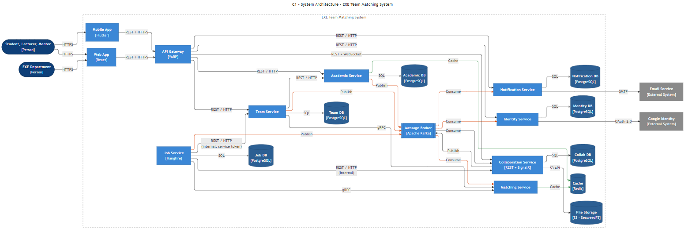

# EXE Team Matching System

Ứng dụng ghép nhóm môn EXE101 / EXE201 tại Đại học FPT, thay cho file Google Sheets nhập tay (~220 nhóm, ~1.250 sinh viên mỗi kỳ).
Sau khi lập nhóm, mỗi nhóm có một **Dự án** (workspace) để làm việc với giảng viên hướng dẫn và mentor: tin nhắn, việc và bài nộp, file, lịch họp. Đề tài được theo dõi xuyên kỳ từ EXE101 sang EXE201.

| Vai trò | Ứng dụng |
|---|---|
| Sinh viên, Giảng viên hướng dẫn, Mentor | **Mobile App (Flutter)** và **Web App (React)** – cùng mã màn hình |
| Bộ môn EXE | **Web App (React)** |

> **19/10/2026:** tài liệu đã cập nhật theo góp ý của giảng viên (bảng màu cam/xanh FPT, workspace, mentor, đề tài xuyên kỳ…) – xem [PROJECT_CONTEXT.md](docs/ux/PROJECT_CONTEXT.md) mục 13. **Figma vẫn là bản Lab 2**, chưa vẽ lại.

- **Figma:** https://www.figma.com/design/tX0K0MdkTKt5wJcvWnPbxr
- **Môn:** PRM393 Lab 2 – Thiết kế UI/UX có hỗ trợ AI · PRN232 (backend)

## Chạy bằng Docker

Cần Docker Desktop. Từ thư mục gốc repo:

```bash
cp deploy/.env.example deploy/.env
docker compose -f deploy/docker-compose.yml up -d --build
```

| Địa chỉ | Nội dung |
|---|---|
| http://localhost:3000 | Web (React) |
| https://exe-team-matching.web.app | Web (React) trên Firebase Hosting, gọi backend Docker ở `localhost:8080` của máy đang mở – dùng khi demo ([deploy.md](docs/setup/deploy.md)) |
| http://localhost:8080 | API Gateway – client chỉ gọi địa chỉ này; Swagger gộp ở `/swagger` |
| http://localhost:5001 … 5007 | Từng service (Identity, Academic, Team, Matching gRPC, Notification, Jobs, Collab), mỗi service có `/health` |
| http://localhost:8085 · 8025 · 9001 | Kafka UI · Mailpit (email dev) · giao diện file S3 |

Mọi service .NET dùng chung `deploy/docker/dotnet.Dockerfile`. Bảng cổng đầy đủ: [PROJECT_CONTEXT.md](docs/ux/PROJECT_CONTEXT.md) mục 9. Lấy JWT thử không cần Google: `POST http://localhost:8080/api/dev/token` ([docs/setup/google-sign-in.md](docs/setup/google-sign-in.md) mục 6).

Kịch bản demo end-to-end (Postman collection, tự tạo dữ liệu, chạy bằng `npx newman`) và bảng đối chiếu yêu cầu PRN232: [docs/demo/README.md](docs/demo/README.md).

DB script chỉ chạy khi volume Postgres còn trống. Nếu volume tạo từ script cũ (ví dụ thiếu `collab_db`), tạo lại (mất dữ liệu local): `docker compose -f deploy/docker-compose.yml down -v` rồi `up -d --build`.

## Kiến trúc hệ thống (System architecture)

Microservices trên ASP.NET Core 8. Client chỉ gọi **API Gateway**. Mỗi service sở hữu một database, không service nào đọc database của service khác.



Nguồn sơ đồ: [c1.mmd](docs/c4-architecture/c1.mmd). Sơ đồ ngữ cảnh C0: [c0.png](docs/c4-architecture/c0.png). Mô tả đầy đủ (ma trận giao tiếp, proto gRPC, sự kiện, background job): [EXE_Team_Matching_Kien_truc_C4.docx](docs/c4-architecture/EXE_Team_Matching_Kien_truc_C4.docx).

| Thành phần | Cổng | Vai trò | Database |
|---|---|---|---|
| API Gateway (YARP) | 8080 | Cổng vào duy nhất của client, kiểm tra JWT, định tuyến REST và WebSocket, gộp Swagger | – |
| Identity Service | 5001 | Đăng nhập Google, phát JWT, tài khoản và vai trò | `identity_db` |
| Academic Service | 5002 | Học kỳ, đợt đăng ký, import sinh viên, giảng viên, mentor, danh mục | `academic_db` |
| Team Service | 5003 | Nghiệp vụ chính: nhóm, lời mời, yêu cầu, đổi nhóm, chốt nhóm, ghép tự động, ghép cố vấn, thống kê | `team_db` |
| Matching Service | 5004 | Chỉ có gRPC: gợi ý thành viên / đề tài, kiểm tra thành phần nhóm, tính phương án ghép; read model trên Redis | – |
| Notification Service | 5005 | Nhận sự kiện Kafka, lưu thông báo trong app, gửi email | `notification_db` |
| Job Service (Hangfire) | 5006 | Tự khóa đợt, nhắc hạn, nhắc họp, hết hạn lời mời, ghép cố vấn đúng lịch | `job_db` |
| Collaboration Service | 5007 | Dự án của nhóm: tin nhắn (SignalR), việc, bài nộp, file (S3), họp, checkpoint | `collab_db` |

Cách các service giao tiếp:

- **REST:** client → Gateway → service; giữa các service dùng REST nội bộ với token dịch vụ (Team → Academic, Job → Team / Collaboration).
- **gRPC:** Team và Job gọi Matching.
- **Kafka:** ghi Outbox cùng transaction rồi phát sự kiện. Team, Academic, Job, Collaboration phát; Notification, Matching, Identity, Collaboration nhận.
- **SignalR:** client → Gateway → Collaboration (`/hubs/collab`) cho tin nhắn và cập nhật realtime.

Mỗi service theo 3 lớp API – Services – Repositories. Quy tắc nghiệp vụ và danh sách sự kiện: [PROJECT_CONTEXT.md](docs/ux/PROJECT_CONTEXT.md). Contract API, sự kiện: [docs/contracts/](docs/contracts/).

## Công nghệ (Technology stack)

| Phần | Công nghệ |
|---|---|
| Backend | .NET 8, ASP.NET Core 8, EF Core 8 (Npgsql), FluentValidation, Serilog, ProblemDetails, Swagger |
| Gateway | YARP 2.2 |
| Giao tiếp | gRPC (`Grpc.AspNetCore`), Apache Kafka 3.8 (`Confluent.Kafka`, Outbox), SignalR |
| Background job | Hangfire 1.8 (lưu trên PostgreSQL) |
| Dữ liệu | PostgreSQL 16 (mỗi service một database), Redis 7, lưu file S3 (SeaweedFS 3.97, `AWSSDK.S3`) |
| Xác thực | Google OAuth 2.0 / OpenID Connect, JWT Bearer |
| Web | React 18, TypeScript 5.6, Vite 6, Tailwind CSS 4, TanStack Query 5, React Router 6, `@microsoft/signalr` |
| Mobile | Flutter 3.47.8 (Dart 3.12, Material 3), Riverpod 3, go_router 18, Dio 5, `signalr_netcore`; Firebase: `firebase_core` 5.1, `firebase_auth` 7.0, `firebase_app_check` 0.5 (project `exe-team-matching`) |
| Triển khai | Docker, Docker Compose |
| Kiểm thử | xUnit (có test tích hợp trên PostgreSQL), Flutter widget test, Postman / newman ([kịch bản demo](docs/demo/README.md)) |

## Thành viên và phân công (Team member responsibilities)

Chia theo nghiệp vụ: mỗi người sở hữu trọn một mảng cả backend, web và mobile. Chi tiết thư mục và mã màn hình: [AGENTS.md](AGENTS.md) mục 2. Danh sách task: [Google Sheet phân công](https://docs.google.com/spreadsheets/d/17i2s3hWEHvSUk5tS-TCRMvDZ9nsaShP44PwQjivsZ7I/edit?usp=sharing).

| Thành viên | Backend | Web và mobile |
|---|---|---|
| **Thiên** (trưởng nhóm) | BuildingBlocks, API Gateway, Identity, proto, Docker Compose, DB script; khung Collaboration, SignalR hub, lưu file S3; ghép cố vấn tự động | Đăng nhập, theme, khung trang theo vai trò, component dùng chung; ghép giảng viên và mentor (W19, W28) |
| **Nam** | Academic (gồm mentor, chuyên môn giảng viên, giai đoạn môn, hồ sơ kỹ năng); Collaboration – Meetings | Học kỳ, đợt, import, sinh viên, giảng viên, mentor, danh mục, cấu hình; hồ sơ, cài đặt, lịch họp |
| **Cường** | Team – Teams, Members, Invitations, JoinRequests, Posts, AuditLog, Outbox; Collaboration – Messages | Trang chủ, khám phá, lời mời, nhóm của tôi, tin nhắn, lịch họp hằng tuần; danh sách nhóm, nhật ký; realtime client |
| **Nguyên** | Matching, Jobs; Team – Finalization, AutoAssign, Statistics, Export; Collaboration – Files, Tasks; test và kịch bản demo | Dashboard, sinh viên chưa có nhóm, ghép tự động, chốt nhóm; dự án, việc, file, gợi ý; màn sau khi đóng đợt; kiểm thử mobile và build APK demo |
| **Thành** | Notification; Team – ChangeRequests, BaselineImport, Projects, LecturerPreferences, TopicInterests, LecturerAssignments, MentorAssignments; Collaboration – Checkpoints | Đổi nhóm, thông báo, đề tài qua các kỳ; onboarding; nguyện vọng và giảng viên của nhóm; màn giảng viên và mentor |

## Artifact Lab 2 (`docs/ux/`)

| Artifact | File | Slide |
|---|---|---|
| Persona (P1–P5, gồm Mentor), problem statement, chỉ số thành công | [persona.md](docs/ux/persona.md) | 02–02e |
| Information architecture, user flow (F1–F3 Lab 2, F4–F7 bổ sung) | [user-flow.md](docs/ux/user-flow.md), [ảnh Figma 01](docs/ux/user-flow-figma-01.png) | 03, 04 |
| Design system bản 4 (token, component, mẫu tương tác, web cho mọi vai trò) | [DESIGN.md](docs/ux/DESIGN.md) | 09, 10 |
| AI log: prompt, phản biện, quyết định, ảnh trước/sau | [ai-design-log.md](docs/ux/ai-design-log.md), [ai-log-truoc-sau/](docs/ux/ai-log-truoc-sau/) | 05, 06, 06b |
| Design decisions (Phần E: quyết định theo góp ý của giảng viên), accessibility | [design-decisions.md](docs/ux/design-decisions.md) | 07, 10 |
| Flutter handoff: 2 bảng ánh xạ, 6 mục cho mỗi màn hình | [flutter-handoff.md](docs/ux/flutter-handoff.md) | 12, 12b |
| Danh sách màn hình (A01–L07, C01–C08, M01 cho mobile và web; W01–W29 cho Bộ môn) | [EXE_Team_Matching_Danh_sach_man_hinh_v2.xlsx](docs/ux/EXE_Team_Matching_Danh_sach_man_hinh_v2.xlsx) | 03 |
| Context cho AI coding assistant | [PROJECT_CONTEXT.md](docs/ux/PROJECT_CONTEXT.md) | – |

## Khác

| Thư mục / file | Nội dung |
|---|---|
| [AGENTS.md](AGENTS.md) | Quy tắc cho thành viên và AI agent: tài liệu phải đọc, ai phụ trách thư mục nào, quy tắc nhánh, commit, PR |
| [Google Sheet phân công task](https://docs.google.com/spreadsheets/d/17i2s3hWEHvSUk5tS-TCRMvDZ9nsaShP44PwQjivsZ7I/edit?usp=sharing) | Phân công task cho 5 thành viên (Backend, Frontend Web, Mobile) – bản chính; [bản xlsx](docs/EXE_Team_Matching_Phan_chia_task.xlsx) trong repo là bản chụp; thay đổi ngày 19/10/2026 cần dán vào sheet: [task-changes-2026-10-19.md](docs/task-changes-2026-10-19.md) |
| [docs/EXE_Database_Design.pdf](docs/EXE_Database_Design.pdf) | Thiết kế database (mỗi service 1 database) – chưa có `collab_db` và các bảng bản 4 (task BE-60) |
| [docs/contracts/](docs/contracts/) | Contract API, proto, sự kiện Kafka – chưa có bản 4 (task BE-61) |
| [docs/lab2-slide/](docs/lab2-slide/) | Slide trình bày Lab 2 và hướng dẫn chấm |
| [docs/c4-architecture/](docs/c4-architecture/) | Sơ đồ kiến trúc C4 (C0, C1) |

Figma file gồm 6 page: `01 User Flow`, `02 Wireframe`, `03 Final UI`, `04 Design System`, `05 Components`, `06 Prototype`.
