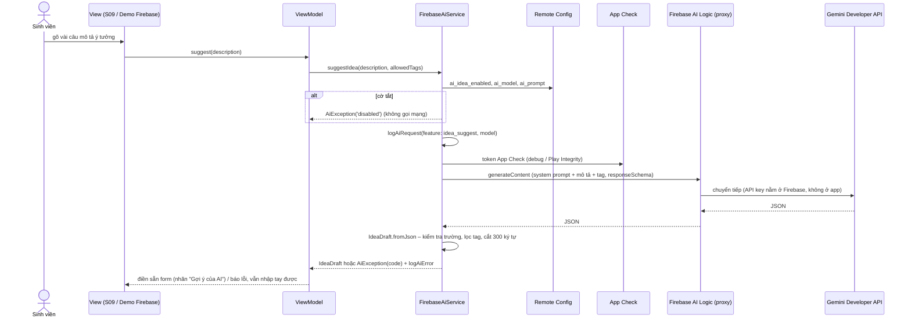

# Tính năng AI – Gợi ý ý tưởng bằng Gemini (MB-55)

> PRM393 Final §8 (mức 2). Service dùng chung ở `mobile/lib/core/ai/`; màn dùng đầu tiên là S09 "Ý tưởng của bạn" (MB-56).
> Mục Demo Firebase (A07, `--dart-define=FIREBASE_DEMO=true`) có nút **Thử AI** để chụp bằng chứng.

## 1. Luồng



- Package `firebase_ai` 5.1.0, backend Gemini Developer API (`FirebaseAI.googleAI()`). Không dùng `google_generative_ai`, không có API key trong code.
- App Check: `firebase_ai` 5.x bỏ tham số `appCheck` của `googleAI()`; SDK tự lấy instance `FirebaseAppCheck` đã đăng ký với app (activate ở `firebase_bootstrap.dart`) và gắn header `X-Firebase-AppCheck` vào mọi request.
- Không widget nào gọi `FirebaseAI`: View → ViewModel → `aiServiceProvider` (`AiService`) → `AiModelClient` (Lab 3 §5).

## 2. Thành phần

| File | Nội dung |
|---|---|
| `core/ai/ai_service.dart` | `AiService` (interface), `FirebaseAiService`, `AiModelClient` / `FirebaseAiModelClient`, `ideaDraftSchema`, `aiErrorCode`, `aiServiceProvider`, `aiModelClientProvider` |
| `core/ai/idea_draft.dart` | `IdeaDraft { title, problem, solution, targetCustomer, tags }` bất biến, `fromJson` có kiểm tra |
| `core/ai/ai_exception.dart` | `AiException { code }` |
| `features/settings/firebase_demo_view_model.dart` | `AiDemoViewModel` (nút Thử AI) |
| `test/core/ai/` | Test parse, lọc tag, cờ tắt, map lỗi bằng `FakeAiModelClient` (không gọi mạng) |

Dùng trong ViewModel (MB-56):

```dart
try {
  final draft = await ref.read(aiServiceProvider).suggestIdea(description: text, allowedTags: domainNames);
  // điền form; khi sinh viên bấm "Dùng gợi ý":
  await ref.read(analyticsServiceProvider).logAiResultAccepted(feature: aiFeatureIdeaSuggest, index: 0);
} on AiException catch (e) {
  // e.code: disabled / quota / network / bad_json / blocked / unknown
}
```

Hiện / ẩn nút theo `ref.watch(remoteConfigProvider).aiIdeaEnabled`. Test ghi đè `aiServiceProvider` (hoặc `aiModelClientProvider`) bằng bản giả.

## 3. Tham số Remote Config

| Khóa | Kiểu | Mặc định (`firebase/remote-config-defaults.json`) | Tác dụng |
|---|---|---|---|
| `ai_idea_enabled` | bool | `false` | Tắt → `AiException('disabled')`, không gọi mạng; S09 ẩn nút |
| `ai_model` | string | `gemini-2.5-flash` | Tên model Gemini; trống → mặc định |
| `ai_prompt` | string | Prompt hệ thống bên dưới | System instruction; trống → mặc định |

Prompt mặc định:

> Bạn là trợ lý giúp sinh viên môn khởi nghiệp EXE (Đại học FPT) viết ý tưởng dự án. Từ mô tả ngắn của sinh viên, viết bản nháp gồm: title (tên ý tưởng ≤ 60 ký tự), problem (vấn đề), solution (giải pháp), targetCustomer (khách hàng mục tiêu), tags (chọn tối đa 3 tag trong danh sách được cho). Viết tiếng Việt, ngắn gọn, mỗi trường 1–3 câu, không bịa số liệu.

Đổi trên Console thì `remoteConfigProvider` cập nhật real-time, `aiServiceProvider` được tạo lại với giá trị mới (không cần build lại).

## 4. JSON schema

`generationConfig`: `responseMimeType: 'application/json'`, `responseSchema`:

```json
{
  "type": "OBJECT",
  "properties": {
    "title":          { "type": "STRING", "description": "Tên ý tưởng, tối đa 60 ký tự" },
    "problem":        { "type": "STRING" },
    "solution":       { "type": "STRING" },
    "targetCustomer": { "type": "STRING" },
    "tags": { "type": "ARRAY", "maxItems": 3, "items": { "type": "STRING", "format": "enum", "enum": ["<allowedTags>"] } }
  },
  "required": ["title", "problem", "solution", "targetCustomer", "tags"],
  "propertyOrdering": ["title", "problem", "solution", "targetCustomer", "tags"]
}
```

Sau khi nhận, app vẫn kiểm tra lại (không tin hoàn toàn vào schema): thiếu trường / chuỗi trống / sai kiểu → `bad_json`; chỉ giữ tag có trong `allowedTags` (không phân biệt hoa thường, bỏ trùng), tối đa 3; mỗi chuỗi cắt còn ≤ 300 ký tự.

## 5. Xử lý lỗi

Timeout 20 giây. Mọi lỗi (trừ `disabled`) đều log `ai_error` với `error_code`; luồng nhập tay ở S09 vẫn chạy.

| Tình huống | Nhận biết | `code` | Ghi Crashlytics |
|---|---|---|---|
| Cờ `ai_idea_enabled` tắt | Remote Config | `disabled` | Không (không log `ai_request` / `ai_error`) |
| Hết quota | `QuotaExceeded`, hoặc thông báo có `429` / `RESOURCE_EXHAUSTED` / `quota` | `quota` | Không |
| Mất mạng, quá 20 giây | `SocketException`, `TimeoutException`, `ClientException` (package http), `HandshakeException` | `network` | Không |
| Bị bộ lọc an toàn chặn / không có text | `FirebaseAIException` "…blocked…", `response.text` trống | `blocked` | Không |
| JSON sai | `FormatException`, thiếu trường, sai kiểu | `bad_json` | Không |
| Lỗi khác (App Check bị từ chối, API chưa bật…) | còn lại | `unknown` | Có – `recordNonFatal(reason: 'ai_idea_suggest')` |

## 6. Quyền riêng tư

- Chỉ gửi **mô tả sinh viên gõ** (cắt còn 1 000 ký tự) và **danh sách tag lĩnh vực**. Không gửi tên, email, MSSV, ảnh, id người dùng hay thông tin nhóm (`FirebaseAiService.buildIdeaPrompt`, có test).
- Tham số Analytics chỉ có `feature`, `model`, `error_code`, `index` – không có nội dung mô tả hay kết quả.
- S09 nên ghi chú cho sinh viên: "Không nhập thông tin cá nhân vào mô tả".

## 7. Analytics

| Sự kiện | Khi nào | Tham số |
|---|---|---|
| `ai_request` | Trước khi gửi (sau khi kiểm tra cờ) | `feature: idea_suggest`, `model` |
| `ai_error` | Gọi lỗi | `feature: idea_suggest`, `error_code` |
| `ai_result_accepted` | MB-56 gọi khi sinh viên bấm dùng gợi ý | `feature: idea_suggest`, `index` |

> `docs/analytics-plan.md` đang ghi `feature = idea_suggestion`; code dùng `idea_suggest` theo mô tả task MB-55 – cần thống nhất lại (xem PR).

## 8. Kết quả chạy thật (điền sau khi chạy trên máy thật)

Chạy: `adb reverse tcp:8080 tcp:8080`, `flutter run --dart-define=API_BASE_URL=http://localhost:8080 --dart-define=FIREBASE_DEMO=true` → Cài đặt → Demo Firebase → Thử AI. Model: `…`, ngày: `…`.

| # | Đầu vào (mô tả) | Đầu ra (title / problem / solution / targetCustomer / tags) | Ảnh |
|---|---|---|---|
| 1 | _(chưa chạy)_ | | `evidence/ai/1.png` |
| 2 | _(chưa chạy)_ | | `evidence/ai/2.png` |
| 3 | _(chưa chạy)_ | | `evidence/ai/3.png` |

| Lỗi đã xử lý | Cách tạo | Kết quả trên app | Ảnh |
|---|---|---|---|
| _(ví dụ: bật chế độ máy bay → `network`; hoặc `ai_idea_enabled = false` → `disabled`)_ | | | `evidence/ai/error.png` |

## 9. Việc trên Firebase Console

1. AI Logic → Get started → Gemini Developer API.
2. App Check → Apps → Android → Manage debug tokens: thêm token in ra trong `adb logcat` (dòng "Firebase App Check debug token").
3. App Check → APIs → Firebase AI Logic → Enforce.
4. Remote Config: `ai_prompt` theo mục 3; `ai_idea_enabled = true` khi thử.
