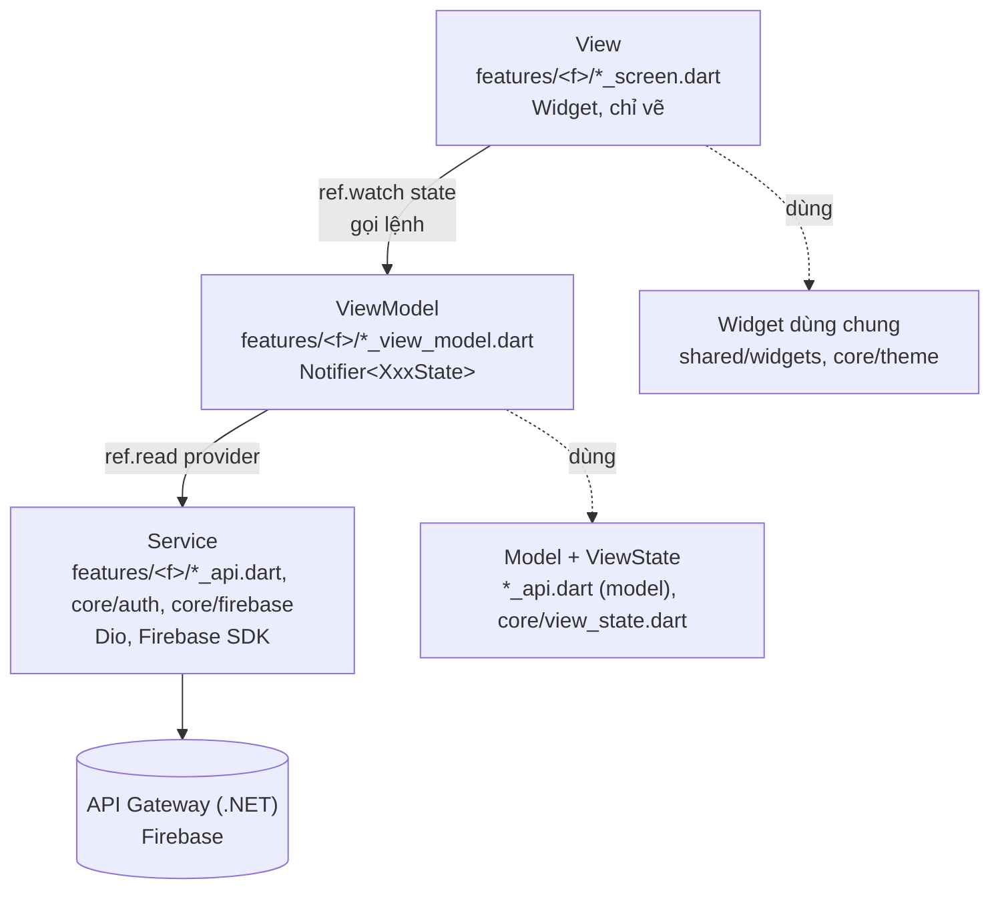
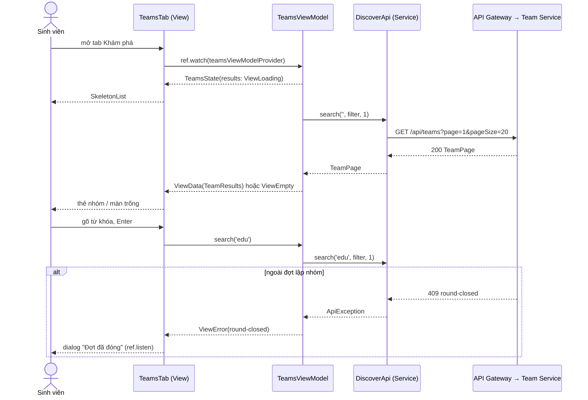

# Kiến trúc mobile – MVVM (PRM393 Lab 3 §5)

> MB-48 (04/11/2026). Áp cho mọi màn trong `mobile/lib`. Mẫu chuẩn: **S05** (`features/discover/teams_view_model.dart`, `discover_screen.dart`) cho màn danh sách và **A03** (`features/auth/login_view_model.dart`, `login_screen.dart`) cho màn có lệnh. Kiến trúc backend: [c4-architecture/](c4-architecture/) và [README](../README.md#kiến-trúc-hệ-thống-system-architecture).

## 1. Các lớp



Phụ thuộc chỉ đi xuống: View → ViewModel → Service. Service không import ViewModel hay widget; ViewModel không import `flutter/material.dart`.

| Lớp | File | Được làm | Không được làm |
|---|---|---|---|
| View | `*_screen.dart`, widget trong feature | Vẽ theo state (`switch` trên `ViewState`), gọi lệnh ViewModel, điều hướng, SnackBar, dialog; giữ trạng thái **thuần giao diện** (`TextEditingController`, `FocusNode`, tab, hiệu ứng) | Gọi `*Api`, `Dio`, `FirebaseAuth.instance` hay SDK khác; lọc / sắp xếp / tính toán nghiệp vụ trong `build()`; `setState` cho dữ liệu tải về |
| ViewModel | `*_view_model.dart` | `Notifier<XxxState>` (Riverpod 3), provider `NotifierProvider.autoDispose` (`.family` khi theo id); tải, phân trang, lọc, kiểm tra form, đổi lỗi thành câu thông báo; lệnh có kết quả một lần trả về `Future<Outcome>` | Import widget; giữ `BuildContext`; điều hướng |
| Service | `*_api.dart`, `core/auth/*`, `core/firebase/*` | Gọi HTTP / SDK, đổi JSON ↔ model, đổi lỗi sang `ApiException` / `SignInFailure` | Giữ trạng thái màn hình |
| Model | trong `*_api.dart` (class bất biến, `fromJson`) | Dữ liệu và getter thuần | Gọi mạng |

## 2. Quy ước

- **State model:** màn tải dữ liệu dùng `ViewState<T>` (`core/view_state.dart`): `ViewLoading`, `ViewEmpty`, `ViewError(error)`, `ViewData(value)`. State của màn là class bất biến có `copyWith`, chứa `ViewState` cho phần tải về và các trường còn lại (từ khóa, bộ lọc…). Ví dụ `TeamsState { query, filter, ViewState<TeamResults> results }`.
- **View vẽ theo state:**
  ```dart
  switch (state.results) {
    ViewLoading() => SkeletonList(),
    ViewError(:final error) => ErrorState(error: error, onRetry: vm.refresh),
    ViewEmpty() => EmptyState(...),
    ViewData(value: final r) => ...,
  }
  ```
- **Tải lần đầu:** `build()` của ViewModel trả state ban đầu `ViewLoading` và gọi `Future.microtask(refresh)`. Sau mỗi `await` kiểm tra `ref.mounted` trước khi gán `state`. Tải lại từ đầu dùng bộ đếm lượt (`_generation`) để bỏ kết quả cũ về muộn.
- **Kết quả một lần** (điều hướng A04, SnackBar, dialog): lệnh trả `sealed class XxxOutcome`; View xử lý bằng `switch`. Không lưu sự kiện một lần vào state. Lỗi cần phản ứng khi state đổi (ví dụ `round-closed` ở S05) thì View dùng `ref.listen`.
- **Inject service:** mỗi service có `Provider` (`discoverApiProvider`, `firebaseAuthProvider`…). ViewModel lấy bằng `ref.read(...)`. Test thay bằng `overrideWithValue(Fake…)`; fake kế thừa service (`class _Fake extends DiscoverApi`) hoặc implement interface (`FirebaseAuthGateway`).
- **Provider chỉ đọc đơn giản** (một `FutureProvider` không có lệnh, lọc hay phân trang) được giữ nếu màn chỉ hiển thị; khi màn có lệnh hoặc logic thì chuyển sang ViewModel.
- **Không có trạng thái toàn cục thay đổi được** ngoài Riverpod. Đăng xuất dựng lại `ProviderScope` (`main.dart`, MB-47) nên mọi cache bị bỏ.
- **Test:** mỗi ViewModel có unit test `test/<tên>_view_model_test.dart` dùng `ProviderContainer` và service giả, không dựng widget; widget test cũ vẫn phải qua.
- **Design system:** màu, chữ, khoảng cách lấy từ `Theme.of(context)`, `AppSpacing`, `AppRadius` (`core/theme`); component dùng chung ở `shared/widgets` (`states.dart`: `SkeletonList`, `EmptyState`, `ErrorState`, `ErrorBanner`, `LoadingButton`).

## 3. Cấu trúc thư mục

Chia theo **feature** thay cho chia theo lớp (`models/`, `services/`, `viewmodels/`… như Lab 3 gợi ý), vì mỗi thành viên sở hữu trọn một nghiệp vụ (AGENTS.md mục 2): một thư mục feature chứa đủ View, ViewModel, Service, Model của nghiệp vụ đó, nên PR của một người ít đụng thư mục người khác. Lớp được nhận ra qua hậu tố file.

| Thư mục | Nội dung |
|---|---|
| `lib/main.dart` | Khởi tạo Firebase, `AppRoot` (dựng lại `ProviderScope` khi đăng xuất) |
| `lib/firebase_options.dart` | Cấu hình FlutterFire (sinh bởi `flutterfire configure`) |
| `lib/app/` | `MaterialApp.router`, go_router (`router.dart`), khung theo vai trò (`role_shell.dart`), danh sách tab (`navigation.dart`), route của từng feature (`feature_routes.dart`) |
| `lib/core/auth/` | Phiên đăng nhập (secure storage), service Firebase Auth |
| `lib/core/config/` | Biến `--dart-define` (`Env`) |
| `lib/features/workspace/report_*.dart` | Xuất báo cáo PDF ở C01 (MB-53): `ReportPdfBuilder`, `ReportApi`, `ReportExportViewModel`, `ReportExportCard` |
| `lib/core/firebase/` | Khởi tạo Firebase, App Check (sau này: Analytics, Crashlytics, Remote Config) |
| `lib/core/network/` | Dio dùng chung, `ApiException` từ ProblemDetails |
| `lib/core/theme/` | Token Lab 2 → `ThemeData`, `AppSpacing`, `AppRadius`, `AppColors` |
| `lib/core/providers.dart` | Provider dùng chung: Dio, Google Sign-In, Firebase Auth, `AuthController` |
| `lib/core/phase.dart` | Giai đoạn môn học, khung theo giai đoạn |
| `lib/core/view_state.dart` | `ViewState<T>` |
| `lib/shared/widgets/` | Component Lab 2 dùng chung (trạng thái, nút, logo, thanh thành phần nhóm, banner hạn chót) |
| `lib/features/<feature>/` | `*_screen.dart` (View), `*_view_model.dart` (ViewModel + State), `*_api.dart` (Service + Model) |

## 4. Luồng đầy đủ – S05 tìm nhóm



## 5. ViewModel và service

Cập nhật bảng khi thêm ViewModel. Danh sách đầy đủ sau MB-49 (PR #148, #149).

| ViewModel | Màn | State | Service dùng |
|---|---|---|---|
| `TeamsViewModel` | S05 | `TeamsState` (`ViewState<TeamResults>`) | `DiscoverApi` |
| `LoginViewModel` | A03 | `LoginState` (Idle / Pending / Failed) + `LoginOutcome` | `AuthController` → `GoogleSignIn`, `FirebaseAuthGateway`, Dio (Identity) |
| `AuthController` | toàn app | `AsyncValue<UserInfo?>` (phiên) | `SessionStore`, `GoogleSignIn`, `FirebaseAuthGateway`, Dio |
| `JoinRequestViewModel` (family teamId) | S09 | `JoinRequestState` + `JoinRequestOutcome` | `DiscoverApi` |
| `SeekingPostsViewModel` | S10 | `SeekingPostsState` (`ViewState<PagedList<SeekingPost>>`) | `PostsApi` |
| `SeekingPostFormViewModel` | S11 | `PostFormState` + `PostFormOutcome` | `PostsApi` |
| `RecruitmentPostViewModel` (family teamId) | S21 | `PostFormState` + `PostFormOutcome` | `PostsApi` |
| `TeamFormViewModel` (family `MyTeam?`) | S13, S16 | `TeamFormState` + `TeamFormOutcome` | `MyTeamApi` |
| `MembersViewModel` | S17 | `String?` (lỗi) + `MemberOutcome` | `MyTeamApi` |
| `JoinRequestsViewModel` (family teamId) | S20 tab 1 | `JoinRequestsState` + `DecisionOutcome` | `MyTeamApi` |
| `SentInvitationsViewModel` (family teamId) | S20 tab 2 | `String?` (lỗi) | `MyTeamApi` |
| `TeamHistoryViewModel` (family teamId) | S22 | `ViewState<PagedList<AuditLogEntry>>` | `TeamHistoryApi` |
| `ReceivedInvitationsViewModel` | S12 tab 1 | `ReceivedInvitationsState` + `AcceptOutcome` | `InvitationsApi` |
| `SentJoinRequestsViewModel` | S12 tab 2 | `String?` (lỗi) | `InvitationsApi` |
| `ChannelViewModel` (family `(channelId, readOnly)`) | C03 | `ChannelState` (`view`: `ViewState<List<Message>>`) | `MessagesApi`, `CollabHub` |
| `ThreadViewModel` (family `(rootId, channelId)`) | C03 luồng trả lời | `ThreadState` | `MessagesApi`, `CollabHub` |
| `AdvisorConversationsViewModel` | C02 GV / mentor | `AdvisorConversationsState` (`ViewState<AdvisorInbox>`) | `myWorkspacesProvider`, `channelsProvider`, `openQuestionChannelsProvider` |
| `ProfileFormViewModel` (family `StudentProfile`) | A05, S03 | `ProfileFormState` | `ProfileApi` |
| `MeetingDetailViewModel` (family meetingId) | C08 | `MeetingActionState` + `MeetingActionOutcome` | `MeetingsApi` |
| `ProposeMeetingViewModel` (family workspaceId) | C08 đang tạo | `ProposeMeetingState` | `MeetingsApi` |
| `TeamScheduleViewModel` (family workspaceId) | C09 nhóm | `TeamScheduleState` | `MeetingScheduleApi`, `CollabHub`, `openUrlProvider` |
| `LecturerScheduleViewModel` (family scheduleId) | C09 giảng viên | `LecturerScheduleState` | `MeetingScheduleApi` |
| `LecturerPreferencesViewModel` (family teamId, không autoDispose để "Hoàn tác" chạy được sau khi màn đóng) | S23, S24, S25 | `void` + `PreferenceUpdateOutcome` | `LecturersApi` |
| `LecturerSearchViewModel` | S24 | `String` (từ khóa) | – |
| `SettingsViewModel` | A07 | `bool?` (giá trị công tắc đang gửi) | `SettingsApi`, `AuthController` |
| `LecturerProfileViewModel` | L06 | `LecturerProfileEditState` | `LecturerProfileApi` |
| `RealtimeStatusViewModel` | `RealtimeStatusBanner` | `HubStatus` | `CollabHub` |
| `LecturerHomeViewModel` (+ `lecturerHomeIsTeamFormationProvider`) | L01 | `LecturerHomeState` (môn) + `InterestOutcome` | `LecturerHomeApi` |
| `AdvisedTeamsViewModel` (+ `advisedTeamsListProvider`) | L04 | `AdvisedTeamsState` (môn, tìm, lọc CP) → `ViewState<List<AdvisedTeamRow>>` | `LecturerHomeApi` |
| `AdvisedTeamDetailViewModel` | L05 | `ViewState<AdvisedTeamDetailData>` | `LecturerHomeApi` |
| `CheckpointViewModel` | L05 (Checkpoint) | `CheckpointMarkState` + `CheckpointOutcome` | `LecturerHomeApi` |
| `TopicInterestsViewModel` | L07 | `TopicInterestsState` (môn, đang gửi) + `TopicToggleOutcome` | `LecturerHomeApi` |
| `TopicDetailViewModel` | L07 chi tiết đề tài | `bool` (đang gửi) + `TopicToggleOutcome` | `LecturerHomeApi` |
| `ProjectOverviewViewModel` | C01 | `OverviewTasksState` | `CollabApi` |
| `TaskBoardViewModel` | C04 | `TaskBoardState` (lọc, đổi lạc quan, lỗi) + `TaskMoveOutcome` | `CollabApi` |
| `TaskFormViewModel` | C04 form việc | `TaskFormState` | `CollabApi` |
| `TaskDetailViewModel` | C05 | `TaskActionState` | `CollabApi` |
| `FilesViewModel` | C06 | `FilesState` (đường dẫn, tải lên) + `PickOutcome`, `UploadOutcome` | `CollabApi`, `pickLocalFileProvider`, `openUrlProvider` |
| `FileDetailViewModel` | C06 chi tiết file | `void` (lệnh) | `CollabApi`, `openUrlProvider` |
| `ProjectFilePickerViewModel` | C05 → C06 chọn file nộp | `FilePickerState` | `CollabApi` |
| `ChangeRequestListViewModel` | S26 | `ChangeRequestFilter` | `ChangeRequestsApi` |
| `CreateChangeRequestViewModel` | S27/S28 | `CreateChangeRequestState` + `CreateChangeRequestOutcome` | `ChangeRequestsApi` |
| `NotificationsViewModel` | A06 | `NotificationsState` (`ViewState<NotificationList>`) + `NotificationOutcome` | `NotificationsApi` |
| `UnreadCountViewModel` | Badge A06 | `int` | `NotificationsApi` |
| `SuggestedMembersViewModel` | S18 | `Set<String>` (đã mời) | `SuggestionsApi` (qua provider) |
| `InviteStudentsViewModel` | S19 | `InviteStudentsState` | `SuggestionsApi` (qua provider) |
| `InviteViewModel` | Sheet gửi lời mời (S18, S19) | `InviteState` | `SuggestionsApi` |
| `MentorHomeViewModel` (+ `mentorActivitySummaryProvider`) | M01 | `MentorHomeState` | `LecturerHomeApi` |
| `SplashViewModel` | A01 | `void`, `resolve()` trả route | `AuthController`, `OnboardingStore` |
| `OnboardingViewModel` | A02 | `bool` (đang lưu) | `OnboardingStore` (`onboardingStoreProvider` mới) |

### Service Firebase (`lib/core/firebase/`, MB-47, MB-50, MB-51)

| Service (interface → bản thật) | Provider | Dùng ở | Fake cho test |
|---|---|---|---|
| `FirebaseAuthGateway` → `FirebaseAuthService` | `firebaseAuthProvider` | `AuthController` (đăng nhập / đăng xuất) | fake trong `login_test.dart` |
| `AnalyticsService` → `FirebaseAnalyticsService` | `analyticsServiceProvider` | `AuthController` (`login`, `logout`, user id); `TeamsViewModel` (`search`); `teamDetailProvider` (`view_team`); `JoinRequestViewModel` (`join_group`); `TeamFormViewModel` (`create_team`); `InviteViewModel` (`send_invitation`); `CreateChangeRequestViewModel` (`submit_change_request`); `changeRequestDetailProvider` (`view_change_request`); `lecturerDetailProvider` (`view_lecturer`); `suggestedTeamsProvider` (`view_suggestions`); `FilesViewModel` (`export_report`) | `FakeAnalyticsService` (`test/support/firebase_fakes.dart`) |
| `CrashReporter` → `FirebaseCrashReporter` | `crashReporterProvider` | bootstrap (`FlutterError.onError`), `AuthController` (user id, key `role`, `course`), router (key `screen`), Remote Config lỗi | `FakeCrashReporter` |
| `ClientErrorReporter` → `ClientErrorApi` (MB-61) | biến `clientErrorReporter`, vì bootstrap chạy trước `ProviderScope` | `FirebaseCrashReporter`, bootstrap (`FlutterError.onError`, `PlatformDispatcher.onError`, gửi báo cáo chờ lúc khởi động) | fake `ClientErrorApi` (`client_error_reporter_test.dart`) |
| `RemoteConfigService` → `FirebaseRemoteConfigService` | `remoteConfigServiceProvider`, `remoteConfigProvider` (giá trị hiện tại, cập nhật theo `onConfigUpdated`) | `suggestedTeamsProvider` (S07, `suggestions_max_items`); MB-55 (`ai_*`) | `FakeRemoteConfigService` |

Sự kiện và tham số: [analytics-plan.md](analytics-plan.md). Giá trị mặc định Remote Config: [`firebase/remote-config-defaults.json`](../firebase/remote-config-defaults.json).
