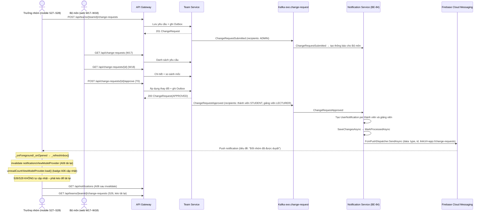

# FE-47: Luồng đổi nhóm xuyên vai trò

> Phiên bản: 2026-11-05. Nguồn đã đối chiếu: `docs/contracts/openapi/team.yaml`, `docs/contracts/events.md`,
> `backend/Services/Notification/Notification.Worker/` (nhánh `feat/BE-84-fcm-push`),
> `mobile/lib/core/firebase/push_notifications.dart`, `mobile/lib/features/change_requests/` (nhánh `feat/MB-52-fcm-mobile`).
> Phụ lục C (Final Assignment PRM393) yêu cầu tài liệu luồng xuyên vai trò, sơ đồ sequence và đo độ trễ thực tế.

---

## 1. Phạm vi và trạng thái

| Hạng mục | Trạng thái |
|---|---|
| Tài liệu mô tả API, sự kiện, sơ đồ | Hoàn thành – đối chiếu nguồn |
| Làm rõ cơ chế realtime (mục 4) | Hoàn thành – ghi rõ hành vi thực tế |
| Kiểm thử thực tế 3 lần trên bản triển khai | **Chưa thực hiện** – xem mục 5 |

**Phụ thuộc và trạng thái môi trường:**
- BE-84 ([PR #166](https://github.com/nmhthien58/ExeTeamMatching/pull/166)) đã merge vào `develop`.
- MB-52 ([PR #172](https://github.com/nmhthien58/ExeTeamMatching/pull/172)) đã rebase trên `develop` mới nhất, 579 unit test passed, `flutter analyze` sạch; đang chờ merge.
- Cấu hình môi trường demo (theo `docs/setup/deploy.md`): Web dùng bản trên Firebase Hosting (`https://exe-team-matching.web.app`), backend Docker chạy trên laptop demo (Gateway port 8080).
- Máy thật Android kết nối qua: `adb reverse tcp:8080 tcp:8080`, build/chạy với `--dart-define=API_BASE_URL=http://localhost:8080`.
- File service account Firebase `deploy/secrets/firebase-service-account.json` đã được đặt vào thư mục secrets (đã gitignore).

---

## 2. Điều kiện tiên quyết trước khi kiểm thử

1. Môi trường demo theo BE-85 (`docs/setup/deploy.md`): Backend Docker chạy trên laptop demo (`http://localhost:8080`), Web trên Firebase Hosting (`https://exe-team-matching.web.app`) đã được cấp quyền CORS từ Gateway.
2. Mobile Android kết nối laptop qua `adb reverse tcp:8080 tcp:8080`, chạy với `--dart-define=API_BASE_URL=http://localhost:8080`.
3. Nhánh MB-52 được merge vào develop hoặc chạy trực tiếp từ `feat/MB-52-fcm-mobile`.
4. Kafka, Notification Service (BE-84) và FCM đang chạy; service account FCM đọc từ biến môi trường.
5. Dữ liệu demo ẩn danh:
   - Nhóm EXE201 kế thừa có trưởng nhóm (tài khoản demo).
   - Đợt đổi nhóm đang mở (`registration_rounds` với `round_type = CHANGE_REQUEST` và `closes_at` chưa qua).
   - Có thay đổi chờ gửi hợp lệ (mốc khác với nhóm hiện tại).
   - Tài khoản Bộ môn.
6. Mobile đăng nhập đúng trưởng nhóm, đã cấp quyền thông báo, device token đã được đăng ký BE-84.

---

## 3. Các bước luồng và API

| Bước | Người làm / màn | API qua Gateway | Service xử lý | Sự kiện Kafka |
|---|---|---|---|---|
| **1a** | Trưởng nhóm (S26, mobile): xem danh sách yêu cầu cũ | `GET /api/teams/{teamId}/change-requests` | Team Service | — |
| **1b** | Trưởng nhóm (S27, mobile): xem thay đổi chờ gửi | `GET /api/teams/{teamId}/pending-changes` _(xem team.yaml tag ChangeRequests/Projects)_ | Team Service | — |
| **1c** | Trưởng nhóm (S27→S28, mobile): gửi yêu cầu | `POST /api/teams/{teamId}/change-requests` body: `{ itemIds, reason }` | Team Service: lưu `change_requests`, ghi Outbox | `ChangeRequestSubmitted` → `exe.change-request` |
| **2a** | Bộ môn (W17, web): xem danh sách | `GET /api/change-requests` (phân trang, lọc trạng thái) | Team Service | — |
| **2b** | Bộ môn (W18, web): xem chi tiết, so sánh mốc | `GET /api/change-requests/{id}` → `ChangeRequestDetail` | Team Service | — |
| **2c** | Bộ môn (W18, web): duyệt | `POST /api/change-requests/{id}/approve` body: `{ note? }` | Team Service: áp dụng thay đổi, ghi Outbox | `ChangeRequestApproved` → `exe.change-request` |
| **3** | Notification Service: consumer Kafka | Consumer nhận `ChangeRequestApproved`; `NotificationEventHandler.HandleAsync` → tạo `UserNotification` per thành viên (type `STUDENT`) và per giảng viên hướng dẫn (`LECTURER`); sau `SaveChangesAsync`, `NotificationProcessedEventStore.MarkProcessedAsync` gọi `FcmPushDispatcher.SendAsync` | Notification Service (BE-84) | — |
| **4** | FCM → mobile: nhận push | FCM gửi data payload: `{ type: "ChangeRequestApproved", id: <notificationId>, linkUrl: "app://change-requests" }` | Firebase Cloud Messaging | — |
| **5** | Mobile (MB-52): xử lý push | `PushNotificationsController._onForeground` / `_onOpened` → `_refreshInbox()`: `ref.invalidate(notificationsViewModelProvider)` + `unreadCountViewModelProvider.load()` | Flutter Riverpod | — |
| **6** | Sinh viên (A06, mobile): kiểm tra thông báo | `GET /api/notifications` (polling A06 hoặc load vừa được invalidate) | Notification Service | — |
| **7** | Sinh viên (S26/S29, mobile): xem kết quả | `GET /api/teams/{teamId}/change-requests` (kéo để tải lại) hoặc `GET /api/change-requests/{id}` | Team Service | — |

**Lưu ý về recipient `ChangeRequestSubmitted`:** theo `NotificationEventHandler` (dòng 135), sự kiện này chỉ báo `ADMIN` (Bộ môn), không có push về mobile cho trưởng nhóm.

---

## 4. Phân tích cơ chế cập nhật realtime (đã đối chiếu nguồn)

### 4.1 Push FCM và A06

- Khi `ChangeRequestApproved` được Notification Service xử lý, `FcmPushDispatcher.SendAsync` tra `device_tokens` theo `userId` (kể cả giảng viên kiêm mentor dùng cùng email).
- Mobile (MB-52): `PushNotificationsController._onForeground/_onOpened` gọi `_refreshInbox()`:
  - **Invalidate `notificationsViewModelProvider`** → A06 tải lại danh sách thông báo.
  - **Load lại `unreadCountViewModelProvider`** → badge A06 cập nhật.
- Thông báo tiêu đề: **"Đổi nhóm đã được duyệt"**, nội dung: "Bộ môn đã duyệt yêu cầu đổi nhóm.", `linkUrl = "app://change-requests"`.

### 4.2 S26/S29 có tự cập nhật không?

**Không tự cập nhật khi đang mở màn.** Nguồn đã xác nhận:
- `_refreshInbox()` trong [`push_notifications.dart`](../mobile/lib/core/firebase/push_notifications.dart) **chỉ invalidate `notificationsViewModelProvider` và `unreadCountViewModelProvider`**. Không invalidate `changeRequestsProvider(teamId)`.
- `ChangeRequestListScreen` (S26) dùng `changeRequestsProvider(teamId)` với `RefreshIndicator` – chỉ tải lại khi người dùng **kéo xuống**.
- Màn S29 (`ChangeRequestDetailScreen`) dùng `changeRequestDetailProvider(id)` – tương tự, không có listener push.
- `collab_hub.dart` (SignalR `/hubs/collab`) chỉ xử lý sự kiện `messageCreated`, `messageUpdated`, `readUpdated`, `typing`, `slotsChanged` – **không** có sự kiện change-request.

**Kết luận:** sau khi nhận push, người dùng thấy thông báo ở A06; trạng thái S26/S29 **không tự cập nhật** – phải kéo để tải lại hoặc mở lại màn.

### 4.3 Đề xuất cải thiện (cần Thiên/Cường duyệt, ngoài phạm vi FE-47)

Để S26/S29 tự đổi trạng thái mà không phải kéo, có thể thêm vào `_refreshInbox()`:
```dart
// Chỉ thêm nếu teamId có thể lấy từ session, và nằm trong luồng Thành phụ trách
ref.invalidate(changeRequestsProvider(teamId));
```
Hoặc MB-52 đọc `linkUrl` từ push data và invalidate provider tương ứng. **Không tự sửa** – ghi đây để Thành báo cáo Thiên/Cường trước khi mở PR riêng.

---

## 5. Sơ đồ sequence



---

## 6. Môi trường triển khai (BE-85 đã duyệt và hoàn tất)

Theo tài liệu triển khai chuẩn `docs/setup/deploy.md` (BE-85, chốt ngày 05/11/2026):

| Thành phần | Môi trường / Địa chỉ | Trạng thái |
|---|---|---|
| **Web React** | Firebase Hosting: `https://exe-team-matching.web.app` | Đã deploy, gọi Gateway `http://localhost:8080` của laptop demo |
| **Backend** | Docker Desktop trên laptop demo (`http://localhost:8080`) | 13 container (Gateway, 8 service, Kafka, Postgres...) |
| **Mobile** | Điện thoại Android cắm cáp | `adb reverse tcp:8080 tcp:8080`, `--dart-define=API_BASE_URL=http://localhost:8080` |
| **FCM** | `deploy/secrets/firebase-service-account.json` | Đã đặt vào secrets, container `notification` mount read-only |
| **CORS** | Gateway `Cors:AllowedOrigins` | Đã cho phép `https://exe-team-matching.web.app` |

---

## 7. Kịch bản kiểm thử thực tế (chưa thực hiện)

### Chuẩn bị

Chuẩn bị **ba yêu cầu độc lập và hợp lệ** (không dùng lại yêu cầu đã duyệt). Mỗi yêu cầu phải khác nhau về itemIds hoặc lý do.

### Quy trình mỗi lần thử

1. Ghi môi trường, phiên bản app/web/backend và thời điểm thử.
2. Trưởng nhóm (mobile) thao tác S26 → S27 → S28, gửi yêu cầu.
3. Bộ môn (web) mở W17, tìm đúng yêu cầu, mở W18 và duyệt.
4. Ghi **T0** = thời điểm phản hồi HTTP 200 từ `POST /approve` trả về.
5. Ghi riêng:
   - **T_push**: thời điểm push xuất hiện trên thiết bị.
   - **T_a06**: thời điểm thông báo hiển thị ở A06 (sau invalidate).
   - **T_s26**: thời điểm S26 tự cập nhật trạng thái, nếu có (theo phân tích mục 4.2: **không xảy ra tự động**).
6. Đo độ trễ bằng cùng đồng hồ hoặc video có thể đối chiếu.
7. Chạm thông báo push: kiểm tra mở đúng màn A06 (linkUrl `app://change-requests`).
8. Lưu ảnh hoặc video **không lộ token, email thật, service account, dữ liệu cá nhân**.

### Bảng kết quả

| Lần | Môi trường / phiên bản | T0 duyệt thành công | T_push | T_a06 | S26/S29 tự cập nhật | Độ trễ (T_push − T0) | Bằng chứng |
|-----|------------------------|---------------------|--------|-------|--------------------|-----------------------|------------|
| 1 | Chưa thực hiện | — | — | — | Không (cần kéo) | Chưa đo | — |
| 2 | Chưa thực hiện | — | — | — | Không (cần kéo) | Chưa đo | — |
| 3 | Chưa thực hiện | — | — | — | Không (cần kéo) | Chưa đo | — |

> **Ghi chú:** cột "S26/S29 tự cập nhật" dự kiến "Không (cần kéo)" dựa trên phân tích source (mục 4.2).
> Nếu kiểm thử thực tế cho thấy khác, ghi lại nguyên nhân (ví dụ: `invalidate` được thêm sau khi tài liệu này viết).
> Không điền số 0 hoặc tạo số đo khi chưa chạy thực tế.

---

## 8. Điều cần hỏi / chờ trước khi hoàn tất kiểm thử

1. **Thiên**: Môi trường BE-85 đã duyệt và chốt phương án demo (Firebase Hosting + Docker laptop theo `docs/setup/deploy.md`).
2. **Thiên/Cường**: Có muốn thêm `invalidate(changeRequestsProvider(teamId))` vào `_refreshInbox()` của MB-52 không? Nếu có, ai sẽ mở PR (Thành không tự sửa vì `push_notifications.dart` nằm trong `core/firebase/` do Thiên phụ trách, `_refreshInbox` chỉ invalidate `notificationsViewModelProvider` và không biết `teamId`; cách khác là MB-52 đọc `linkUrl` từ push data và điều hướng + invalidate provider tương ứng).
3. Dữ liệu demo ẩn danh đã sẵn sàng chưa (nhóm EXE201 kế thừa, đợt đổi nhóm đang mở, tài khoản Bộ môn).

---

> **Hai sự kiện `UserMentioned` đã gửi vào Kafka local trước đó** (kiểm thử FCM) **không phải bằng chứng của FE-47**:
> đó là sự kiện `exe.collab`, không phải `ChangeRequestApproved` trên `exe.change-request`.
