# AI Design Log – EXE Team Matching System

> Nhật ký các vòng tinh chỉnh giao diện làm cùng **Claude Code** (PRM323 Lab 2). Vòng 0–3: Lab 2, bảng màu bản 3 (12/10/2026). Từ 22/10/2026: chuyển Figma sang **DESIGN.md bản 5** (mã màu FPT), vẽ màn hình mới và **vòng 4–6** cùng ba mục tiêu trên giao diện bản 5.
> Mỗi vòng ghi: prompt nguyên văn → phản biện của AI → quyết định của nhóm kèm lý do → ảnh trước / sau → kết quả đo và điểm còn tồn tại.
> Tham chiếu: [design-decisions.md](design-decisions.md), [persona.md](persona.md), [DESIGN.md](DESIGN.md).
> File Figma: "PRM - Lab 2", trang `Mobile`.

---

## Vòng 0 – Tạo UI ban đầu bằng AI

**Công cụ:** Claude, trong một Project trên claude.ai. Thay vì sinh ảnh như Google Stitch, Claude đọc ba file context rồi viết **plugin Figma** (`manifest.json` + script, kèm `HUONG_DAN.txt`); chạy plugin trong Figma sẽ vẽ frame, component, token và liên kết prototype.
**Ảnh chụp:** [vong-0/prompt-nap-context.png](ai-log-truoc-sau/vong-0/prompt-nap-context.png), [vong-0/ket-qua-plugin-web.png](ai-log-truoc-sau/vong-0/ket-qua-plugin-web.png).

### 1. Prompt nguyên văn

Kèm ba file đính kèm `persona.md`, `user-flow.md`, `DESIGN.md`:

> Đây là các file mới. Trong đó file design có 1 số thứ khác cần cho yêu cầu của project. Hãy đọc hết tất cả các file này rồi lưu vào bộ nhớ của project

Prompt ngắn vì năm phần mà Lab 2 yêu cầu nằm trong file đính kèm:

| Phần | Nằm ở |
|---|---|
| Persona | `persona.md` – Minh, Vy, thầy Khoa, cô Hạnh |
| Task | `user-flow.md` – ba flow F1–F3 |
| Platform | `DESIGN.md` mục 1 – Flutter Material 3, frame 360 × 800, kiểm tra 412 × 915 |
| Constraints | `DESIGN.md` mục 4.4, Phụ lục A – tương phản ≥ 4,5:1, vùng chạm 48 dp, chữ ≥ 14 sp, một nút Primary mỗi màn hình |
| Style | `DESIGN.md` mục 2–3 – nền trắng, Primary `#0277BD`, Be Vietnam Pro, lưới 4 px |

### 2. Kết quả của AI (theo ảnh chụp)

- Lưu ba file vào Project và ghi chú để các lượt chat sau dùng đúng file mới.
- Tự phản biện các màn S07–S20 đã vẽ trước đó theo `DESIGN.md`: thanh "% phù hợp" dùng cặp màu Sky / Primary Container bị cấm; chữ gợi ý trong ô nhập dùng Text Disabled; viền ô nhập phải đổi sang Border Strong `#728AA3`; chip và dòng phụ phải lên cỡ 14.
- Ở lượt sau, viết plugin dựng 26 trang web W01–W26 (79 frame 1440 × 900, 35 component `Web/`, 593 liên kết prototype, 5 flow) và liệt kê các chỗ AI tự quyết cần nhóm xác nhận (sidebar 17 mục, form mở trong drawer).

### 3. Còn thiếu

- **Chưa lưu được prompt của lượt đầu tiên** tạo các màn mobile. Ảnh chụp trên là lượt nạp lại file context, sau khi một phần màn hình đã được vẽ.
- Ảnh "trước" của vòng 1–3 (thư mục `truoc/`) là trạng thái UI do AI tạo trước khi tinh chỉnh, được dùng làm output ban đầu trên Slide 05.

---

## Vòng 1 – Phân cấp thị giác (12/10/2026)

**Mục tiêu:** hạn chót và hành động chính là thứ nổi nhất màn hình.
**Phạm vi:** S01, L01, A07 và các thẻ nhóm có chip trạng thái (B1, B4, B7, B11 trong design-decisions.md).

### 1. Prompt nguyên văn

Prompt mở vòng:

> Vòng 1 – mục tiêu: phân cấp thị giác, để hạn chót và hành động chính nổi nhất. Phạm vi: S01, L01, A07 và các thẻ nhóm có chip trạng thái (B1, B4, B7, B11).
>
> 1. Xuất ảnh “trước” của các frame này vào `ux/ai-log/vong-1/truoc/`.
> 2. Phản biện từng màn hình theo Nielsen, accessibility và persona. Đề xuất cách sửa, có thể kèm phương án thay thế.
> 3. Dừng lại chờ tôi quyết định accept / modify / reject từng đề xuất. Chưa được sửa.

Prompt quyết định, sau khi đọc phản biện:

> Accept
> Áp dụng đúng các quyết định trên. Sửa ở component nếu được, và sửa cả bản sao của frame trong section 06 Prototype và Kiểm tra 412. Xuất ảnh “sau” vào ux/ai-log/vong-1/sau/, rồi ghi vòng này vào ux/ai-design-log.md: prompt nguyên văn của tôi, critique, quyết định kèm lý do, ảnh trước/sau. Cập nhật cột “Tình trạng” trong design-decisions.md.

### 2. Phản biện của AI

AI xem 23 ảnh xuất từ `03 Final UI` và đo vị trí, màu nền, cỡ chữ của từng lớp bằng script đọc file Figma.

**S01 – Trang chủ sinh viên**

- Khối lời chào nền Sky `#29B6F6` cao 88 px là mảng bão hòa nhất màn hình và lặp nghĩa với tiêu đề "Trang chủ". Banner hạn chót ngay dưới chỉ là nền Primary Container nhạt (Nielsen 8; DESIGN.md nguyên tắc 2).
- Tiêu đề và dòng mô tả của banner hạn chót cùng cỡ 14, cùng màu. Ở mức còn hơn 72 giờ, "Còn 5 ngày" chìm trong dòng mô tả, trong khi persona Vy cần biết còn bao lâu.
- Banner "Bạn có 1 lời mời… Chạm để xem" dùng cùng component và màu với banner hạn chót, không có mũi tên, và nằm dưới thẻ "Bạn chưa có nhóm". Lời mời có hạn 72 giờ và là đường vào nhóm nhanh nhất của Vy (Nielsen 4, 6).
- Banner "Bạn đã được ghép vào Team 214" cũng ghi "Chạm để xem" mà không có dấu hiệu bấm được; thẻ nhóm ngay dưới dẫn tới cùng chỗ.
- Trạng thái trưởng nhóm không có nút Primary nào. Việc gấp nhất của persona Minh (thay Bùi Khánh Linh trước hạn đổi nhóm) chỉ là một dòng danh sách, ngang hàng với "Chọn giảng viên hướng dẫn". Đây là phát hiện mới, không có trong Phần B.

**L01 – Trang chủ giảng viên**

- Khối Sky: cùng vấn đề như S01.
- Hàng nút Từ chối / Chấp nhận của yêu cầu đầu tiên nằm ở y = 811, trong khi vùng nhìn thấy của frame 360 × 800 kết thúc ở khoảng y = 696. Persona thầy Khoa xử lý giữa các tiết nhưng phải cuộn mới bấm được.
- Hai thẻ số liệu lệch chiều cao (86 và 134 px) vì nhãn "Nhóm đang hướng dẫn" xuống hai dòng.
- Nút "Chấp nhận" dạng viền trên thẻ được giữ: một màn hình có nhiều thẻ, DESIGN.md chỉ cho một nút Primary, và nút tô đặc đã có ở L03.

**A07 – Cài đặt và tài khoản**

- Nút "Đăng xuất" nền Error rộng hết màn hình là thứ nổi nhất. Đăng xuất không mất dữ liệu (dialog ghi "Dữ liệu nhóm vẫn được giữ") nên không đáng mức cảnh báo cao nhất (Nielsen 5). Dialog xác nhận đúng quy cách.

**Thẻ nhóm có chip trạng thái (B7)**

- Ở màn hình chi tiết S08, S15, L03, L05, chip trạng thái nằm chung hàng wrap với chip domain, cùng hình dạng và chiều cao 32 (Nielsen 4).
- Ở thẻ danh sách S01, L01, L02, L04, chip trạng thái đã nằm cạnh tên nhóm. B7 vì thế chỉ cần sửa ở bốn màn hình chi tiết.
- Rủi ro: chip dài như "Giảng viên chính thức" (189 px) để lại rất ít chỗ cho tên nhóm.

### 3. Quyết định

Nhóm trả lời **Accept** cho cả 7 đề xuất chính, không chọn phương án thay thế nào. Cột "Lý do" là lập luận trong phản biện của AI mà nhóm chấp nhận.

| # | Màn hình | Quyết định | Lý do | Phương án thay thế đã bỏ |
|---|---|---|---|---|
| 1.1 (B1) | S01, L01 | **Accept.** Bỏ khối nền Sky; lời chào là chữ Display trên nền trang, dòng lớp màu Text Secondary. | Sky chỉ để trang trí nhưng đang lấn át hạn chót (Nielsen 8). | Nền Primary Container (hai khối cùng màu chồng nhau); đưa lời chào lên app bar (tiêu đề tab mất nhất quán). |
| 1.2 | Component `Banner/Deadline` | **Accept.** Tiêu đề banner lên Subtitle 16; mô tả giữ Body 14; giữ nguyên câu chữ. | Thời gian còn lại phải nổi hơn phần giải thích (persona Vy, Minh). | Đổi tiêu đề mức còn hơn 72 giờ thành "Còn 5 ngày" (phải sửa DESIGN.md mục 6.1). |
| 1.3 (B4) | S01 / Chưa có nhóm, Được ghép tự động | **Accept.** Lời mời thành thẻ điều hướng có icon thư và mũi tên, đặt trên thẻ "Bạn chưa có nhóm", bỏ "Chạm để xem". Banner ghép tự động thành thông tin tĩnh. | Phần tử bấm được phải trông giống các dòng điều hướng khác (Nielsen 4, 6); lời mời có hạn 72 giờ. | Giữ banner ở chỗ cũ, chỉ thêm mũi tên. |
| 1.4 (mới) | S01 / Là trưởng nhóm | **Accept.** Việc gắn với hạn chót thành thẻ riêng ngay dưới banner, có nút Primary "Mời người thay thế". | Màn hình chưa có hành động chính; persona Minh cần thay thành viên trước hạn. | Giữ danh sách, thêm chip Warning ở dòng đầu. |
| 1.5 | L01 | **Accept.** Hai thẻ số liệu cao bằng nhau; nhãn rút thành "Đang hướng dẫn". | Bố cục lệch; giảm chiều cao phía trên yêu cầu đầu tiên (persona thầy Khoa). | Gộp hai số liệu vào một thẻ hai dòng. |
| 1.6 (B7) | S08, S15, L03, L05 | **Accept.** Chip trạng thái lên cùng hàng với tên nhóm, căn phải; hàng chip bên dưới chỉ còn domain. | Trạng thái và domain là hai loại thông tin khác nhau (Nielsen 4); thống nhất với thẻ danh sách. | Chip trạng thái nằm riêng một dòng dưới tên. |
| 1.7 (B11) | A07 | **Accept.** "Đăng xuất" thành nút viền Primary có icon `logout`; màu Error chỉ còn ở nút trong dialog. | Đăng xuất không phá dữ liệu nên không dùng mức cảnh báo cao nhất (Nielsen 5). | Thành một dòng trong thẻ "Tài khoản". |

### 4. Đã sửa gì trong Figma

Trước khi sửa, AI lưu một phiên bản trong lịch sử file: **"Trước vòng 1 – phân cấp thị giác"**.

| # | Sửa ở đâu | Số chỗ |
|---|---|---|
| 1.1 | Frame `Hero` đổi tên thành `Greeting`, bỏ nền và padding, dòng phụ gắn `color/text-secondary` | 15 frame: 9 Final UI, 2 Kiểm tra 412, 4 Prototype |
| 1.2 | Component set `Banner/Deadline`: lớp `Title` của 4 variant gắn `type/subtitle` | 1 component; 53 instance đổi theo, gồm cả S15 |
| 1.3 | Instance `Banner/Message` thay bằng `Card/Lời mời` (cùng cấu trúc với `Card/Lối tắt`); liên kết prototype của banner cũ được chuyển sang thẻ mới | 3 frame: Final UI, @412, Prototype |
| 1.3 | Câu ở banner ghép tự động: "Hệ thống tạo nhóm sau hạn chót. Xem thành viên ở thẻ nhóm bên dưới." | 1 frame |
| 1.4 | Thêm `Card/Việc cần làm ngay` với instance `Button/Primary`; bỏ dòng tương ứng khỏi `Card/Lối tắt`; liên kết prototype của dòng cũ chuyển sang nút | 2 frame: Final UI, Prototype |
| 1.5 | Hai thẻ `Stat` đặt chiều cao Fill; nhãn đổi thành "Đang hướng dẫn" | 5 frame: 3 Final UI, 1 @412, 1 Prototype |
| 1.6 | Tên nhóm và `Chip/Status` gom vào frame `Header` (auto layout ngang, space-between, wrap) | 41 frame: 22 Final UI, 3 @412, 16 Prototype |
| 1.7 | Component set `Button/Secondary`: thêm lớp `Icon` ẩn mặc định và thuộc tính boolean `Icon` ở cả 5 variant. Nút "Đăng xuất" đổi từ `Button/Danger` sang `Button/Secondary`, bật icon `logout` | 1 component; 4 instance: 2 Final UI, 2 Prototype |

Section `02 Wireframe` không được sửa.

### 5. Ảnh trước / sau

Toàn bộ 23 cặp ảnh nằm ở [ai-log-truoc-sau/vong-1/truoc/](ai-log-truoc-sau/vong-1/truoc/) và [ai-log-truoc-sau/vong-1/sau/](ai-log-truoc-sau/vong-1/sau/), cùng tên file.

| Màn hình | Trước | Sau |
|---|---|---|
| S01 / Chưa có nhóm (1.1, 1.2, 1.3) | 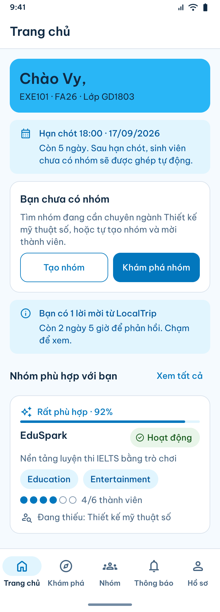 | 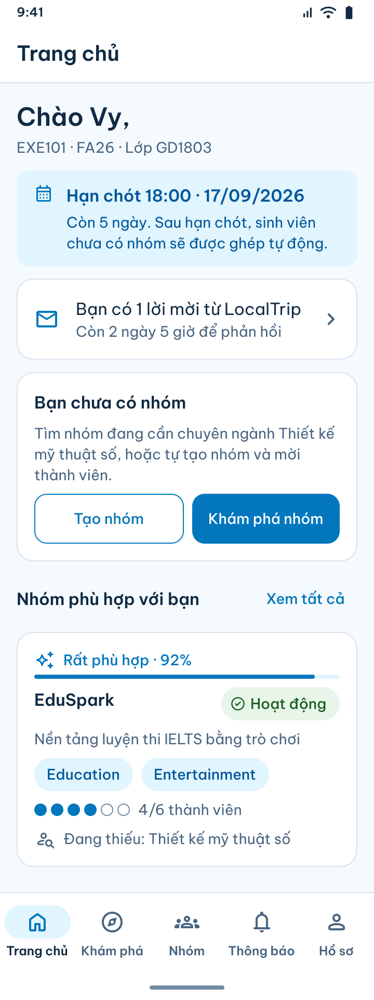 |
| S01 / Là trưởng nhóm (1.1, 1.2, 1.4) | 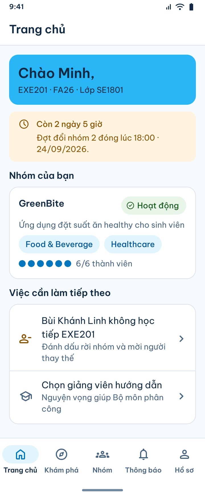 |  |
| S01 / Được ghép tự động (1.3) | 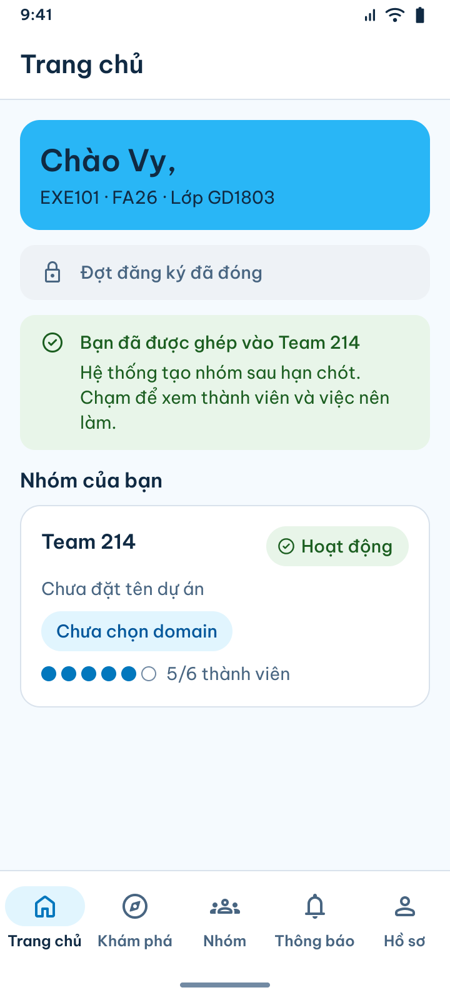 | 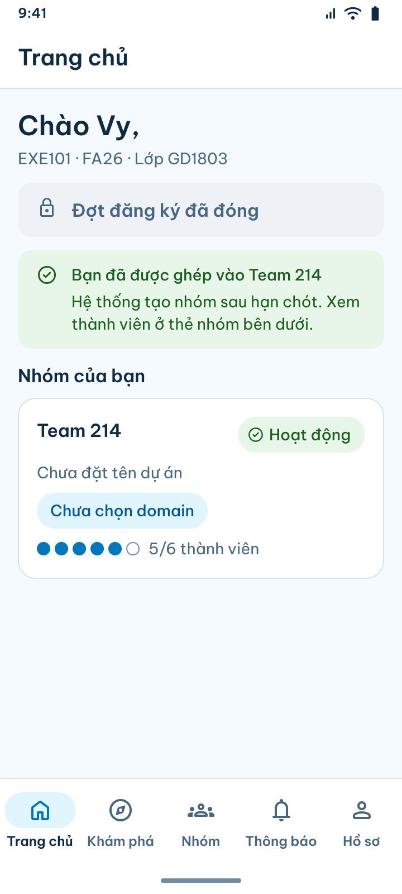 |
| S01 / Banner hạn chót 4 mức (1.2) | 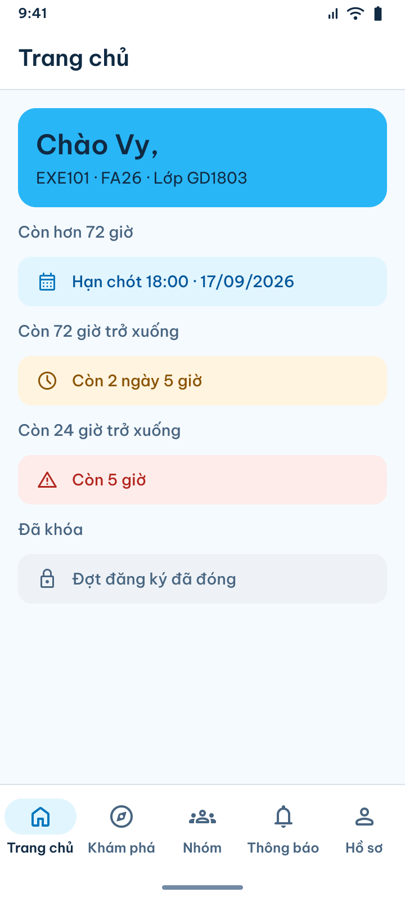 | 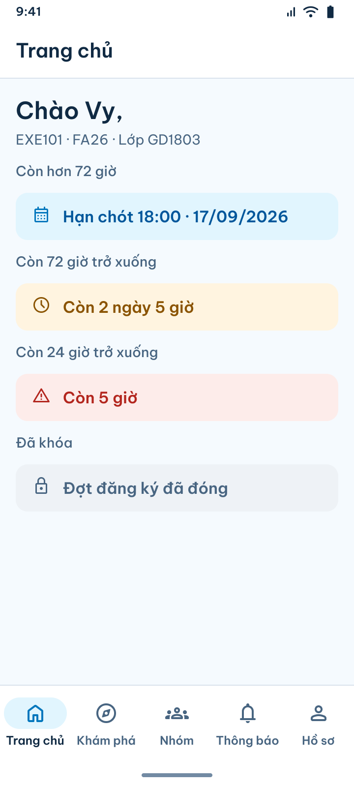 |
| L01 / Có yêu cầu chờ (1.1, 1.2, 1.5) | 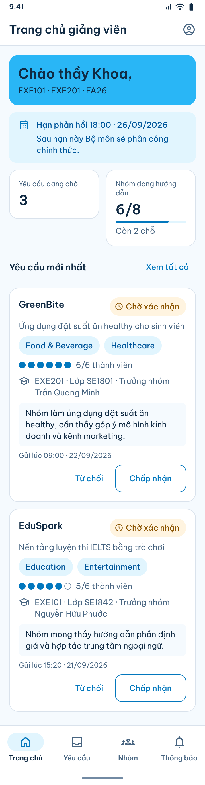 | 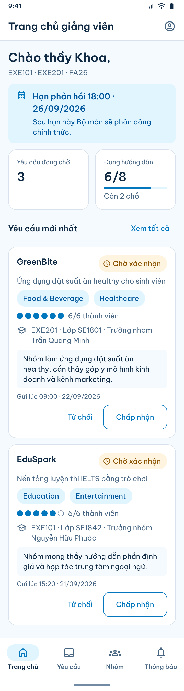 |
| A07 / Mặc định (1.7) | 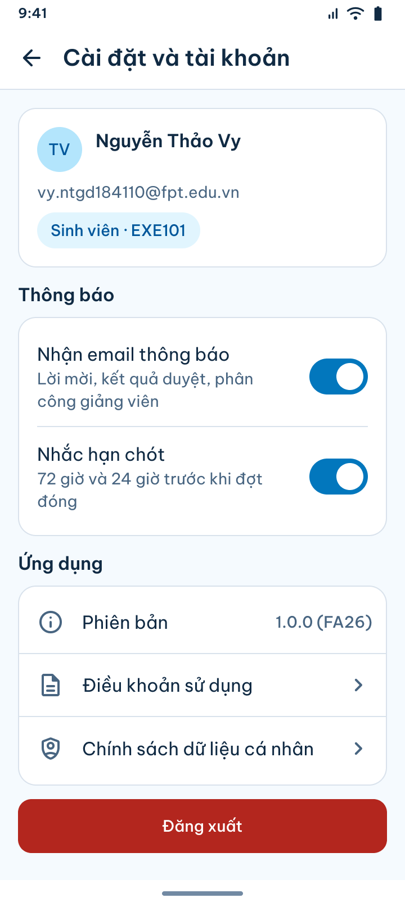 | 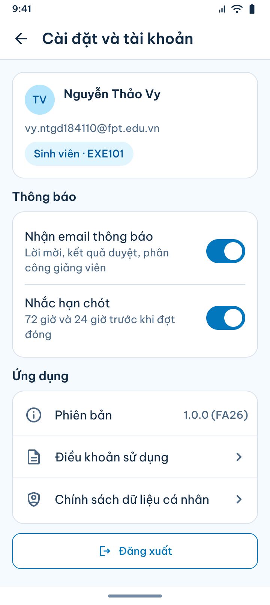 |
| S08 / Mặc định (1.6) | 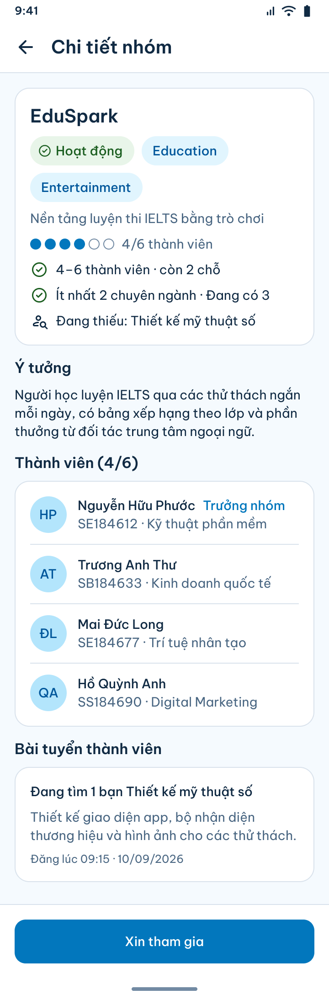 | 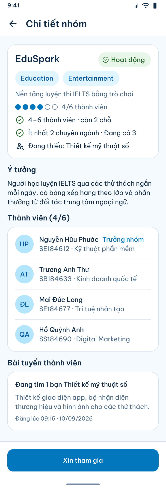 |
| L05 / Giảng viên chính thức (1.6) | 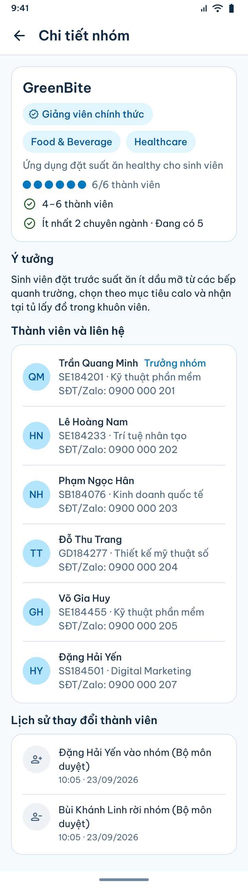 | 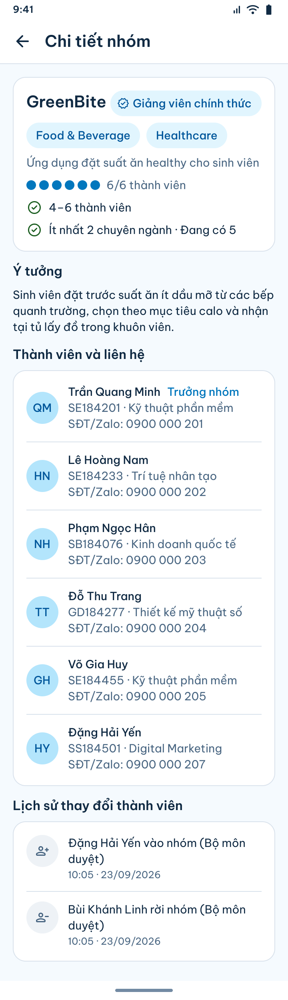 |

### 6. Kết quả đo

Đo trên frame 360 px trong `03 Final UI`; y tính từ mép trên frame.

| Chỉ số | Trước | Sau |
|---|---|---|
| S01: mảng nền Sky | 328 × 88 px | Không còn |
| S01 / Chưa có nhóm: banner hạn chót bắt đầu ở | y = 196 | y = 164 |
| S01 / Chưa có nhóm: lời mời bắt đầu ở | y = 490, dưới thẻ "Bạn chưa có nhóm" | y = 268, trên thẻ đó |
| S01 / Là trưởng nhóm: nút Primary | Không có | "Mời người thay thế", y = 389 |
| Banner hạn chót: cỡ tiêu đề / mô tả | 14 / 14 | 16 / 14 |
| L01: chiều cao hai thẻ số liệu | 86 / 134 px | 118 / 118 px |
| L01 / Có yêu cầu chờ: hàng nút của yêu cầu đầu tiên | y = 811 | y = 791 |
| A07: nút nền Error trên màn hình | 1 | 0 |
| S08, S15, L03, L05: chip trạng thái chung hàng với chip domain | 41 frame | 0 |

### 7. Điểm chưa đạt và tồn tại

- **L01 vẫn phải cuộn mới thấy nút.** Hàng nút chỉ lên được 20 px (811 → 791), vẫn dưới mép nhìn thấy 696. Ước lượng của AI lúc phản biện (663–711) sai vì hai lý do: lời chào vẫn chiếm 56 px sau khi bỏ nền, và thẻ "Đang hướng dẫn" còn thanh tiến độ và dòng "Còn 2 chỗ" nên chỉ thấp đi 16 px. Ở frame 412 hàng nút nằm ở y = 747.
- **Tiêu đề banner L01 xuống hai dòng ở 360 px.** "Hạn phản hồi 18:00 · 26/09/2026" không vừa một dòng ở cỡ 16, làm banner cao thêm 28 px. Ở 412 px tiêu đề vừa một dòng. Đây là tác dụng phụ của 1.2.
- **1.6 làm bằng hàng wrap.** Khi tên nhóm và chip không vừa một dòng, chip rớt xuống dưới tên thay vì ép gãy tên. Với dữ liệu mẫu hiện tại, mọi frame đều vừa một dòng; ở L05 / Giảng viên chính thức khoảng hở giữa tên và chip chỉ còn 5 px.
- **Banner `Banner/Message` vẫn dùng tiêu đề cỡ 14**, nên ở L01 / Đã đủ sức chứa banner cảnh báo có tiêu đề nhỏ hơn banner hạn chót ở các trạng thái khác.
- **DESIGN.md chưa được cập nhật** theo vòng này: mục 2.1 còn ghi Sky dùng cho "nền header trang chủ"; mục 6.1 chưa ghi tiêu đề banner hạn chót là Subtitle và chưa ghi nút phụ có icon tùy chọn.
- **Ngoài phạm vi, chưa sửa:** S10 còn câu "Chạm để đăng" trên một banner; S15 / Có thay đổi chờ duyệt còn cắt chữ "Rời nhóm · Digit…" (B8).

---

## Vòng 2 – Hoàn thành tác vụ (12/10/2026)

**Mục tiêu:** người dùng không bị kẹt giữa luồng.
**Phạm vi:** S10 → S04, S06, S05, L02, W18 (B2, B3, B6, B9, W3 trong design-decisions.md).

### 1. Prompt nguyên văn

Prompt mở vòng:

> Vòng 2 – mục tiêu: hoàn thành tác vụ, người dùng không bị kẹt giữa luồng. Phạm vi: S10 → S04, S06, S05, L02, W18 (B2, B3, B6, B9, W3).

Prompt quyết định, sau khi đọc phản biện:

> ok đồng ý, làm đi
> xong thì tiếp vòng 3
> Vòng 3 – mục tiêu: accessibility và độ đọc. Phạm vi: S17, S19, S27–S29, L01, S23, W19 (B8, B12, B13, W1).
> vòng này cứ làm không cần đợi accept

### 2. Phản biện của AI

AI xem 25 ảnh xuất từ Figma và đọc liên kết prototype của từng frame trong `06 Prototype`.

**S10 → S04 – Trưởng nhóm tìm người (B2)**

- Cả ba thẻ sinh viên ở S10 dẫn sang `S04 / Người khác xem`, màn chỉ có nút quay lại. `S04 / Trưởng nhóm xem` có nút "Gửi lời mời" nhưng S10 không dẫn tới (Nielsen 7; persona Minh).
- S10 chỉ có góc nhìn của người chưa có nhóm: banner "Bạn chưa đăng bài tìm nhóm", không có nút mời trên thẻ.
- `S04 / Người khác xem` không giải thích vì sao không có hành động (DESIGN.md nguyên tắc 4). Phát hiện mới.

**S06 – Bộ lọc và sắp xếp (B3)**

- Bottom sheet cao 936 px, bắt đầu ở y = 48 trong frame cao 800. Hàng nút "Xóa tất cả" / "Áp dụng" ở y = 912 bị cắt hẳn, nên không áp dụng được bộ lọc (Nielsen 3; persona Vy).
- Ở 412 px nút hiện ra nhưng kết thúc ở y = 912 trong frame cao 915, không chừa vùng điều hướng hệ thống (DESIGN.md mục 1.2).

**S05 – Nhóm đang tuyển (B6)**

- PetCare+ 6/6 nằm trong "Tất cả nhóm đang tuyển" và dẫn sang `S08 / Nhóm đã đủ`, nơi không xin tham gia được.
- Chip "Hoạt động" / "Chưa đủ điều kiện" là trạng thái nội bộ; người ngoài cần biết còn mấy chỗ (Nielsen 2; persona Vy).

**L02 và L01 – Yêu cầu hướng dẫn (B9)**

- Thẻ FoodHub "Đã thu hồi" nằm trong tab "Chờ xác nhận (3)" và được đếm vào số 3 dù không còn việc gì để làm (Nielsen 4, 8).
- Hai thẻ đầy đủ ở L01 giống hệt hai thẻ đầu của L02. Đây cũng là lý do hàng nút ở L01 vẫn nằm dưới màn hình đầu sau vòng 1.
- Tab "Đã từ chối (2)" chỉ có 1 thẻ (lỗi dữ liệu mẫu).

**W18 – Duyệt yêu cầu đổi nhóm (W3)**

- "Từ chối" / "Duyệt" ở header (y < 64), còn thẻ "Lý do của trưởng nhóm" bắt đầu ở y = 842; ở khung 1440 × 900 nội dung lý do nằm dưới mép (Nielsen 5; persona cô Hạnh).
- Nếu chỉ đưa lý do lên, hai dòng "Rời nhóm" / "Thêm vào" ở cuối danh sách bị đẩy xuống y ≈ 846–959 và bị mép 900 cắt.

### 3. Quyết định

Nhóm trả lời "ok đồng ý, làm đi" cho cả 7 đề xuất chính, không chọn phương án thay thế nào. Cột "Lý do" là lập luận trong phản biện của AI mà nhóm chấp nhận.

| # | Màn hình | Quyết định | Lý do | Phương án thay thế đã bỏ |
|---|---|---|---|---|
| 2.1 (B2) | S10, frame mới | **Accept.** Thêm `S10 / Trưởng nhóm xem`: dòng "Nhóm bạn đang thiếu: …" thay banner đăng bài, mỗi thẻ có nút viền "Gửi lời mời". | Trưởng nhóm phải mời được người ngay từ danh sách (Nielsen 7; persona Minh). | Không đặt nút trên thẻ, chỉ sửa liên kết. |
| 2.2 (mới) | S04 / Người khác xem | **Accept.** Thêm dòng "Chỉ trưởng nhóm gửi được lời mời." | Màn không có hành động phải nói lý do (DESIGN.md nguyên tắc 4). | Giữ nguyên. |
| 2.3 (B3) | S06 | **Accept.** Sheet nằm gọn trong frame, phần lọc cuộn bên trong, hai nút vào thanh cố định cuối sheet phía trên vùng hệ thống. | Không có nút thì không thoát được sheet bằng cách áp dụng (Nielsen 3). | Thêm số kết quả vào nhãn nút ("Xem 5 nhóm"). |
| 2.4 (B6) | S05, nền của S06, thẻ gợi ý ở S01 | **Accept.** Bỏ thẻ nhóm 6/6; bỏ chip trạng thái trên thẻ người ngoài xem; dòng thành viên ghi "4/6 thành viên · còn 2 chỗ". | Danh sách tuyển chỉ nên có nhóm còn chỗ; trạng thái nội bộ không giúp người ngoài (Nielsen 2). | Chip "Còn 2 chỗ". |
| 2.5 (B9) | L02 | **Accept.** Thẻ "Đã thu hồi" rời tab đầu; số đếm thành (2); tab thứ ba đổi thành "Đã đóng (2)", chứa từ chối và thu hồi. | Tab chờ chỉ chứa việc còn phải làm (Nielsen 8). | Bỏ hẳn thẻ thu hồi. |
| 2.6 (B9) | L01 | **Accept.** Hai thẻ đầy đủ thành hai dòng gọn dẫn sang L03; giữ "Xem tất cả". | L01 là tổng quan, không lặp L02; mọi thứ nằm trong màn hình đầu (persona thầy Khoa). | Giữ một thẻ đầy đủ có nút. |
| 2.7 (W3) | W18 | **Accept.** Thẻ lý do lên ngay dưới banner; hai dòng thay đổi lên đầu cột "Nhóm sau thay đổi". | Căn cứ phải nằm trước nút quyết định (Nielsen 5). | Chuyển nút xuống thanh cố định cuối trang. |

### 4. Đã sửa gì trong Figma

Trước khi sửa, AI lưu phiên bản **"Trước vòng 2 – hoàn thành tác vụ"** trong lịch sử file.

| # | Sửa ở đâu | Số chỗ |
|---|---|---|
| 2.1 | Frame mới `S10 – Khám phá – Sinh viên đang tìm nhóm / Trưởng nhóm xem`. Trong prototype: thẻ → `S04 / Trưởng nhóm xem`, nút → `S04 / Đã mời` | 2 frame mới: Final UI, Prototype |
| 2.1 | Tab "Khám phá" của ba màn hình trưởng nhóm trong prototype (S01 / Là trưởng nhóm, S15 / Trưởng nhóm, A06 / Trưởng nhóm) trỏ sang frame mới | 3 liên kết |
| 2.2 | Thêm dòng icon + chữ dưới mục "Liên hệ" | 2 frame |
| 2.3 | `Bottom sheet` cao cố định bằng frame trừ 48; `Sheet body` cắt nội dung và giãn; hàng nút thành `Bottom bar` có viền trên; thêm `System/Navigation bar` trong sheet. Liên kết prototype của nút giữ nguyên | 5 frame: 2 Final UI, 1 @412, 2 Prototype |
| 2.4 | Bỏ 8 thẻ PetCare+; bỏ chip trạng thái và thêm "· còn n chỗ" ở 27 thẻ | 35 thẻ trên S05, S06, S01 |
| 2.5 | Nhãn tab ở mọi frame L02; thẻ thu hồi chuyển sang frame tab thứ ba (Final UI, Prototype) và bỏ ở @412; frame `… / Đã từ chối` đổi tên thành `… / Đã đóng` | 9 frame L02 |
| 2.5 | Thẻ số liệu "Yêu cầu đang chờ" ở L01 / Có yêu cầu chờ: 3 → 2 | 3 frame |
| 2.6 | Hai `Card/Nhóm` thay bằng `Card/Yêu cầu đang chờ` hai dòng; liên kết prototype của thẻ chuyển sang dòng | 3 frame: Final UI, @412, Prototype |
| 2.7 | Đổi thứ tự thẻ trong `Content` và thứ tự dòng trong `Members` | 3 frame W18 (trang Web) |

### 5. Ảnh trước / sau

Ảnh nằm ở [ai-log-truoc-sau/vong-2/truoc/](ai-log-truoc-sau/vong-2/truoc/) (25 ảnh) và [ai-log-truoc-sau/vong-2/sau/](ai-log-truoc-sau/vong-2/sau/) (26 ảnh, thêm frame mới của S10), cùng tên file.

| Màn hình | Trước | Sau |
|---|---|---|
| S10 (2.1): trước là "Có dữ liệu", sau là frame mới "Trưởng nhóm xem" | 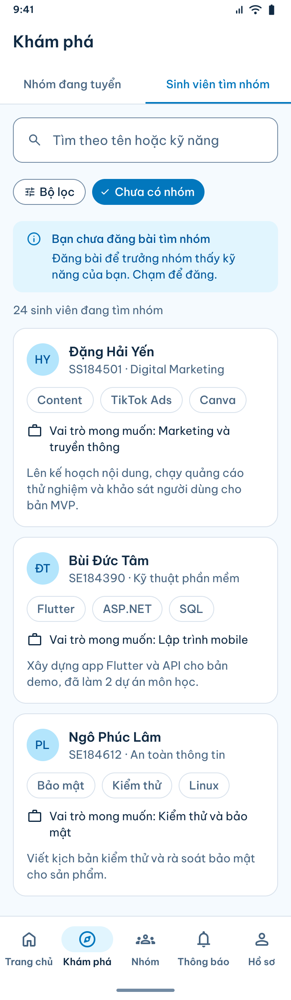 | 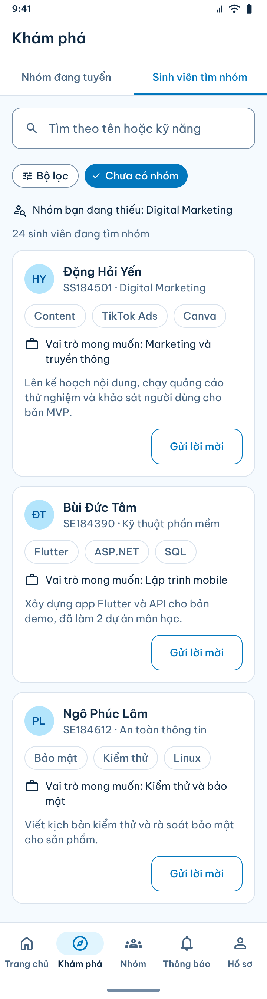 |
| S04 / Người khác xem (2.2) | 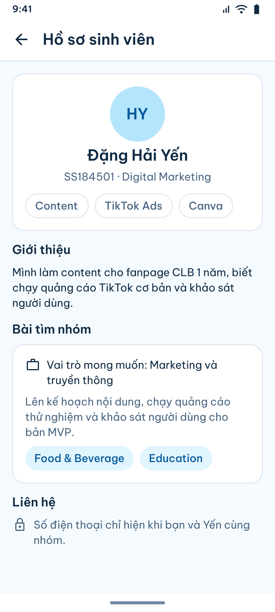 | 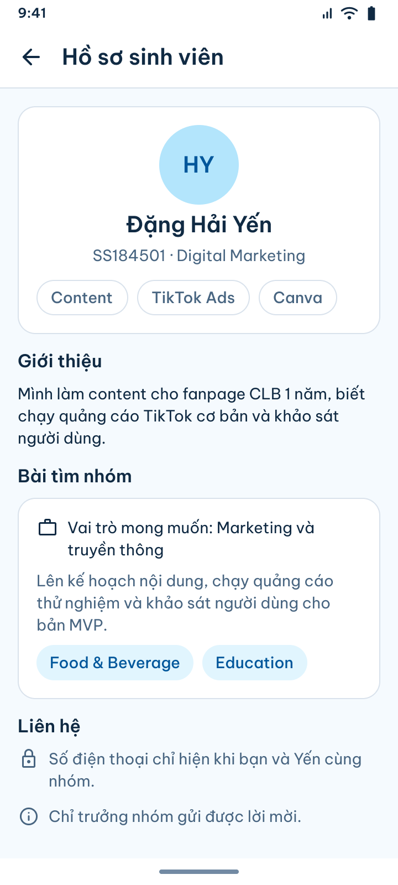 |
| S06 / Đã chọn (2.3) | 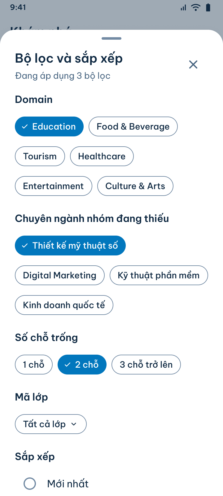 | 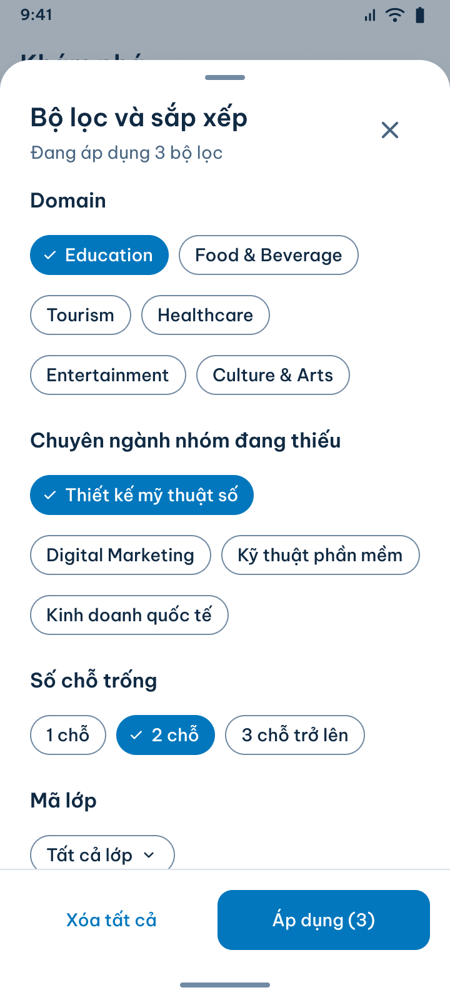 |
| S05 / Có dữ liệu (2.4) | 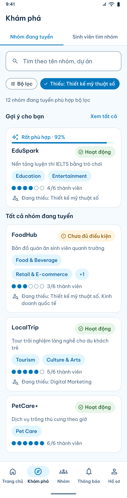 | 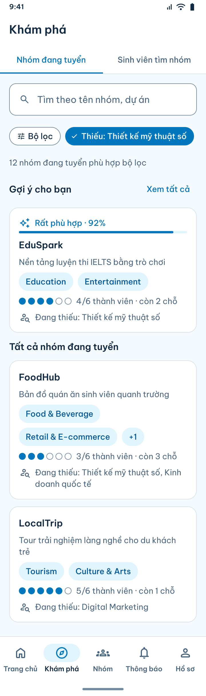 |
| L02 / Chờ xác nhận (2.5) | 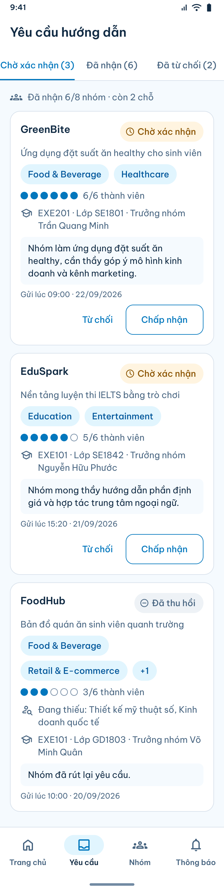 | 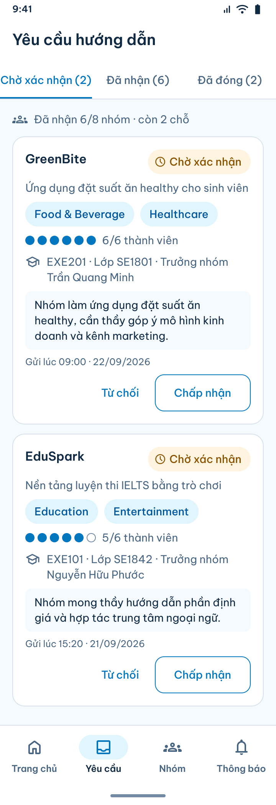 |
| L02 / Đã từ chối → Đã đóng (2.5) | 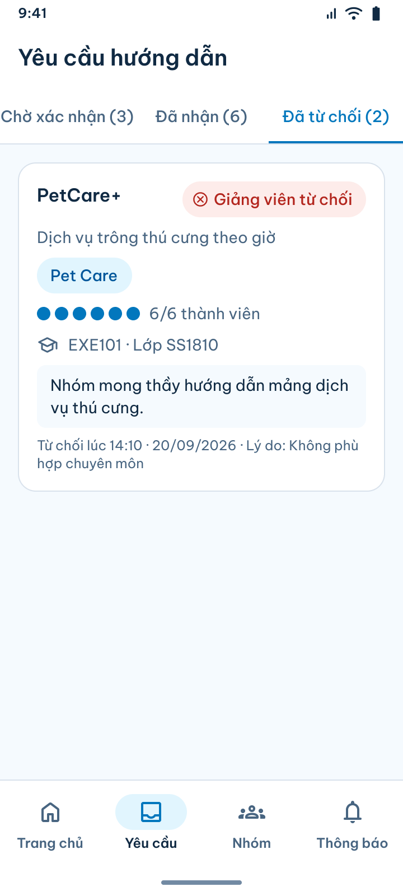 | 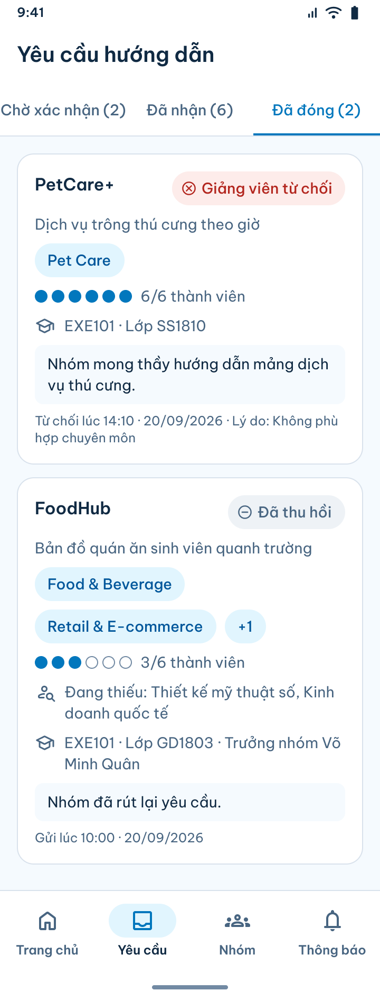 |
| L01 / Có yêu cầu chờ (2.6) |  |  |
| W18 / Chờ duyệt (2.7) | 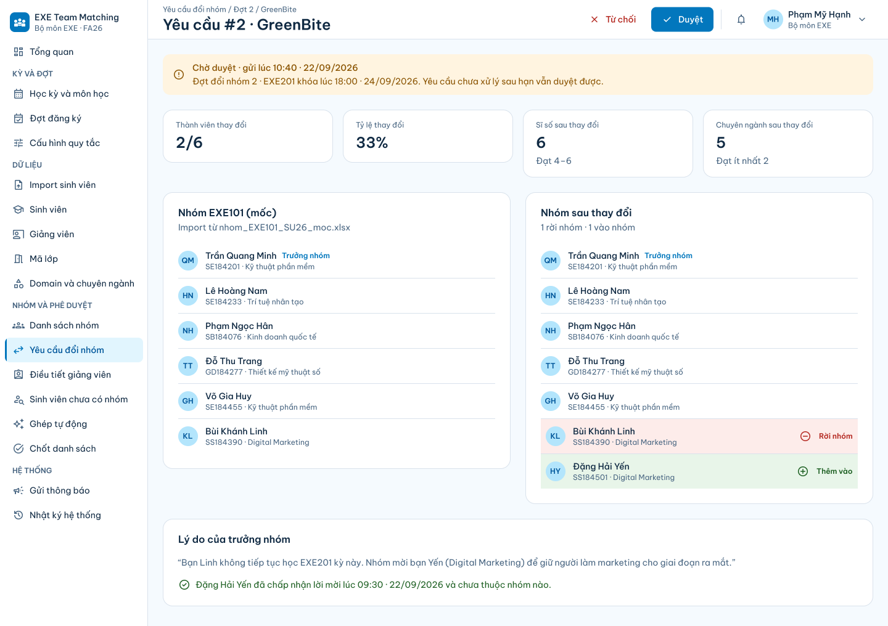 | 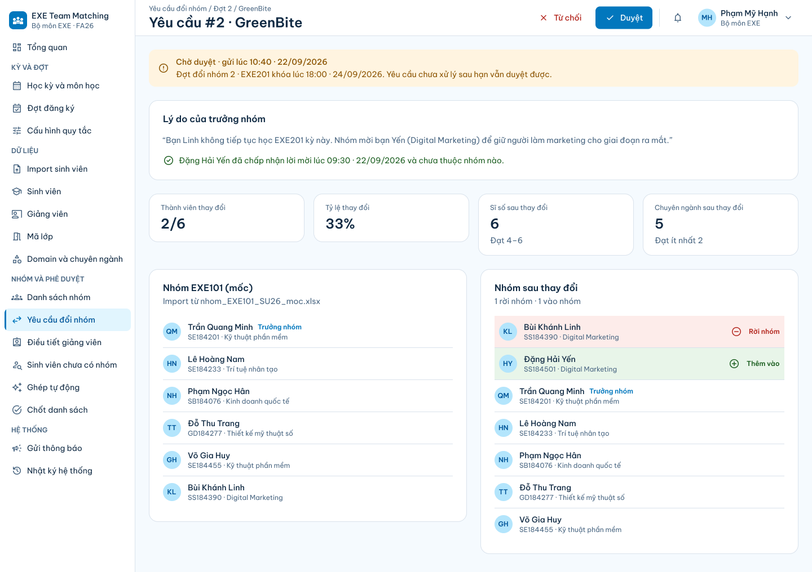 |

### 6. Kết quả đo

| Chỉ số | Trước | Sau |
|---|---|---|
| S10: đường từ thẻ sinh viên tới nút "Gửi lời mời" trong prototype | Không có | Nút ngay trên thẻ; hoặc 1 lần chạm sang `S04 / Trưởng nhóm xem` |
| S06 ở 360 px: hàng nút | y = 912, ngoài frame cao 800 | y = 695–776, trong frame |
| S06 ở 412 px: hàng nút | y = 864–912, sát đáy frame cao 915 | y = 810–891, phía trên vùng hệ thống 24 px |
| S05: nhóm 6/6 trong danh sách tuyển | 1 | 0 |
| L02: thẻ không còn việc trong tab "Chờ xác nhận" | 1 trên 3 | 0 trên 2 |
| L01 / Có yêu cầu chờ: chiều cao frame | 1350 px, phải cuộn | 800 px, không cuộn |
| W18: thẻ lý do | y = 842–984, nội dung dưới mép 900 | y = 178–320 |
| W18: hai dòng thay đổi | y ≈ 680–793 | y = 561–675 |

### 7. Điểm chưa đạt và tồn tại

- **`S08 / Nhóm đã đủ` không còn đường vào trong prototype.** Ba liên kết tới frame này đều là thẻ PetCare+ đã bỏ (S05 và hai frame S06). Frame vẫn còn trong Final UI và Prototype.
- **Tab "Khám phá" của trưởng nhóm mở thẳng S10.** Prototype không có bản S05 riêng cho trưởng nhóm, nên ba màn hình trưởng nhóm được trỏ thẳng sang `S10 / Trưởng nhóm xem`. Từ đó tab "Nhóm đang tuyển" vẫn dẫn về S05.
- **L01 không còn chấp nhận tại chỗ.** Việc chấp nhận chuyển sang L02 hoặc L03. `L01 / Đã đủ sức chứa` vẫn giữ một thẻ đầy đủ có nút bị khóa, nên hai trạng thái của L01 chưa cùng kiểu.
- **W18: hai cột không còn thẳng hàng theo từng người.** Cột "Nhóm sau thay đổi" bắt đầu bằng hai dòng thay đổi, cột mốc giữ thứ tự cũ.
- **S07 chưa được xem.** Nếu thẻ nhóm ở S07 có chip trạng thái thì nó chưa được đổi theo 2.4.
- **Tên frame đổi.** `L02 … / Đã từ chối` thành `L02 … / Đã đóng`; tài liệu nào dẫn tên cũ cần sửa.

---

## Vòng 3 – Accessibility và độ đọc (12/10/2026)

**Mục tiêu:** chữ đọc được, không bị cắt, đạt tương phản.
**Phạm vi:** S17, S19, S27–S29, L01, S23, W19 (B8, B12, B13, W1 trong design-decisions.md).

### 1. Prompt nguyên văn

> Vòng 3 – mục tiêu: accessibility và độ đọc. Phạm vi: S17, S19, S27–S29, L01, S23, W19 (B8, B12, B13, W1).
> vòng này cứ làm không cần đợi accept

### 2. Phản biện của AI

AI xem 29 ảnh và đo bằng script: cỡ chữ, chữ bị cắt (so chiều cao khi bỏ giới hạn dòng), độ mờ của lớp, chiều rộng ô bảng.

**S17, S19, S27–S29 – Dòng "MSSV · chuyên ngành" (B8)**

- Trong 203 dòng phụ của các dòng thành viên, 79 dòng bị cắt bằng "…": "SE184233 · Trí tuệ nhân t…", "SS184501 · Digital M…". Chuyên ngành là căn cứ để mời người và để kiểm tra quy tắc ít nhất 2 chuyên ngành (Nielsen 6).
- Ở S28 và S29, dòng phụ lặp lại đúng chữ của chip bên cạnh ("Rời nhóm · Digital Marketing" cạnh chip "Rời nhóm"), nên phần bị cắt lại chính là chuyên ngành.
- Ở S17, nhãn "Trưởng nhóm" tràn ra ngoài thẻ: tên 159 px + nhãn 90 px không vừa cột 242 px. Phát hiện mới.

**S27–S29, L01 – Nhãn số liệu (B12)**

- Nhãn "Thành viên thay đổi", "Tỷ lệ thay đổi", "Yêu cầu đang chờ", "Đang hướng dẫn" dùng `type/caption` 12 px, trong khi đây là nội dung phải đọc để hiểu con số (DESIGN.md mục 3).

**S23 – Giảng viên đã đủ nhóm (B13)**

- Thẻ TS. Nguyễn Thu Hà bị đặt độ mờ 72%. Chữ Text Secondary trên nền trắng vì thế chỉ còn khoảng 3,3:1 (AI tính từ mã màu), dưới ngưỡng 4,5:1.
- Chip ghi "Đã khóa", trong khi mục 7 của DESIGN.md dùng "Đã khóa" cho đợt đăng ký; ở đây ý là giảng viên đã đủ nhóm.

**W19 – Điều tiết giảng viên (W1)**

- Bảng vừa đúng 1150 px, nhưng cột Trạng thái chỉ rộng 168 px (144 px sau padding) trong khi chip rộng nhất là 167 px. Mỗi frame có 4–5 chip bị cắt ở mép phải, gồm "Giảng viên đã nhận" và "Chưa có nguyện vọng".

### 3. Quyết định

Theo yêu cầu của nhóm, vòng này AI áp dụng ngay, không dừng chờ duyệt. Hướng sửa của B8, B12, B13, W1 đã được ghi là Accept / Modify trong design-decisions.md từ lượt phản biện trước; các điểm AI tự quyết thêm được ghi rõ.

| # | Màn hình | Quyết định | Lý do | Ai quyết |
|---|---|---|---|---|
| 3.1 (B8) | S17, S19, S27–S29 | **Accept.** Dòng phụ của dòng thành viên xuống tối đa 2 dòng. | Chuyên ngành phải đọc được đầy đủ (Nielsen 6). | Nhóm (B8) |
| 3.1a | S28, S29 | Bỏ tiền tố trùng với chip ("Rời nhóm · ", "Thành viên mới · "). | Chip đã nói điều đó; chỗ trống dành cho chuyên ngành. | AI tự quyết |
| 3.1b | S17 | Hàng tên cho phép xuống dòng: nhãn "Trưởng nhóm" rớt xuống dưới tên khi không vừa. | Chữ không được tràn khỏi thẻ. | AI tự quyết |
| 3.2 (B12) | S27–S29, L01 | **Accept.** Nhãn số liệu từ `type/caption` lên `type/body` 14; hai thẻ số liệu cao bằng nhau. | Chữ nội dung tối thiểu 14 sp. | Nhóm (B12) |
| 3.3 (B13) | S23 | **Modify.** Bỏ độ mờ của thẻ; chip thành "Đã đủ"; dòng sức chứa thành "Đã nhận 8/8 nhóm". | Giữ tương phản chữ; chỉ hành động bị khóa. | Nhóm (B13); câu chữ do AI chọn |
| 3.4 (W1) | W19 | **Accept**, theo hướng "rút gọn cột": cột Trạng thái 168 → 192 px, cột GV chính thức 240 → 216 px. | Chip trạng thái không được cắt; bảng vẫn vừa 1150 px. | Nhóm (W1); số đo do AI chọn |

### 4. Đã sửa gì trong Figma

Trước khi sửa, AI lưu phiên bản **"Trước vòng 3 – accessibility và độ đọc"** trong lịch sử file.

| # | Sửa ở đâu | Số chỗ |
|---|---|---|
| 3.1 | `maxLines` 1 → 2 cho dòng phụ `type/body` trong `Row/Thành viên` và `Member` | 203 dòng chữ |
| 3.1a | Bỏ tiền tố trùng với nhãn chip | 26 dòng chữ |
| 3.1b | Hàng tên đặt auto layout wrap | 13 hàng; 8 hàng thực sự tràn |
| 3.2 | Text style nhãn trong `Stat`; hai `Stat` đặt chiều cao Fill | 56 nhãn trong 28 khung `Stats` |
| 3.3 | Độ mờ 0,72 → 1; đổi nhãn chip và dòng sức chứa | 3 thẻ: 2 Final UI, 1 Prototype |
| 3.4 | Chiều rộng hai cột cuối ở hàng tiêu đề và 5 hàng dữ liệu | 3 frame W19 (trang Web) |

Mọi thay đổi trên mobile áp cho `03 Final UI`, `Kiểm tra 412` và `06 Prototype`.

### 5. Ảnh trước / sau

29 cặp ảnh nằm ở [ai-log-truoc-sau/vong-3/truoc/](ai-log-truoc-sau/vong-3/truoc/) và [ai-log-truoc-sau/vong-3/sau/](ai-log-truoc-sau/vong-3/sau/), cùng tên file.

| Màn hình | Trước | Sau |
|---|---|---|
| S17 / Trưởng nhóm (3.1, 3.1b) | 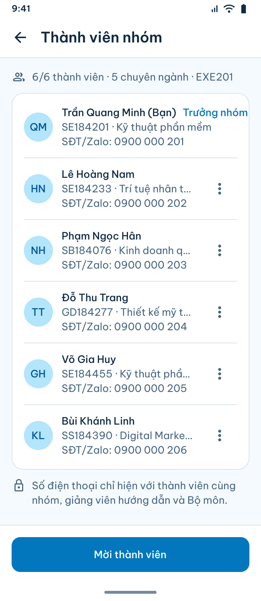 | 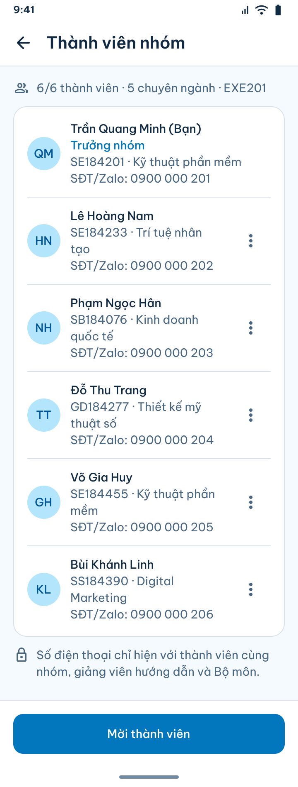 |
| S17 / Thay đổi chờ Bộ môn duyệt (3.1) | 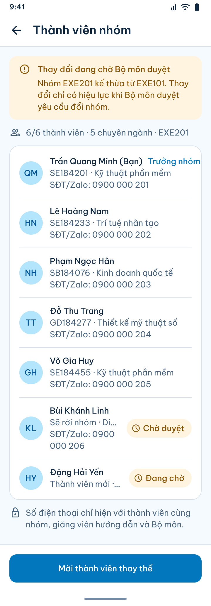 | 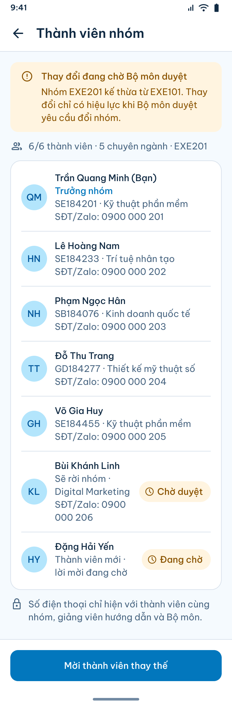 |
| S19 / Kết quả (3.1) | 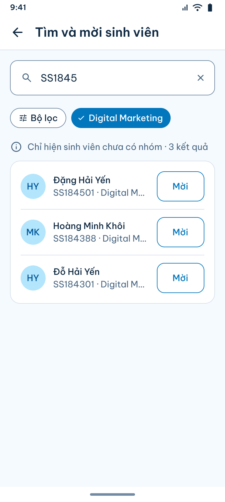 | 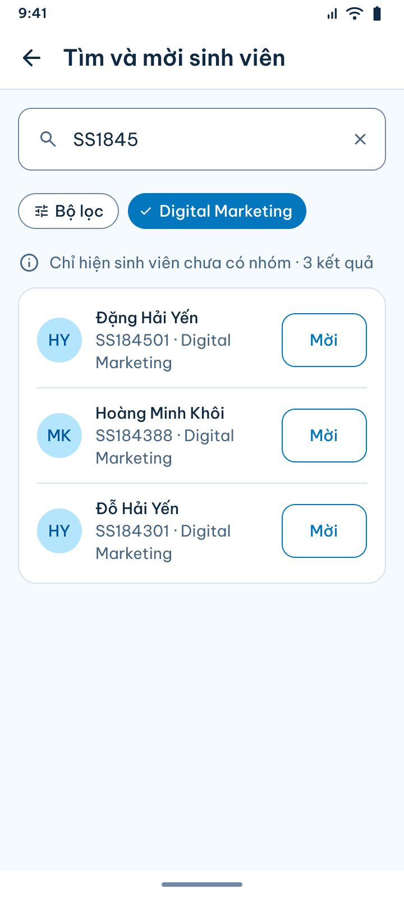 |
| S27 / Có thay đổi (3.1, 3.2) | 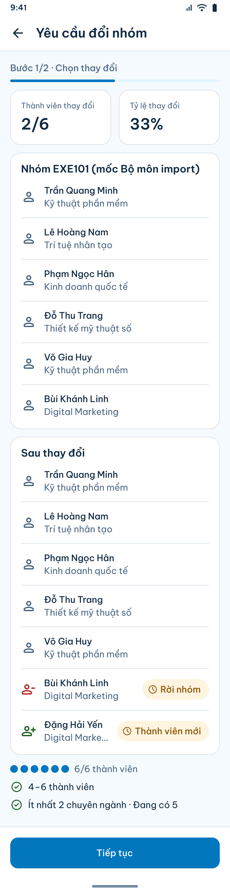 | 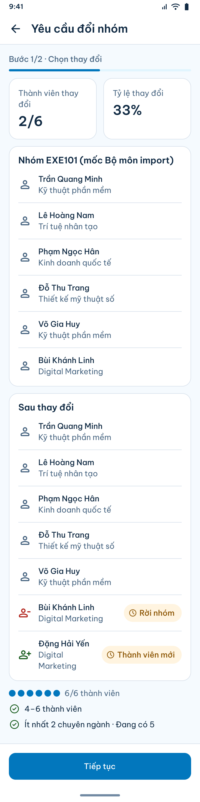 |
| S28 / Mặc định (3.1a, 3.2) | 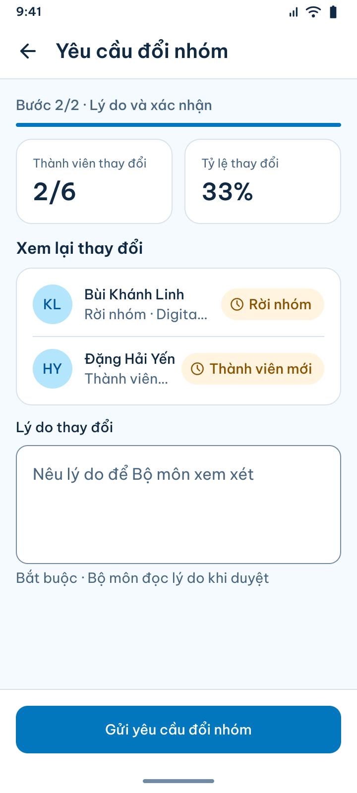 | 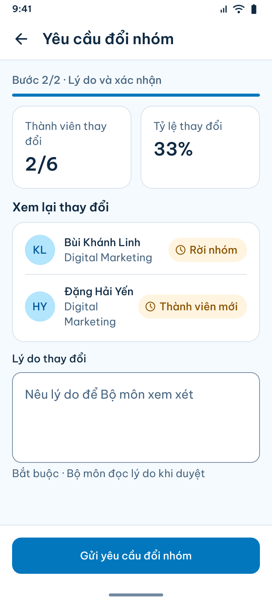 |
| S29 / Chờ duyệt (3.1a, 3.2) | 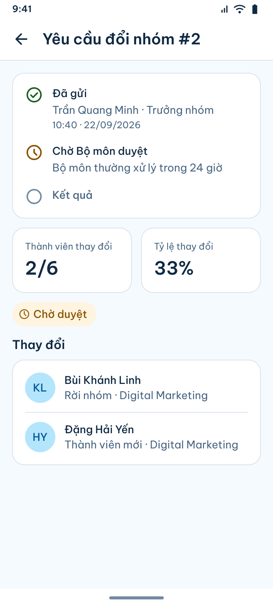 | 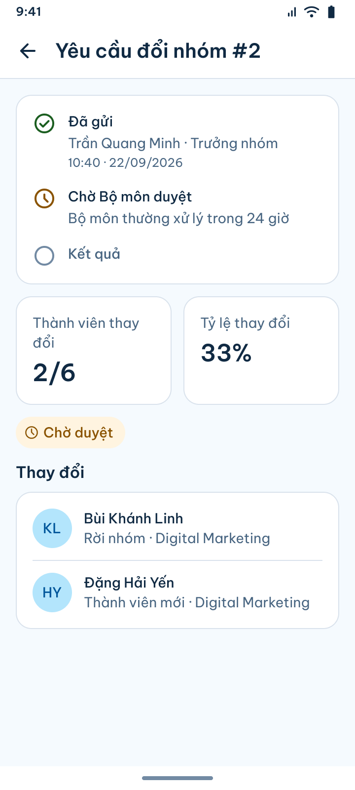 |
| L01 / Có yêu cầu chờ (3.2) | 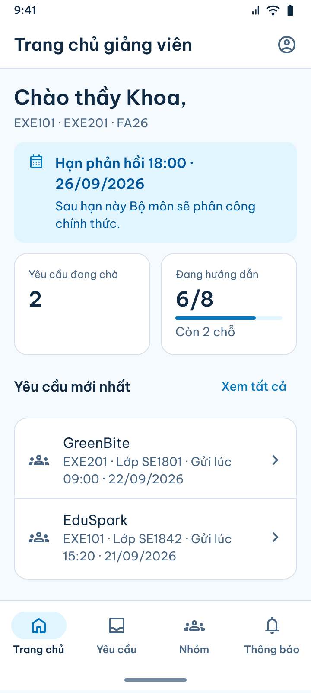 |  |
| S23 / Còn nhận (3.3) | 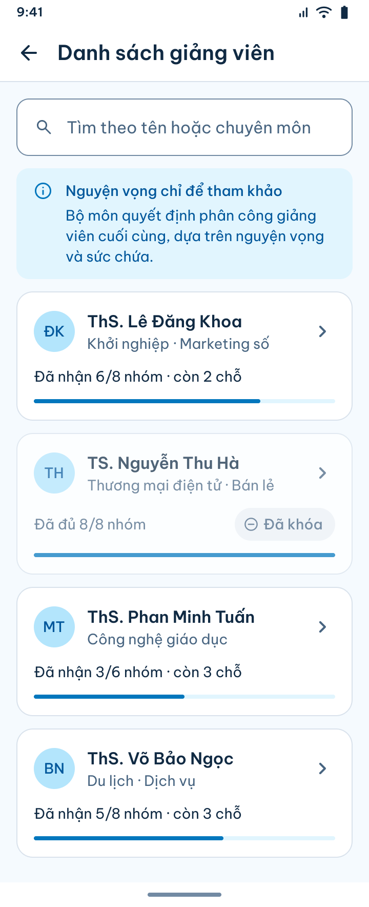 | 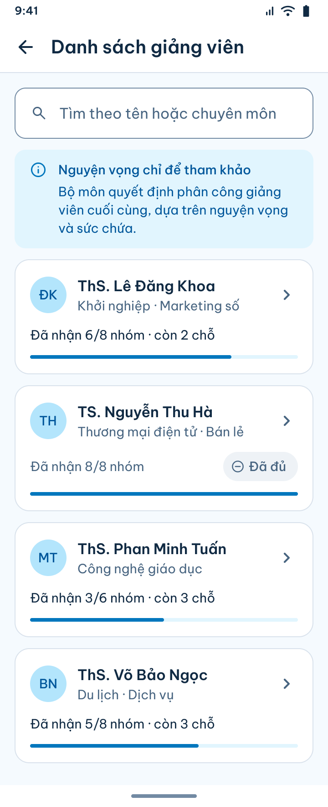 |
| W19 / Chưa gán (3.4) | 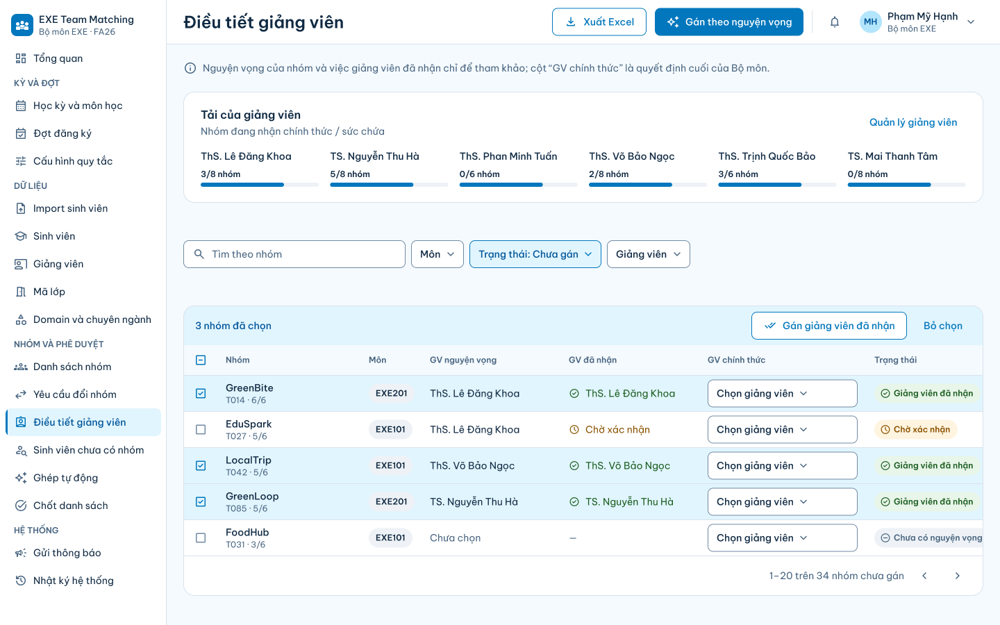 |  |

### 6. Kết quả đo

| Chỉ số | Trước | Sau |
|---|---|---|
| Dòng phụ thành viên bị cắt (S17, S19, S27–S29; cả Final UI, @412, Prototype) | 79 trên 203 | 0 trên 203 |
| S17: nhãn "Trưởng nhóm" tràn khỏi cột | 8 hàng | 0 |
| Nhãn số liệu cỡ 12 (S27–S29, L01) | 56 | 0 |
| Chữ cỡ 12 còn lại ở S27–S29, L01, ngoài thanh hệ thống | — | 16, đều là mốc thời gian (được phép theo DESIGN.md mục 3) |
| S23: độ mờ thẻ giảng viên đã đủ | 0,72 | 1 |
| S23: tương phản chữ Text Secondary trên thẻ đó | khoảng 3,3:1 | 6,08:1 |
| W19: chip trạng thái bị cắt (3 frame) | 4 / 5 / 4 | 0 / 0 / 0 |
| W19: tổng chiều rộng các cột | 1150 trên 1150 px | 1150 trên 1150 px |

### 7. Điểm chưa đạt và tồn tại

- **Dòng thành viên cao hơn.** Ở S17 / Trưởng nhóm, năm trên sáu dòng giờ có chuyên ngành xuống 2 dòng; frame cao hơn khoảng 115 px.
- **Nhãn "Thành viên thay đổi" xuống 2 dòng ở 360 px.** 20 trên 56 nhãn số liệu không vừa một dòng ở cỡ 14 trong cột 124 px.
- **S17 / Thay đổi chờ Bộ môn duyệt: số điện thoại của Bùi Khánh Linh vẫn xuống 2 dòng** vì chip "Chờ duyệt" chiếm chỗ. Chữ không bị cắt.
- **Trái với DESIGN.md mục 1.1.** Mục này ghi "Dòng phụ: 1 dòng"; dòng phụ của dòng thành viên giờ là tối đa 2 dòng. DESIGN.md chưa được cập nhật, cũng chưa ghi kiểu chữ cho nhãn số liệu trên mobile.
- **Ngoài phạm vi, chưa sửa:** S15 / Có thay đổi chờ duyệt còn cắt "Rời nhóm · Digit…"; thanh tải ở W19 vẽ sai tỷ lệ (W2); W19 chưa có frame kiểm tra 1280 px.
- **Các frame dialog và bottom sheet** có nội dung nền dài hơn 800 px và bị cắt dưới lớp phủ; đây là tình trạng có từ trước, không phải trạng thái người dùng thao tác.

---

## Sau ba vòng (13/10/2026)

Các điểm "DESIGN.md chưa được cập nhật" ghi ở mục 7 của vòng 1 và vòng 3 đã được xử lý: [DESIGN.md](DESIGN.md) lên **bản 3**, và 19 điểm khác bản 2 được liệt kê ở Phụ lục C kèm số mục của nhật ký này. Bản 3 không thêm hay đổi giá trị token nào. Không có thay đổi nào trong Figma ở bước này.

---

## Chuyển Figma sang bản 5 và vẽ màn hình mới (22/10/2026)

**Công cụ:** Claude Code, chạy script Plugin API qua cầu nối cục bộ `figma-bridge` (Figma MCP hết lượt gọi). File Figma: "PRM - Lab 2", trang `Mobile` và `Web`.
**Ảnh trước / sau:** [ban-5/truoc/](ai-log-truoc-sau/ban-5/truoc/) (bản 3) và [ban-5/sau/](ai-log-truoc-sau/ban-5/sau/) (bản 5).

### 1. Prompt nguyên văn

> chuyển cả file sang bản 4, sửa và vẽ các màn mới,ko cần tách thành 6 pages cứ để mobile và web, thực hiện đủ 3 vòng kiểm định theo file md, ko cần chờ duyệt, có thể thực hiện qua figma bridge

Giữa chừng, sau khi xem ảnh A06 và A05 đã đổi màu:

> từ từ, các cái màu này đâu phải màu fpt, và trên cả là nút thì màu đỏ , tab bar thì màu xanh, nút chọn thì màu xanh, bạn ko thấy lệch à? chỉnh sửa file .md gấp cho tôi, research lại các mã màu fpt

> cái icon khi chưa có dữ liệu cũng màu xanh

> ok áp sang figma luôn

### 2. Diễn biến

1. **Áp bản 4 (một phần).** Đổi giá trị 21 biến `Color`, thêm `color/secondary*`, đổi `color/sky` thành `color/brand-orange`, `radius/lg` 16 → 20, `radius/xl` 24 → 28, hai effect style độ nổi. Phân lại 134 chỗ trong component và 305 chỗ trên màn hình từ `primary` sang `secondary` (điều hướng, lựa chọn). 567 thẻ trên nền Background bỏ viền, dùng `elevation/1`.
2. **Trưởng nhóm phản đối bảng màu bản 4** (prompt thứ hai ở trên). Nhận xét đúng: `#C2410C` và `#0E5BA8` không phải mã FPT, và màn hình có hai màu nhấn cho hai loại điều khiển (nút cam đỏ, tab và chip lọc xanh).
3. **Tra mã màu gốc.** *Sổ tay thương hiệu Tập đoàn FPT* (01-QD/TH/HDCV/FPT, bản 3.0, trang 14–15): FPT Orange `#F37021` – "màu chủ đạo trong nhận diện của Tập đoàn", FPT Blue `#0066B3`, FPT Green `#0DB14B`, nền bổ trợ `#F1F2F2`, `#A7A9AC`. `#F37021` với chữ trắng chỉ đạt 2,94:1, nên nút dùng `#C6510B`: cùng sắc độ 22,6°, sắc sáng nhất còn đạt 4,5:1 (4,58:1).
4. **DESIGN.md bản 5** (commit `1d4d887` trên `main`): cam là màu nhấn duy nhất cho mọi thứ bấm được và đang chọn; bỏ nhóm `secondary`; thêm nhóm `info` theo FPT Blue chỉ cho thông tin không bấm được; thang xám trung tính; đo lại Phụ lục A; Phụ lục E ghi thay đổi.
5. **Áp bản 5 sang Figma.** Đổi giá trị biến, thêm `color/info`, `color/info-dark`, `color/info-container`, `color/brand-green`; phân lại 139 chỗ trong component và 336 chỗ trên màn hình (chip domain, chip trạng thái "Đang mở / Đã ghép", banner thông tin, nhãn "Rất phù hợp" sang `info`; còn lại sang cam); avatar nền Primary Container; xóa ba biến `secondary`; biến thể `Chip/Status` "Primary" đổi tên thành "Info". Trang `04 Design System` cập nhật mã màu, mô tả, bảng tương phản và nguồn.
6. **Sửa ba mục còn tồn tại của Lab 2.** B5: bỏ "· 92%" và thanh % ở 35 khối gợi ý, thay bằng một dòng lý do. B14: S14 đổi thành đúng 18 domain D01–D18 theo `deploy/db/90_seed_catalogs.sql` (ô đang chọn chuyển theo nghĩa); 321 chip và nhãn domain trên các màn khác đổi theo nghĩa gần nhất; bảng W13 sửa cột "Lĩnh vực con" và "Ngành chính" theo seed. W2: W19 vẽ lại (xem mục 3).
7. **Vẽ màn hình mới** bằng thư viện vẽ `figma-bridge/v4/lib4.js`, dùng instance của component có sẵn:

| Nơi | Nội dung | Số frame |
|---|---|---|
| `05 Components` → nhóm "Bản 5 – Dự án, cố vấn, kỹ năng" | 17 component mới theo DESIGN.md §6.3: `Chip/Role`, `Chip/Lý do ghép`, `Skill/Slider` (6 giá trị), `Skill/Bar`, `Idea/Card`, `Message/Bubble` (5 loại), `Message/Composer`, `Task/Card`, `File/Row`, `Meeting/Slot vote`, `Button/Quan tâm`, `Preference/Slot`, `Checkpoint/Progress` (0–4), `Weekly/Slot`, `Chip/Buổi mentor`, `Card/Đề tài`, `Dialog/Giai đoạn` | – |
| `03 Final UI` → "Dự án (bản 5)" | C01–C09, đủ trạng thái có dữ liệu / trống / đang tải / lỗi theo flutter-handoff §4a | 44 |
| `03 Final UI` → "Giảng viên và Mentor (bản 5)" | L07 (5 trạng thái), M01 (4 trạng thái) | 9 |
| `03 Final UI` → "Màn hình thay đổi (bản 5)" | A05 một màn, S02–S04 kỹ năng, S05 hộp nhắc giai đoạn, S09 ý tưởng, S15 học kỳ, S20 kỹ năng + ý tưởng, S23–S25 nguyện vọng, L01 hai giai đoạn, L04, L05 checkpoint | 26 |
| Web → "W4 – Bản 5" | W19 Ghép cố vấn – giảng viên (4 trạng thái), W28 Ghép cố vấn – mentor, W27 Mentor (2), W29 Đề tài qua các kỳ (2) | 9 |
| Web → "W5 – Bản 5" | Web cho vai trò, 1440: C02 + C03 tin nhắn ba cột, C04 bảng việc kéo thả, L07 danh sách + chi tiết | 3 |

35 frame Lab 2 bị thay thế (A05 hai bước, S02–S04 có SĐT, S23–S25 gửi yêu cầu, L01–L03) được giữ lại với hậu tố ` · Lab 2` để không trùng tên; `06 Prototype` F1–F3 của Lab 2 giữ nguyên.

**AI tự quyết, cần nhóm xác nhận:**
- Sidebar web gần kín 900 px. Thay vì thêm 4 mục, AI gom **W19 và W28 thành một mục "Ghép cố vấn" có hai tab** (Giảng viên hướng dẫn / Mentor); W27 Mentor thành tab trong mục **"Giảng viên và mentor"** (đổi tên từ "Giảng viên"); chỉ thêm một mục "Đề tài qua các kỳ" (W29).
- B14: domain cũ của các nhóm mẫu được đổi theo nghĩa gần nhất (ví dụ Food & Beverage → Marketing & Consumer Growth, Healthcare → AI & Data Innovation). Đây là dữ liệu mẫu, không phải ánh xạ chính thức.

### 3. Ảnh trước / sau (bản 3 → bản 5)

| Màn hình | Bản 3 | Bản 5 |
|---|---|---|
| S01 / Là trưởng nhóm | 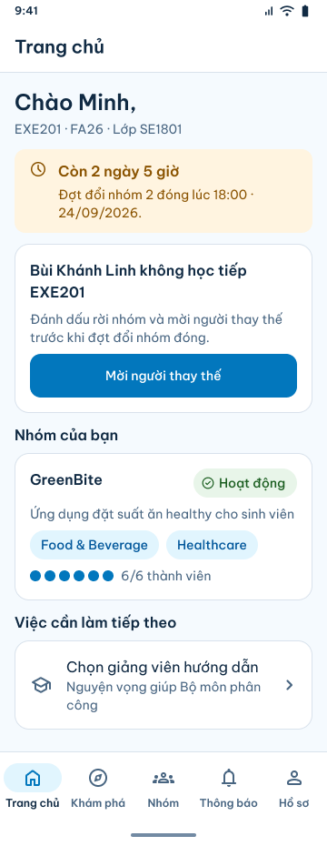 | 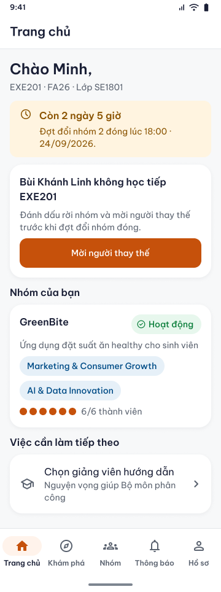 |
| S05 / Có dữ liệu (gồm B5, B14) |  | 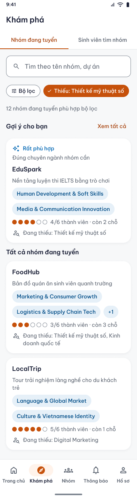 |
| A05 (hai bước → một màn) | 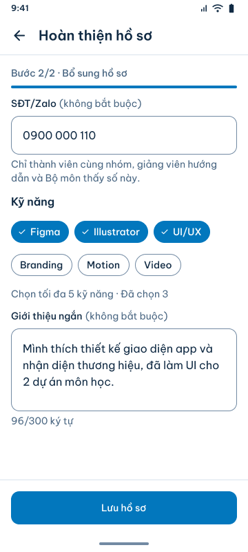 | 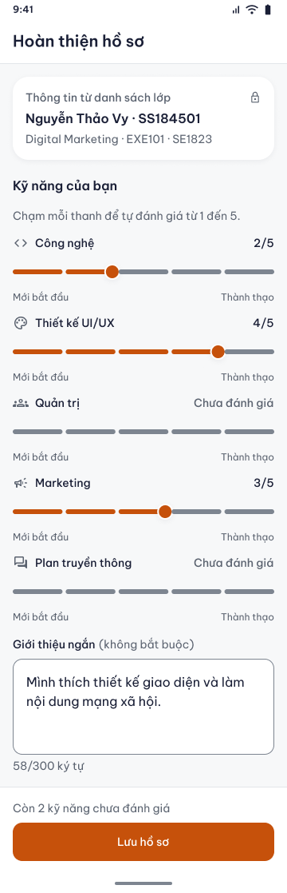 |
| L01 (yêu cầu hướng dẫn → học kỳ EXE201) |  |  |
| W19 (Điều tiết → Ghép cố vấn, gồm W2) |  |  |

---

## Vòng 4 – Phân cấp thị giác (bản 5, 22/10/2026)

**Mục tiêu:** việc gấp và con số quan trọng nổi nhất, ít chữ.
**Phạm vi:** C01, M01, L01, S05, L04.

### 1. Prompt nguyên văn

Không có prompt riêng; vòng này chạy theo yêu cầu "thực hiện đủ 3 vòng kiểm định theo file md, ko cần chờ duyệt" (mục trên). Mục tiêu từng vòng giữ như vòng 1–3.

### 2. Phản biện của AI

AI đo bằng script: số dòng của nhãn thẻ số liệu, chiều cao thẻ, chữ bị cắt.

- **L01, M01:** ba thẻ số liệu trên một hàng 360 px làm nhãn xuống 2–3 dòng ("Chưa trình bày CP2" 3 dòng, thẻ cao 128 px), đẩy danh sách việc xuống. Thẻ thứ ba ("Họp hôm nay", "Chưa trình bày CP2") trùng với danh sách ngay bên dưới (Nielsen 8).
- **C01:** thẻ "Họp tuần này" có 4 dòng chữ, một dòng là câu giải thích ("Nút "Vào họp" mở lúc 09:05") – trái DESIGN.md 9.1.
- **S05:** dòng lý do vừa thêm cho B5 dài 2 dòng, đặt trên tên nhóm và lặp ý với dòng "Đang thiếu: …" (Nielsen 8).
- **L04:** chip lý do ghép chung hàng với tên nhóm, làm cắt cả 3 dòng đề tài.

### 3. Quyết định

| # | Màn hình | Quyết định | Lý do | Ai quyết |
|---|---|---|---|---|
| 4.1 | L01, M01 | **Accept.** Còn 2 thẻ số liệu; số thứ ba đưa vào tiêu đề danh sách ("Họp hôm nay (6)") hoặc thành dòng điều hướng có icon cảnh báo ("1 cuộc họp chờ chốt lịch") | Nhãn 1 dòng; không lặp thông tin | AI (theo yêu cầu không chờ duyệt) |
| 4.2 | C01 | **Accept.** Bỏ câu giải thích, thay bằng chip "Mở lúc 09:05" cạnh giờ họp | Ít chữ, thông tin còn nguyên | AI |
| 4.3 | S05, S01, S07, S18 | **Modify B5.** Lý do rút còn một dòng: "Đúng chuyên ngành nhóm cần" (thẻ nhóm) / "Bù chuyên ngành nhóm đang thiếu" (thẻ người) | Giữ yêu cầu "luôn kèm lý do" của B5 mà không đẩy tên nhóm xuống | AI |
| 4.4 | L04 | **Accept.** Chip lý do ghép xuống hàng chip dưới (cùng slot họp, bài chờ duyệt); dòng đề tài tối đa 2 dòng | Tên và đề tài là căn cứ nhận ra nhóm | AI |

### 4. Ảnh trước / sau

[vong-4/truoc/](ai-log-truoc-sau/vong-4/truoc/) và [vong-4/sau/](ai-log-truoc-sau/vong-4/sau/), cùng tên file.

| Màn hình | Trước | Sau |
|---|---|---|
| L01 / Học kỳ – EXE101 (4.1) |  |  |
| M01 / Có nhóm (4.1) |  |  |
| C01 / Thành viên – EXE201 (4.2) |  |  |
| S05 / Có dữ liệu (4.3) |  |  |
| L04 / Học kỳ – EXE201 (4.4) |  |  |

### 5. Kết quả đo

| Chỉ số | Trước | Sau |
|---|---|---|
| L01 / EXE101: số dòng nhãn thẻ số liệu, chiều cao thẻ | 2 / 2 / 3 dòng, 128 px | 1 / 1 dòng, 96 px |
| L01 / EXE201, M01: số dòng nhãn, chiều cao thẻ | 2 dòng, 108 px | 1 dòng, 96 px |
| C01: số dòng chữ trong thẻ "Họp tuần này" | 4 | 3 |
| S05: dòng lý do gợi ý | 2 dòng | 1 dòng |
| L04 / EXE201: dòng đề tài bị cắt | 3 | 0 |

### 6. Điểm chưa đạt

- **C01: giờ họp "Thứ Ba 21/10 · 09:15" xuống 2 dòng ở 360 px** vì chip "Mở lúc 09:05" chiếm chỗ; ở 412 px vừa một dòng.
- Thẻ số liệu C01 vẫn 4 thẻ cùng trọng lượng; chưa làm nổi riêng "Sắp đến hạn" ngoài màu số Warning.

---

## Vòng 5 – Hoàn thành tác vụ (bản 5, 22/10/2026)

**Mục tiêu:** người dùng đi hết luồng mới mà không bị kẹt.
**Phạm vi:** C05, C08, S23, C09, S09 và prototype cho luồng F4–F8.

### 1. Prompt nguyên văn

Như vòng 4.

### 2. Phản biện của AI

- **S09 / Đã thêm ý tưởng:** bottom sheet cao 809 px trong frame 800, mép trên ở y = −9 – lặp lại lỗi B3 của Lab 2 (Nielsen 3).
- **C05 / Bài nộp – Chưa nộp:** nút "Nộp bài" bật khi chưa chọn file; bấm sẽ không có gì để nộp (Nielsen 5).
- **C08 / Đã họp – biên bản:** dòng "Bổ sung câu hỏi về giá" đã tích nhưng dòng phụ ghi "Chọn để tạo việc"; dòng đã thành việc vẫn là checkbox (Nielsen 1).
- **S23:** không cho biết nguyện vọng đã được lưu chưa; nút "Thêm" không nói thêm vào đâu (Nielsen 1, 6).
- **C09:** thành viên không phải trưởng nhóm không có trạng thái riêng, không biết vì sao không chọn được slot (DESIGN.md nguyên tắc 4).
- **Prototype:** chưa có điểm bắt đầu hay liên kết nào cho màn hình bản 5; mọi luồng F4–F8 là ngõ cụt.

### 3. Quyết định

| # | Màn hình | Quyết định | Lý do | Ai quyết |
|---|---|---|---|---|
| 5.1 | S09 (mọi bottom sheet) | **Accept.** Sheet tối đa bằng frame trừ 48 px, phần thân cuộn bên trong; quy tắc đưa vào hàm `overlay` của thư viện vẽ | DESIGN.md 6.1 Bottom sheet | AI |
| 5.2 | C05 | **Accept.** "Nộp bài" vô hiệu kèm dòng "Chọn file trước khi nộp"; thêm trạng thái "Đã chọn file" và "Đã nộp" | Nút vô hiệu phải nêu lý do (6.2) | AI |
| 5.3 | C08 | **Accept.** Việc đã tạo thành dòng điều hướng có dấu tích Success ("Đã thành việc · Minh"); dòng đã tích ghi "Sẽ tạo việc" | Trạng thái khớp với điều khiển | AI |
| 5.4 | S23 | **Accept.** Thêm dòng "Đã tự lưu · trưởng nhóm sửa được tới 18:00 · 17/09"; nút đổi thành "Thêm vào NV3" | Nielsen 1, 6 | AI |
| 5.5 | C09 | **Accept.** Thêm trạng thái "Thành viên xem" với dòng "Chỉ trưởng nhóm chọn được slot…" | Nguyên tắc 4 | AI |
| 5.6 | 06 Prototype | **Accept.** Section mới "Bản 5 – F4, F5, F6, F8": 20 frame, 37 liên kết, 5 điểm bắt đầu (F4 hai điểm, F5, F6, F8); mọi nút quay lại dùng "Back"; F6 có nhánh lỗi tải lên → Thử lại; F8 có nhánh slot vừa bị chọn | Không có ngõ cụt (DESIGN.md mục 11) | AI |

### 4. Ảnh trước / sau

[vong-5/truoc/](ai-log-truoc-sau/vong-5/truoc/) và [vong-5/sau/](ai-log-truoc-sau/vong-5/sau/).

| Màn hình | Trước | Sau |
|---|---|---|
| S09 / Đã thêm ý tưởng (5.1) |  |  |
| C05 / Bài nộp – Chưa nộp (5.2) |  |  |
| C08 / Đã họp – biên bản (5.3) |  |  |
| S23 / Mặc định (5.4) |  |  |
| C09: trưởng nhóm → thành viên xem (5.5) |  |  |

### 5. Kết quả đo

| Chỉ số | Trước | Sau |
|---|---|---|
| S09: chiều cao sheet / mép trên trong frame 800 | 809 px / y = −9 | 752 px / y = 48 |
| C05 / Chưa nộp: trạng thái nút "Nộp bài" | Default | Disabled + dòng lý do |
| Điểm bắt đầu prototype cho luồng bản 5 | 0 | 5 |
| Liên kết prototype trong luồng bản 5 | 0 | 37 trên 20 frame |

### 6. Điểm chưa đạt

- Prototype F4–F8 chỉ nối màn hình mobile; web (C03, C04, L07 bản 1440) chưa có prototype.
- F5 dùng chờ 3 giây để chuyển từ "Trước khi ghép" sang "Đã ghép", thay cho việc hệ thống ghép lúc đóng đợt.

---

## Vòng 6 – Accessibility và độ đọc (bản 5, 22/10/2026)

**Mục tiêu:** chữ đọc được, không tràn, không cắt, tương phản và vùng chạm đạt.
**Phạm vi:** toàn bộ frame bản 5 (mobile và web) bằng script; sửa L07, C07, C03, W19, W15, W13, các link chữ; thêm frame kiểm tra 412.

### 1. Prompt nguyên văn

Như vòng 4.

### 2. Phản biện của AI

Script quét 91 frame, 3.153 đoạn chữ: tính tương phản thật của từng đoạn chữ với nền gần nhất (giải giá trị biến màu), cỡ chữ, chữ bị cắt (so chiều cao khi bỏ giới hạn dòng), chữ tràn khỏi khung cha, chiều cao của link chữ.

- **Tương phản:** mọi chữ đạt. Chỉ icon "gửi" ở khung soạn tin trống (Text Disabled, 2,36:1) – thành phần vô hiệu, WCAG miễn trừ.
- **Vùng chạm:** 8 link chữ chỉ cao 20 px ("Xem tất cả" ở C01, C07, L01; "Lịch", "Lịch sử", "Tìm", "Sửa", "Gửi lại").
- **Chữ tràn khung:** tab "Nhóm chọn tôi (3)" ở L07 tràn sang tab bên cạnh; W19 cột "Tối đa" 100 px tràn chữ "Không giới hạn".
- **Chữ bị cắt:** đề tài ở L07 (chip "Nguyện vọng n" chen hàng tên); tên domain dài ở W13 và chip "+1" ở W15 (hệ quả của B14: tên D01–D18 dài hơn tên cũ).
- **Chữ cỡ 12 cho nội dung cần đọc:** "Chưa gửi" (trạng thái tin lỗi) và nhãn ngày "T2…T6" ở C07.
- **412 px:** chưa có frame kiểm tra nào cho màn hình bản 5.

### 3. Quyết định

| # | Màn hình | Quyết định | Lý do | Ai quyết |
|---|---|---|---|---|
| 6.1 | Mọi màn có link chữ | **Accept.** Link trong tiêu đề mục, "Lịch sử" (`Card/Đề tài`), "Gửi lại" (`Message/Bubble`) bọc vùng chạm 48 px | DESIGN.md 4.4 | AI |
| 6.2 | L07 | **Accept.** Tab rút gọn "Gợi ý · Chọn tôi (3) · Quan tâm (5)"; chip "Nguyện vọng n" xuống hàng chip domain | Không tràn, không cắt đề tài | AI |
| 6.3 | C03, C07 | **Accept.** "Chưa gửi" lên Body 14; nhãn ngày lên Label 14 | Cỡ 12 chỉ cho thời gian, bộ đếm, nhãn tab (mục 3) | AI |
| 6.4 | W19 | **Accept.** Cột "Tối đa" 100 → 140 px, cột "Chuyên môn" 260 → 240 px | Chữ không tràn | AI |
| 6.5 | W13, W15 | **Accept.** Tên domain được xuống 2 dòng; ô domain ở W15 xuống dòng, dòng bảng giãn theo nội dung (tối thiểu 52 px) | Thông tin ra quyết định không bị cắt (mục 11) | AI |
| 6.6 | Section mới "Kiểm tra 412 (bản 5)" | **Accept.** 14 frame @412 cho màn trong F4–F8 và các màn thay đổi chính | DESIGN.md 1.1 | AI |
| – | Icon gửi vô hiệu | **Reject sửa.** Giữ Text Disabled | WCAG miễn trừ thành phần vô hiệu; DESIGN.md Phụ lục A.3 | AI |

### 4. Ảnh trước / sau

[vong-6/truoc/](ai-log-truoc-sau/vong-6/truoc/) và [vong-6/sau/](ai-log-truoc-sau/vong-6/sau/). **Ảnh "trước" của vòng này cắt từ ảnh kiểm tra chụp lúc vẽ (tỷ lệ 0,3–0,5)**, vì AI lưu phiên bản "Trước vòng 6" nhưng quên xuất ảnh trước khi sửa; phiên bản đó vẫn mở được trong lịch sử file.

| Màn hình | Trước | Sau |
|---|---|---|
| L07 / Gợi ý (6.2) |  |  |
| C03 / Tin gửi lỗi (6.1, 6.3) |  |  |
| C07 / Giảng viên – theo ngày (6.3) |  |  |
| W15 / Có dữ liệu (6.5) |  |  |
| W19 / Trước hạn (6.4) |  |  |
| C09 @412, S23 @412 (6.6) | – |   |

### 5. Kết quả đo

Quét lại sau khi sửa: 105 frame (thêm 14 frame @412), 3.701 đoạn chữ.

| Chỉ số | Trước | Sau |
|---|---|---|
| Chữ dưới 4,5:1 (icon dưới 3:1), trừ thành phần vô hiệu | 0 | 0 |
| Chữ nhỏ hơn 12 px | 0 | 0 |
| Chữ cỡ 12 cho nội dung không phải thời gian / bộ đếm / nhãn tab / chữ cái avatar | 2 loại ("Chưa gửi", "T2…T6") | 0 |
| Link chữ cao dưới 48 px | 8 | 0 |
| Chữ tràn khỏi khung cha | 2 | 0 |
| Chữ thông tin bị cắt (ngoài dòng xem trước tin nhắn) | 1 (L07) | 0 |
| Tên domain bị cắt ở W13, W15 và các bảng web cũ | 6 tên; chip "+1" bị che ở W15 | 0 |
| Frame @412 của màn bản 5 / số frame tràn ngang ở 412 | 0 / – | 14 / 0 |

### 6. Điểm chưa đạt

- **Dòng xem trước tin nhắn ở C02 và cột hội thoại web cắt 1 dòng** – có chủ đích (xem trước), toàn văn ở C03.
- **Chip 32 px bấm được** (`Chip/Lý do ghép` mở cách ghép, chip lọc) chưa bọc frame 48 px trong Figma; handoff dựa vào `materialTapTargetSize.padded` (DESIGN.md 12.3).
- **W15 / Có dữ liệu cao 1.026 px** sau khi cho ô domain xuống dòng.
- Tương phản được tính theo nền gần nhất có màu đặc; chưa xét chữ đặt trên ảnh (bản 5 chưa có ảnh).
