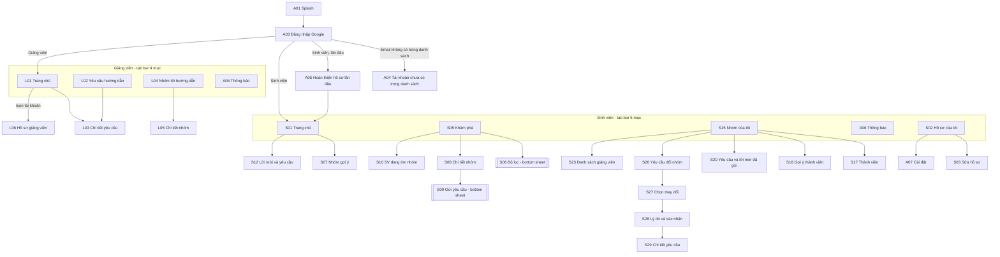
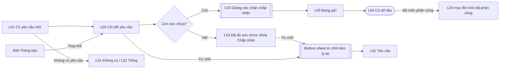

# Information Architecture & User Flow – EXE Team Matching System

> Artifact cho **Slide 03 – Information Architecture** và **Slide 04 – Three User Flows** (PRM323 Lab 2), đồng thời là nguồn cho page Figma `01 User Flow`.
> Persona tham chiếu: [persona.md](persona.md). Quy tắc nghiệp vụ tham chiếu: `PROJECT_CONTEXT.md` mục 3.
> Mã màn hình theo **`EXE_Team_Matching_Danh_sach_man_hinh_v2.xlsx`** (sheet Mobile) – cùng bộ mã với file Figma.
> Phạm vi chấm Lab 2 là **Mobile App (Flutter)** cho Sinh viên và Giảng viên. Web App của Bộ môn EXE được liệt kê ở mục 6 để tham khảo.
> Cập nhật: 19/10/2026 – đổi sang mã màn hình theo file Excel, khớp Figma `01 User Flow`.

---

## 1. Cấu trúc điều hướng (sitemap)

Một điểm vào chung (đăng nhập Google), sau đó rẽ theo vai trò. Mỗi vai trò có thanh điều hướng dưới (tab bar) riêng.

### 1.1 Danh sách màn hình

Danh sách đầy đủ (nội dung, trạng thái cần vẽ) nằm trong file Excel v2. Bảng dưới gom theo nhóm.

| Nhóm | Mã | Màn hình | Cấp | Flow Lab 2 |
|---|---|---|---|---|
| A. Khởi động và dùng chung | A01 | Splash | điểm vào | — |
| | A02 | Giới thiệu (onboarding) | điểm vào | — |
| | A03 | Đăng nhập Google | điểm vào | F1 |
| | A04 | Tài khoản chưa có trong danh sách | 2 | F1 (lỗi) |
| | A05 | Hoàn thiện hồ sơ lần đầu | 2 | F1 |
| | A06 | Thông báo | **1 (tab)** | F1, F2, F3 |
| | A07 | Cài đặt và tài khoản | 2 | — |
| | A08 | Trạng thái chung (mẫu: đang tải, trống, lỗi, mất mạng, không có quyền) | mẫu | — |
| S1. Trang chủ và hồ sơ | S01 | Trang chủ | **1 (tab)** | F1, F2 |
| | S02 | Hồ sơ của tôi | **1 (tab)** | — |
| | S03 | Chỉnh sửa hồ sơ | 2 | — |
| | S04 | Hồ sơ sinh viên khác | 2 | — |
| S2. Khám phá và ghép nhóm | S05 | Khám phá – Nhóm đang tuyển | **1 (tab)** | F1 |
| | S06 | Bộ lọc và sắp xếp | bottom sheet | F1 |
| | S07 | Nhóm gợi ý cho bạn | 2 | F1 (thay thế) |
| | S08 | Chi tiết nhóm (xem từ bên ngoài) | 2 | F1 |
| | S09 | Gửi yêu cầu tham gia | bottom sheet | F1 |
| | S10 | Khám phá – Sinh viên đang tìm nhóm | 1 (tab con của Khám phá) | — |
| | S11 | Đăng / sửa bài "Tôi đang tìm nhóm" | 2 | — |
| | S12 | Lời mời và yêu cầu của tôi | 2 | F1 (thay thế) |
| S3. Nhóm của tôi | S13 | Tạo nhóm | 2 | — |
| | S14 | Chọn domain nghiên cứu | 2 | — |
| | S15 | Nhóm của tôi – Tổng quan | **1 (tab)** | F1, F2 |
| | S16 | Chỉnh sửa thông tin nhóm | 2 | — |
| | S17 | Thành viên nhóm | 2 | F2 |
| | S18 | Gợi ý thành viên | 2 | F2 |
| | S19 | Tìm và mời sinh viên | 2 | F2 (thay thế) |
| | S20 | Yêu cầu tham gia và lời mời đã gửi | 2 | F2 (thay thế, lỗi) |
| | S21 | Đăng / sửa bài tuyển thành viên | 2 | — |
| | S22 | Lịch sử hoạt động nhóm | 2 | — |
| S4. Giảng viên, đổi nhóm, sau hạn | S23 | Danh sách giảng viên | 2 | — |
| | S24 | Chi tiết giảng viên và gửi yêu cầu | 2 | — |
| | S25 | Trạng thái giảng viên của nhóm | 2 | — |
| | S26 | Yêu cầu đổi nhóm – danh sách | 2 | F2 (lỗi) |
| | S27 | Tạo yêu cầu đổi nhóm – chọn thay đổi | 2 | F2 |
| | S28 | Tạo yêu cầu đổi nhóm – lý do và xác nhận | 2 | F2 |
| | S29 | Chi tiết yêu cầu đổi nhóm | 2 | F2 |
| | S30 | Đợt đăng ký đã khóa | 2 | — |
| | S31 | Bạn đã được ghép nhóm tự động | 2 | — |
| L. Giảng viên | L01 | Trang chủ giảng viên | **1 (tab)** | F3 |
| | L02 | Yêu cầu hướng dẫn | **1 (tab)** | F3 (thay thế, lỗi) |
| | L03 | Chi tiết yêu cầu hướng dẫn | 2 | F3 |
| | L04 | Nhóm tôi hướng dẫn | **1 (tab)** | F3 |
| | L05 | Chi tiết nhóm (giảng viên xem) | 2 | F3 (thay thế) |
| | L06 | Hồ sơ giảng viên | 2 (từ icon tài khoản) | — |

**Tổng: 45 mã = 42 màn hình khác nhau + 2 bottom sheet (S06, S09) + 1 frame mẫu trạng thái (A08).** Theo hướng dẫn chấm, dialog, bottom sheet và biến thể trạng thái không tính là màn hình riêng.

### 1.2 Overlay và trạng thái (không tính là màn hình)

| Loại | Ở đâu | Nội dung |
|---|---|---|
| Bottom sheet | S06 | Bộ lọc domain, chuyên ngành thiếu, số chỗ trống, mã lớp |
| Bottom sheet | S09 | Xin tham gia kèm lời nhắn, nhắc hạn 72 giờ |
| Dialog | S12 | Xác nhận vào nhóm (mỗi SV chỉ thuộc 1 nhóm) |
| Dialog | S17 | Xóa thành viên / rời nhóm / chuyển quyền trưởng nhóm |
| Dialog | S28 | Xác nhận gửi yêu cầu đổi nhóm |
| Dialog | L03 | Xác nhận chấp nhận hướng dẫn |
| Bottom sheet | L03 | Từ chối kèm lý do |
| Dialog | A07 | Xác nhận đăng xuất |
| Trạng thái | A08 và từng màn | Đang tải (skeleton), trống, lỗi tải, mất mạng, không có quyền |

### 1.3 Quy tắc điều hướng

- Màn hình cấp 1 (tab) không có nút Back; chuyển qua lại bằng tab bar và giữ nguyên vị trí cuộn.
- Màn hình cấp 2 có nút Back trên app bar, trở về đúng màn hình cha đã mở nó.
- Sau khi gửi thành công (S09, S28, L03), Back **không** quay lại form đã gửi mà về màn hình cha.
- Chạm một thông báo ở A06 mở màn hình cấp 2 tương ứng; Back trở về A06.
- Mọi trạng thái lỗi đều có lối ra: Thử lại hoặc Back. Không có màn hình ngõ cụt.

---

## 2. Flow 1 – Sinh viên chưa có nhóm tham gia một nhóm

| | |
|---|---|
| **Persona** | P2 – Vy (Secondary) |
| **Bắt đầu** | A03 / Mặc định (mở app, chưa đăng nhập) |
| **Mục tiêu** | Trở thành thành viên của một nhóm đang cần chuyên ngành của mình |
| **Kết thúc** | S15 / Thành viên |
| **Điều kiện** | Đợt đăng ký EXE101 đang mở; Vy có trong danh sách học kỳ |

**Happy path (Figma 06 Prototype):** A03 Mặc định → A03 Đang xử lý → A05 Bước 1 → A05 Bước 2 → A05 Đang lưu → S01 Chưa có nhóm → S05 Có dữ liệu → S06 Đã chọn → S08 Mặc định → S09 Mặc định → S09 Đang gửi → S09 Gửi thành công → A06 Có dữ liệu → S15 Thành viên.

**Nhánh thay thế**
- **A1 – Từ gợi ý:** S01 → S07 Nhóm gợi ý → S08.
- **A2 – Nhận lời mời:** S01 → S12 → Dialog xác nhận vào nhóm → S15.
- **A3 – Đã có hồ sơ:** đăng nhập lần sau bỏ qua A05.

**Nhánh lỗi / phục hồi**
- **E1 – Email không có trong danh sách:** A04 → Đăng nhập bằng tài khoản khác → A03 (flow riêng "F1 – Lỗi tài khoản").
- **E2 – Lọc không có kết quả:** S05 Không tìm thấy → Xóa bộ lọc.
- **E3 – Gửi lỗi:** S09 Lỗi gửi giữ lời nhắn, nút Thử lại.
- **E4 – Nhóm đã đủ:** S08 Nhóm đã đủ, nút khóa kèm lý do.

---

## 3. Flow 2 – Trưởng nhóm EXE201 gửi yêu cầu đổi thành viên

| | |
|---|---|
| **Persona** | P1 – Minh (Primary) |
| **Bắt đầu** | S01 / Là trưởng nhóm (nhóm 6 người theo mốc EXE101, một thành viên không học tiếp) |
| **Mục tiêu** | Thay thành viên đã rời bằng thành viên mới và được Bộ môn duyệt |
| **Kết thúc** | S15 / Đã duyệt đổi thành viên |
| **Điều kiện** | Đợt đổi nhóm EXE201 đang mở; Minh là trưởng nhóm |

**Happy path (Figma 06 Prototype):** S01 Là trưởng nhóm → S17 Trưởng nhóm → S17 Dialog xóa thành viên → S17 Thay đổi chờ Bộ môn duyệt → S18 Có gợi ý → S18 Đã mời → A06 Có dữ liệu (trưởng nhóm) → S15 Có thay đổi chờ duyệt → S27 Có thay đổi → S28 Mặc định → S28 Thiếu lý do → S28 Đã nhập lý do → S28 Dialog xác nhận gửi → S28 Đang gửi → S28 Lỗi mạng → S28 Gửi thành công → S29 Chờ duyệt → S29 Đã duyệt → S15 Đã duyệt đổi thành viên.

Prototype cố ý đi qua hai nhánh lỗi (thiếu lý do, lỗi mạng) ngay trong happy path để trình diễn phục hồi.

**Nhánh thay thế**
- **A1 – Chỉ giảm thành viên:** bỏ qua S18, gửi yêu cầu chỉ với thay đổi "rời nhóm" (nhóm vẫn ≥ 4 người).
- **A2 – Sinh viên chủ động xin vào:** S20 Yêu cầu tham gia → Chấp nhận → S15 Có thay đổi chờ duyệt.
- **A3 – Tìm theo MSSV:** S18 → S19 Kết quả → Mời.

**Nhánh lỗi / phục hồi**
- **E1 – Thiếu lý do:** S28 Thiếu lý do (lỗi tại ô nhập, không mở dialog).
- **E2 – Lỗi mạng khi gửi:** S28 Lỗi mạng giữ nội dung, nút Thử lại.
- **E3 – Lời mời bị từ chối / hết hạn:** S20 Đã từ chối / Hết hạn → Mời người khác → S18.
- **E4 – Bộ môn từ chối:** S29 Đã từ chối → Tạo yêu cầu mới → S27; nhóm giữ nguyên như mốc.
- **E5 – Đợt đã đóng:** S26 Đợt đã đóng, nút khóa kèm lý do.

**Ghi chú nghiệp vụ:** với nhóm kế thừa, thành viên chỉ thay đổi thật khi Bộ môn duyệt (quy tắc 7). Trước đó S15 và S17 hiển thị tách bạch "thành viên hiện tại" và "thay đổi đang chờ duyệt".

---

## 4. Flow 3 – Giảng viên phản hồi yêu cầu hướng dẫn

| | |
|---|---|
| **Persona** | P3 – Thầy Khoa (Supporting) |
| **Bắt đầu** | L01 / Có yêu cầu chờ |
| **Mục tiêu** | Trả lời yêu cầu và biết nhóm nào chính thức thuộc về mình |
| **Kết thúc** | L04 / Có dữ liệu (nhóm vừa nhận nằm ở mục "Tôi đã nhận") |
| **Điều kiện** | Trưởng nhóm đã gửi yêu cầu từ S24 |

**Happy path (Figma 06 Prototype):** L01 Có yêu cầu chờ → L03 Mặc định → L03 Dialog xác nhận chấp nhận → L03 Đang gửi → L04 Có dữ liệu.

**Nhánh thay thế**
- **A1 – Từ thông báo:** tab Thông báo → A06 (giảng viên) → L03.
- **A2 – Từ chối:** L03 → Bottom sheet từ chối kèm lý do → L02.
- **A3 – Bộ môn phân công khác:** nhóm hiện ở mục "Bộ môn đã phân công" của L04.

**Nhánh lỗi / phục hồi**
- **E0 – Chưa có yêu cầu:** L02 Trống / L01 Không có.
- **E1 – Đã đủ sức chứa:** L03 Đã đủ sức chứa (khóa Chấp nhận, vẫn từ chối được).
- **E3 – Yêu cầu bị rút lại:** L02 → FoodHub → L03 Yêu cầu không còn hiệu lực.

---

## 5. Ánh xạ flow – màn hình

| Màn hình | F1 Tham gia nhóm | F2 Đổi thành viên | F3 Giảng viên |
|---|:-:|:-:|:-:|
| A03 Đăng nhập | ● bắt đầu | | |
| A04 Tài khoản chưa có | ○ lỗi | | |
| A05 Hoàn thiện hồ sơ | ● | | |
| A06 Thông báo | ● | ● | ○ |
| S01 Trang chủ | ● | ● bắt đầu | |
| S05 Khám phá | ● | | |
| S06 Bộ lọc (bottom sheet) | ● | | |
| S07 Nhóm gợi ý | ○ | | |
| S08 Chi tiết nhóm | ● | | |
| S09 Gửi yêu cầu (bottom sheet) | ● | | |
| S12 Lời mời | ○ | | |
| S15 Nhóm của tôi | ● kết thúc | ● kết thúc | |
| S17 Thành viên | | ● | |
| S18 Gợi ý thành viên | | ● | |
| S19 Tìm và mời | | ○ | |
| S20 Yêu cầu và lời mời đã gửi | | ○ | |
| S26 Yêu cầu đổi nhóm | | ○ lỗi | |
| S27 Chọn thay đổi | | ● | |
| S28 Lý do và xác nhận | | ● | |
| S29 Chi tiết yêu cầu | | ● | |
| L01 Trang chủ giảng viên | | | ● bắt đầu |
| L02 Yêu cầu hướng dẫn | | | ○ |
| L03 Chi tiết yêu cầu | | | ● |
| L04 Nhóm tôi hướng dẫn | | | ● kết thúc |

● thuộc happy path  ○ chỉ thuộc nhánh thay thế / lỗi

| Yêu cầu của Lab | Đáp ứng ở đâu |
|---|---|
| ≥ 8 màn hình khác nhau | 42 màn hình (mục 1.1); happy path của 3 flow đi qua 15 màn hình khác nhau |
| 3 flow có start → goal → end | Mục 2, 3, 4 |
| Mỗi flow có nhánh thay thế | F1: A1–A3; F2: A1–A3; F3: A1–A3 |
| ≥ 1 nhánh lỗi / phục hồi | F1: E1–E4; F2: E1–E5; F3: E0, E1, E3 |
| Dialog dạng overlay | S28, L03 (dialog); S06, S09, L03 (bottom sheet) |
| Chuyển cảnh loading → result | S09 Đang gửi → Gửi thành công; S28 Đang gửi → S29; L03 Đang gửi → L04 |
| Back đúng, không ngõ cụt | Mục 1.3 |

---

## 6. Web App của Bộ môn EXE (ngoài phạm vi chấm Lab 2)

Dành cho P4 – Cô Hạnh. 26 mã W01–W26 theo sheet Web của file Excel v2; điều hướng bằng sidebar.

| Nhóm | Mã |
|---|---|
| W1. Đăng nhập, tổng quan, kỳ và đợt đăng ký | W01 Đăng nhập · W02 Tổng quan · W03 Học kỳ và môn học · W04 Đợt đăng ký · W05 Cấu hình quy tắc |
| W2. Import và danh mục | W06–W08 Import sinh viên (tải file, xem trước và lỗi, lịch sử) · W09–W10 Sinh viên · W11 Giảng viên · W12 Mã lớp · W13 Domain · W14 Ngành và chuyên ngành |
| W3. Nhóm, phê duyệt, giảng viên, ghép tự động | W15–W16 Nhóm · W17–W18 Yêu cầu đổi nhóm · W19 Điều tiết giảng viên · W20 SV chưa có nhóm · W21 Ghép tự động · W22 Chốt danh sách · W23 Thông báo chung · W24 Nhật ký hệ thống |
| W0. Dùng chung | W25 Khung trang · W26 Trạng thái chung |

---

## 7. Giả định cần xác nhận

- **Hai vai trò dùng chung một ứng dụng**, tab bar đổi theo vai trò sau khi đăng nhập.
- **Tab thứ tư của giảng viên là Thông báo**, hồ sơ mở từ icon tài khoản (quyết định B10 trong [design-decisions.md](design-decisions.md)); dựa trên giả định A4 trong persona.md.
- **Sức chứa giảng viên "8 nhóm"** là số minh họa; giá trị thật do Bộ môn cấu hình.
- **Kiểm tra cơ cấu nhóm khi gửi yêu cầu đổi nhóm:** chặn khi nhóm còn dưới 4 người, chỉ *cảnh báo* khi thiếu chuyên ngành thứ hai (S27), vì quy tắc ≥ 2 chuyên ngành là chặn cứng lúc chốt nhóm.
- **Trong prototype**, phản hồi của bên thứ hai (trưởng nhóm chấp nhận, Bộ môn duyệt) được mô phỏng bằng cách chạm vào thông báo ở A06.
