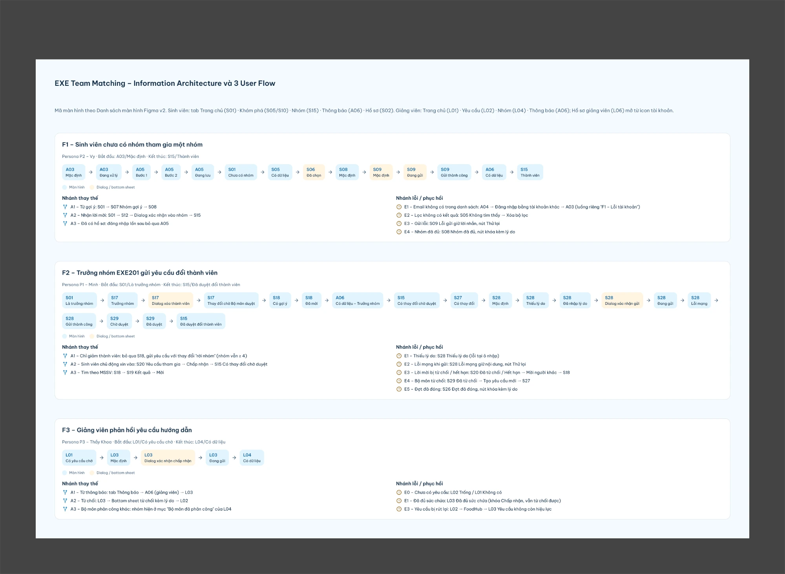
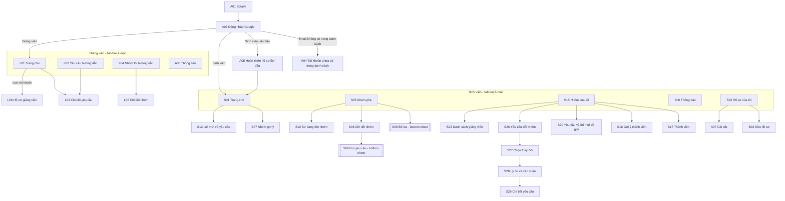
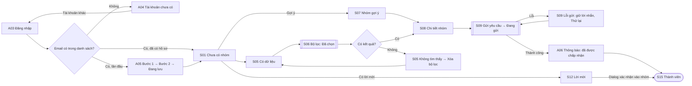
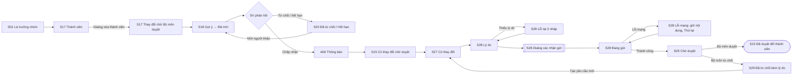
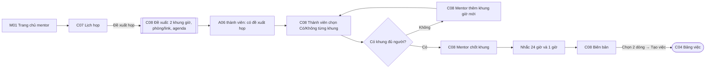
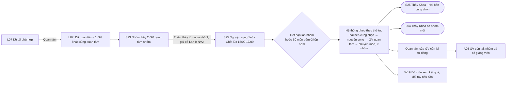
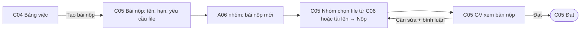
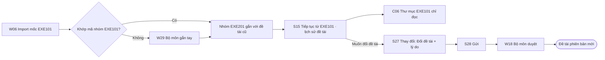
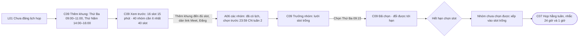
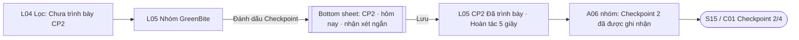

# Information Architecture & User Flow – EXE Team Matching System

> Artifact cho **Slide 03 – Information Architecture** và **Slide 04 – Three User Flows** (PRM323 Lab 2), đồng thời là nguồn cho page Figma `01 User Flow`.
> Persona tham chiếu: [persona.md](persona.md). Quy tắc nghiệp vụ tham chiếu: `PROJECT_CONTEXT.md` mục 3.
> Mã màn hình theo **`EXE_Team_Matching_Danh_sach_man_hinh_v2.xlsx`** (sheet Mobile) – cùng bộ mã với file Figma.
> Phạm vi chấm Lab 2 là **Mobile App (Flutter)** cho Sinh viên và Giảng viên. Web App của Bộ môn EXE được liệt kê ở mục 6 để tham khảo.
> Cập nhật: 19/10/2026 – đổi sang mã màn hình theo file Excel, khớp Figma `01 User Flow`.
> **Cập nhật lần 2 (19/10/2026, sau góp ý của giảng viên):** thêm mục 0 (điều hướng theo giai đoạn học kỳ, web cho mọi vai trò, Mentor), màn hình mới C01–C08, L07, M01, W27–W28 (mục 1.4) và flow F4–F6 (mục 4a). **F1–F3 và Figma giữ nguyên như Lab 2**; chỗ nào F1 thay đổi khi code được ghi chú ngay trong flow.
> **Cập nhật lần 3 (20/10/2026, chốt nghiệp vụ giảng viên và mentor):** hệ thống **tự ghép** giảng viên hướng dẫn (lúc đóng đợt lập nhóm, theo nguyện vọng 1–3 của nhóm + quan tâm của giảng viên) và mentor (tuần 6, theo quan tâm của mentor); **bỏ bước giảng viên chấp nhận/từ chối** nên F3 chỉ còn là flow của Lab 2. Thêm **Checkpoint 1–4** cho EXE101, **lịch họp cố định hằng tuần** cho EXE201 (màn hình mới C09), flow F5 viết lại, thêm F8–F9.

---

## 0. Điều hướng theo vai trò và giai đoạn (bổ sung 19/10/2026)

**Web và mobile dùng chung mã màn hình.** Sinh viên, Giảng viên và Mentor có cả Web App và Mobile App với cùng tính năng và cùng mã màn hình; web dùng sidebar thay cho tab bar và bố cục nhiều cột (`DESIGN.md` §8.2). Bộ môn chỉ dùng web (W01–W28).

**Tab bar đổi theo giai đoạn của môn** (`PROJECT_CONTEXT.md` §1.1, quy tắc 18):

| Vai trò | Giai đoạn lập nhóm | Giai đoạn học kỳ (sau khi đợt lập nhóm đóng) |
|---|---|---|
| Sinh viên | Trang chủ (S01) · **Khám phá (S05)** · Nhóm (S15) · Thông báo (A06) · Hồ sơ (S02) | Trang chủ (S01) · **Dự án (C01)** · Nhóm (S15) · Thông báo (A06) · Hồ sơ (S02) |
| Giảng viên | Trang chủ (L01) · **Đề tài (L07)** · Nhóm (L04) · Tin nhắn (C02) · Thông báo (A06) | Trang chủ (L01) · Nhóm (L04) · Lịch (C07) · Tin nhắn (C02) · Thông báo (A06); trang chủ ưu tiên "Cần trả lời", "Trễ hạn nộp", "Họp hôm nay" (EXE201) hoặc "Chưa trình bày CP" (EXE101) |
| Mentor | – (chưa có nhóm) | Trước tuần 6: Trang chủ (M01) · **Đề tài (L07)** · Thông báo (A06). Từ tuần 6: Trang chủ (M01) · Nhóm (L04) · Tin nhắn (C02) · Thông báo (A06) |

- **Khám phá biến mất khi đợt lập nhóm đóng** và được thay bằng **Dự án**. Mọi đường dẫn cũ tới S05, S08, S10 (thông báo, link chia sẻ) mở hộp nhắc *"Đợt lập nhóm đã đóng lúc 18:00 · 17/09. Bạn đang ở nhóm GreenBite."* với nút "Mở dự án" hoặc, nếu chưa có nhóm, "Xem thông tin ghép tự động" (S31).
- Trong đợt đổi nhóm EXE201, trưởng nhóm tìm người thay thế từ *Nhóm* (S18 gợi ý, S19 tìm MSSV), không cần Khám phá.
- Giảng viên của trường làm mentor cho nhóm khác có một tài khoản hai vai trò; vẫn dùng tab bar giảng viên, nhóm mình mentor hiện trong L04 với nhãn "Mentor" – không phải chuyển vai trò.
- **Mỗi nhóm chỉ có một mentor và một giảng viên hướng dẫn.** Giảng viên lớp trên FAP không hiển thị trong hệ thống.
- **Không có bước "xin – chấp nhận".** Trong đợt lập nhóm, giảng viên bấm *Quan tâm* ở L07, nhóm xếp *nguyện vọng 1–3* ở S23–S25; hết hạn (hoặc Bộ môn bấm "Ghép sớm" ở W19) hệ thống ghép và báo cho cả hai bên kèm lý do ("Hai bên cùng chọn", "Nguyện vọng 2"…). Mentor bấm *Quan tâm* ở L07 trước tuần 6; sinh viên không chọn mentor (`PROJECT_CONTEXT.md` quy tắc 9, 19, 20).
- **Nhịp làm việc khác nhau theo môn:** EXE101 – sinh viên trình bày trên lớp, giảng viên đánh dấu **Checkpoint 1–4** ở L05 (quy tắc 27); EXE201 – sinh viên không lên lớp, giảng viên đăng **khung họp 15 phút hằng tuần** ở C09 và mỗi nhóm chọn một slot cố định (quy tắc 25).

Một điểm vào chung (đăng nhập Google), sau đó rẽ theo vai trò. Mỗi vai trò có thanh điều hướng dưới (tab bar) riêng.

### 1.1 Danh sách màn hình

Danh sách đầy đủ (nội dung, trạng thái cần vẽ) nằm trong file Excel v2. Bảng dưới gom theo nhóm.

| Nhóm | Mã | Màn hình | Cấp | Flow Lab 2 |
|---|---|---|---|---|
| A. Khởi động và dùng chung | A01 | Splash | điểm vào | — |
| | A02 | Giới thiệu (onboarding) | điểm vào | — |
| | A03 | Đăng nhập Google | điểm vào | F1 |
| | A04 | Tài khoản chưa có trong danh sách | 2 | F1 (lỗi) |
| | A05 | Hoàn thiện hồ sơ lần đầu | 2 | F1 |
| | A06 | Thông báo | **1 (tab)** | F1, F2, F3 |
| | A07 | Cài đặt và tài khoản | 2 | — |
| | A08 | Trạng thái chung (mẫu: đang tải, trống, lỗi, mất mạng, không có quyền) | mẫu | — |
| S1. Trang chủ và hồ sơ | S01 | Trang chủ | **1 (tab)** | F1, F2 |
| | S02 | Hồ sơ của tôi | **1 (tab)** | — |
| | S03 | Chỉnh sửa hồ sơ | 2 | — |
| | S04 | Hồ sơ sinh viên khác | 2 | — |
| S2. Khám phá và ghép nhóm | S05 | Khám phá – Nhóm đang tuyển | **1 (tab)** | F1 |
| | S06 | Bộ lọc và sắp xếp | bottom sheet | F1 |
| | S07 | Nhóm gợi ý cho bạn | 2 | F1 (thay thế) |
| | S08 | Chi tiết nhóm (xem từ bên ngoài) | 2 | F1 |
| | S09 | Gửi yêu cầu tham gia | bottom sheet | F1 |
| | S10 | Khám phá – Sinh viên đang tìm nhóm | 1 (tab con của Khám phá) | — |
| | S11 | Đăng / sửa bài "Tôi đang tìm nhóm" | 2 | — |
| | S12 | Lời mời và yêu cầu của tôi | 2 | F1 (thay thế) |
| S3. Nhóm của tôi | S13 | Tạo nhóm | 2 | — |
| | S14 | Chọn domain nghiên cứu | 2 | — |
| | S15 | Nhóm của tôi – Tổng quan | **1 (tab)** | F1, F2 |
| | S16 | Chỉnh sửa thông tin nhóm | 2 | — |
| | S17 | Thành viên nhóm | 2 | F2 |
| | S18 | Gợi ý thành viên | 2 | F2 |
| | S19 | Tìm và mời sinh viên | 2 | F2 (thay thế) |
| | S20 | Yêu cầu tham gia và lời mời đã gửi | 2 | F2 (thay thế, lỗi) |
| | S21 | Đăng / sửa bài tuyển thành viên | 2 | — |
| | S22 | Lịch sử hoạt động nhóm | 2 | — |
| S4. Giảng viên, đổi nhóm, sau hạn | S23 | Danh sách giảng viên | 2 | — |
| | S24 | Chi tiết giảng viên và gửi yêu cầu | 2 | — |
| | S25 | Trạng thái giảng viên của nhóm | 2 | — |
| | S26 | Yêu cầu đổi nhóm – danh sách | 2 | F2 (lỗi) |
| | S27 | Tạo yêu cầu đổi nhóm – chọn thay đổi | 2 | F2 |
| | S28 | Tạo yêu cầu đổi nhóm – lý do và xác nhận | 2 | F2 |
| | S29 | Chi tiết yêu cầu đổi nhóm | 2 | F2 |
| | S30 | Đợt đăng ký đã khóa | 2 | — |
| | S31 | Bạn đã được ghép nhóm tự động | 2 | — |
| L. Giảng viên | L01 | Trang chủ giảng viên | **1 (tab)** | F3 |
| | L02 | Yêu cầu hướng dẫn | **1 (tab)** | F3 (thay thế, lỗi) |
| | L03 | Chi tiết yêu cầu hướng dẫn | 2 | F3 |
| | L04 | Nhóm tôi hướng dẫn | **1 (tab)** | F3 |
| | L05 | Chi tiết nhóm (giảng viên xem) | 2 | F3 (thay thế) |
| | L06 | Hồ sơ giảng viên | 2 (từ icon tài khoản) | — |

**Tổng: 45 mã = 42 màn hình khác nhau + 2 bottom sheet (S06, S09) + 1 frame mẫu trạng thái (A08).** Theo hướng dẫn chấm, dialog, bottom sheet và biến thể trạng thái không tính là màn hình riêng.

### 1.1a Màn hình bổ sung sau góp ý (19/10/2026, chưa có trong Figma)

| Nhóm | Mã | Màn hình | Vai trò | Flow |
|---|---|---|---|---|
| C. Workspace nhóm | C01 | Dự án – tổng quan (việc của tôi, hạn sắp tới, họp sắp tới, file mới, câu hỏi chờ; thẻ "Tóm tắt cho mentor" và "Buổi mentor n/3") | Thành viên, GV, Mentor | F4, F6 |
| | C02 | Tin nhắn – danh sách hội thoại (SV: 2 kênh của nhóm; GV/Mentor: mọi nhóm, lọc "Cần trả lời") | Tất cả | F4 |
| | C03 | Kênh tin nhắn (Nhóm / Cố vấn), luồng trả lời, đánh dấu câu hỏi | Tất cả | F4 |
| | C04 | Bảng việc (Cần làm · Đang làm · Xong) và bài nộp | Thành viên, GV, Mentor | F6 |
| | C05 | Chi tiết việc / bài nộp (người làm, hạn, bình luận, nộp file, duyệt) | Thành viên, GV, Mentor | F6 |
| | C06 | File dự án (thư mục, bản mới nhất, lịch sử phiên bản, bình luận) | Thành viên, GV, Mentor | F6 |
| | C07 | Lịch họp (sắp tới, chờ chốt, đã họp; họp hằng tuần EXE201 có nhãn "Hằng tuần"). GV xem lịch của mọi nhóm | Thành viên, GV, Mentor | F4, F8 |
| | C08 | Đề xuất / chi tiết cuộc họp (khung giờ, trả lời, chốt, biên bản → việc; với họp hằng tuần: hủy / dời một tuần) | Thành viên, GV, Mentor | F4, F8 |
| | C09 | Lịch họp hằng tuần (EXE201). GV: tạo khung giờ, cắt slot 15 phút, link họp, xem nhóm nào ở slot nào, đổi slot cho nhóm. Trưởng nhóm: lưới slot trống, chọn một slot, hạn chọn | GV, Trưởng nhóm (thành viên chỉ xem) | F8 |
| L. Giảng viên | L07 | Đề tài (gợi ý theo chuyên môn, **"Nhóm chọn tôi"** kèm thứ hạng nguyện vọng, đã quan tâm; số người khác cùng quan tâm). Mentor dùng cùng màn hình trước tuần 6 | Giảng viên, Mentor | F5 |
| M. Mentor | M01 | Trang chủ mentor (trước tuần 6: "Đang quan tâm n đề tài · Ghép vào tuần 6"; sau đó: cần trả lời, họp sắp tới, nhóm đang mentor) | Mentor | F4 |
| W. Bộ môn | W27 | Mentor – danh sách và tạo mới | Bộ môn | – |
| | W28 | Ghép mentor (kết quả ghép kèm lý do, "Ghép sớm" → xem trước → chốt, đổi mentor tay; cảnh báo vượt số mong muốn, chặn vượt tối đa) | Bộ môn | – |
| | W29 | Đề tài qua các kỳ (nhóm EXE101 → EXE201, % thành viên giữ lại, lịch sử đề tài) | Bộ môn | F7 |

**Màn hình cũ thay đổi khi code** (Figma chưa cập nhật):

| Mã | Thay đổi | Quy tắc |
|---|---|---|
| A05 | Còn **một màn**: thông tin import (chỉ đọc, thu gọn) + 5 thanh kỹ năng 1–5 + mô tả; bỏ SĐT/Zalo | 16 |
| S02, S03, S04 | Hồ sơ chỉ có 5 kỹ năng và mô tả; không có ô liên lạc. S04 không có SĐT | 11, 16 |
| S05, S08, S10 | Chỉ có trong giai đoạn lập nhóm; ngoài giai đoạn → hộp nhắc | 18 |
| S09 | Thêm "Ý tưởng của bạn": nút "+ Thêm ý tưởng" (tối đa 3) hoặc ô tích "Chưa có ý tưởng" | 17 |
| S20 | Yêu cầu tham gia hiện 5 thanh kỹ năng so với chỗ trống của nhóm và các ý tưởng | 16, 17 |
| S23 | Đổi thành **"Nguyện vọng giảng viên"**: đầu trang là 3 ô nguyện vọng (kéo để đổi thứ tự, có nút lên/xuống thay cho kéo); mục "Quan tâm nhóm bạn" (avatar + nút "Thêm vào nguyện vọng") và "Đã hướng dẫn ở EXE101" ở đầu danh sách; dòng hạn "Chốt lúc 18:00 · 17/09". Không còn nút "Gửi yêu cầu" | 9, 19 |
| S24 | Chi tiết giảng viên: chuyên môn, "Đang quan tâm nhóm bạn" (nếu có); nút "Thêm vào nguyện vọng" / "Bỏ khỏi nguyện vọng". Không hiện số nhóm tối đa | 9 |
| S25 | Trước khi ghép: nguyện vọng 1–3 kèm chip "Quan tâm nhóm bạn". Sau khi ghép: giảng viên hướng dẫn + lý do ghép ("Hai bên cùng chọn", "Nguyện vọng 2", "Giảng viên quan tâm", "Theo chuyên môn", "Bộ môn phân công"), nguyện vọng bị khóa | 9 |
| S15 | Thêm thẻ **Đề tài** (tên, "Tiếp tục từ EXE101 · SP26", lịch sử đề tài), mục Cố vấn (giảng viên hướng dẫn + mentor, hoặc "Chốt giảng viên lúc 18:00 · 17/09" / "Mentor ghép từ tuần 6"), lối tắt sang Dự án. EXE101: thanh **Checkpoint 2/4**; EXE201: "Họp hằng tuần Thứ Ba 09:15" hoặc nút "Chọn lịch họp" → C09 | 9, 20, 21, 25, 26, 27 |
| C01 | EXE101: thẻ Checkpoint (4 chấm, nhận xét gần nhất); EXE201: thẻ "Họp tuần này" | 25, 27 |
| S27, S28 | Thêm loại thay đổi "Đổi đề tài" (nhập đề tài mới và lý do) trong yêu cầu đổi nhóm EXE201 | 26 |
| C06 | Nhóm EXE201 có thư mục "EXE101 (kỳ trước)" chỉ đọc | 26 |
| L01 | Giai đoạn lập nhóm: "n nhóm chọn tôi làm nguyện vọng", "Đang quan tâm 5/12", hạn ghép. Giai đoạn học kỳ: "Cần trả lời", "Trễ hạn nộp" gom từ mọi nhóm, cộng "Họp hôm nay" (EXE201) hoặc "Chưa trình bày CP2: 7 nhóm" (EXE101) | 9, 22, 23, 25, 27 |
| L02, L03 | **Bỏ khi code** (không còn yêu cầu hướng dẫn để chấp nhận/từ chối). Danh sách nhóm chọn giảng viên chuyển thành tab "Nhóm chọn tôi" của L07; chi tiết đề tài mở từ L07 | 9 |
| L04, L05 | Thêm tiến độ việc và bài nộp của từng nhóm; nhãn "Mentor" cho nhóm mình làm mentor; lý do ghép. EXE101: cột / bộ lọc Checkpoint, L05 có nút "Đánh dấu Checkpoint" (bottom sheet). EXE201: slot họp hằng tuần của nhóm | 9, 20, 23, 25, 27 |
| W05 | Thêm cấu hình: số nguyện vọng (3), giới hạn quan tâm, tuần bắt đầu mentor, hạn chọn slot họp, thời lượng slot (15 phút), tuần mục tiêu của Checkpoint 1–4 | 9, 19, 20, 25, 27 |
| W11 | Thêm "Số nhóm tối đa" theo môn (EXE101, EXE201), để trống = không giới hạn | 9 |
| W16, W19 | W16 thêm mục Mentor và lý do ghép. W19 đổi thành **"Ghép giảng viên hướng dẫn"**: trước hạn – tiến độ (nhóm đã có nguyện vọng, giảng viên đang quan tâm), nút "Ghép sớm" → xem trước → chốt; sau khi ghép – bảng nhóm · giảng viên · lý do · nguyện vọng · quan tâm, lọc "Chưa có giảng viên", thanh tải từng giảng viên so với tối đa, đổi giảng viên tay kèm lý do | 9, 19, 20 |

### 1.2 Overlay và trạng thái (không tính là màn hình)

| Loại | Ở đâu | Nội dung |
|---|---|---|
| Bottom sheet | S06 | Bộ lọc domain, chuyên ngành thiếu, số chỗ trống, mã lớp |
| Bottom sheet | S09 | Xin tham gia kèm lời nhắn, nhắc hạn 72 giờ |
| Dialog | S12 | Xác nhận vào nhóm (mỗi SV chỉ thuộc 1 nhóm) |
| Dialog | S17 | Xóa thành viên / rời nhóm / chuyển quyền trưởng nhóm |
| Dialog | S28 | Xác nhận gửi yêu cầu đổi nhóm |
| Dialog | L03 | Xác nhận chấp nhận hướng dẫn *(chỉ trong Figma Lab 2; bỏ khi code)* |
| Bottom sheet | L03 | Từ chối kèm lý do *(chỉ trong Figma Lab 2; bỏ khi code)* |
| Bottom sheet | L05 | Đánh dấu Checkpoint (chọn CP1–4, ngày, nhận xét) – bổ sung 20/10/2026 |
| Bottom sheet | C09 | Đổi slot cho nhóm (GV) / xác nhận chọn slot (trưởng nhóm) – bổ sung 20/10/2026 |
| Dialog | W19, W28 | Xem trước kết quả "Ghép sớm" rồi chốt – bổ sung 20/10/2026 |
| Dialog | A07 | Xác nhận đăng xuất |
| Trạng thái | A08 và từng màn | Đang tải (skeleton), trống, lỗi tải, mất mạng, không có quyền |

### 1.3 Quy tắc điều hướng

- Màn hình cấp 1 (tab) không có nút Back; chuyển qua lại bằng tab bar và giữ nguyên vị trí cuộn.
- Màn hình cấp 2 có nút Back trên app bar, trở về đúng màn hình cha đã mở nó.
- Sau khi gửi thành công (S09, S28, L03), Back **không** quay lại form đã gửi mà về màn hình cha.
- Chạm một thông báo ở A06 mở màn hình cấp 2 tương ứng; Back trở về A06.
- Mọi trạng thái lỗi đều có lối ra: Thử lại hoặc Back. Không có màn hình ngõ cụt.

---

## 2. Flow 1 – Sinh viên chưa có nhóm tham gia một nhóm

| | |
|---|---|
| **Persona** | P2 – Vy (Secondary) |
| **Bắt đầu** | A03 / Mặc định (mở app, chưa đăng nhập) |
| **Mục tiêu** | Trở thành thành viên của một nhóm đang cần chuyên ngành của mình |
| **Kết thúc** | S15 / Thành viên |
| **Điều kiện** | Đợt đăng ký EXE101 đang mở; Vy có trong danh sách học kỳ |

> **Khi code (quy tắc 16, 17):** A05 gộp còn một màn; S09 có thêm phần "Ý tưởng của bạn". Prototype Figma vẫn là bản Lab 2.

**Happy path (Figma 06 Prototype):** A03 Mặc định → A03 Đang xử lý → A05 Bước 1 → A05 Bước 2 → A05 Đang lưu → S01 Chưa có nhóm → S05 Có dữ liệu → S06 Đã chọn → S08 Mặc định → S09 Mặc định → S09 Đang gửi → S09 Gửi thành công → A06 Có dữ liệu → S15 Thành viên.

**Nhánh thay thế**
- **A1 – Từ gợi ý:** S01 → S07 Nhóm gợi ý → S08.
- **A2 – Nhận lời mời:** S01 → S12 → Dialog xác nhận vào nhóm → S15.
- **A3 – Đã có hồ sơ:** đăng nhập lần sau bỏ qua A05.

**Nhánh lỗi / phục hồi**
- **E1 – Email không có trong danh sách:** A04 → Đăng nhập bằng tài khoản khác → A03 (flow riêng "F1 – Lỗi tài khoản").
- **E2 – Lọc không có kết quả:** S05 Không tìm thấy → Xóa bộ lọc.
- **E3 – Gửi lỗi:** S09 Lỗi gửi giữ lời nhắn, nút Thử lại.
- **E4 – Nhóm đã đủ:** S08 Nhóm đã đủ, nút khóa kèm lý do.

---

## 3. Flow 2 – Trưởng nhóm EXE201 gửi yêu cầu đổi thành viên

| | |
|---|---|
| **Persona** | P1 – Minh (Primary) |
| **Bắt đầu** | S01 / Là trưởng nhóm (nhóm 6 người theo mốc EXE101, một thành viên không học tiếp) |
| **Mục tiêu** | Thay thành viên đã rời bằng thành viên mới và được Bộ môn duyệt |
| **Kết thúc** | S15 / Đã duyệt đổi thành viên |
| **Điều kiện** | Đợt đổi nhóm EXE201 đang mở; Minh là trưởng nhóm |

**Happy path (Figma 06 Prototype):** S01 Là trưởng nhóm → S17 Trưởng nhóm → S17 Dialog xóa thành viên → S17 Thay đổi chờ Bộ môn duyệt → S18 Có gợi ý → S18 Đã mời → A06 Có dữ liệu (trưởng nhóm) → S15 Có thay đổi chờ duyệt → S27 Có thay đổi → S28 Mặc định → S28 Thiếu lý do → S28 Đã nhập lý do → S28 Dialog xác nhận gửi → S28 Đang gửi → S28 Lỗi mạng → S28 Gửi thành công → S29 Chờ duyệt → S29 Đã duyệt → S15 Đã duyệt đổi thành viên.

Prototype cố ý đi qua hai nhánh lỗi (thiếu lý do, lỗi mạng) ngay trong happy path để trình diễn phục hồi.

**Nhánh thay thế**
- **A1 – Chỉ giảm thành viên:** bỏ qua S18, gửi yêu cầu chỉ với thay đổi "rời nhóm" (nhóm vẫn ≥ 4 người).
- **A2 – Sinh viên chủ động xin vào:** S20 Yêu cầu tham gia → Chấp nhận → S15 Có thay đổi chờ duyệt.
- **A3 – Tìm theo MSSV:** S18 → S19 Kết quả → Mời.

**Nhánh lỗi / phục hồi**
- **E1 – Thiếu lý do:** S28 Thiếu lý do (lỗi tại ô nhập, không mở dialog).
- **E2 – Lỗi mạng khi gửi:** S28 Lỗi mạng giữ nội dung, nút Thử lại.
- **E3 – Lời mời bị từ chối / hết hạn:** S20 Đã từ chối / Hết hạn → Mời người khác → S18.
- **E4 – Bộ môn từ chối:** S29 Đã từ chối → Tạo yêu cầu mới → S27; nhóm giữ nguyên như mốc.
- **E5 – Đợt đã đóng:** S26 Đợt đã đóng, nút khóa kèm lý do.

**Ghi chú nghiệp vụ:** với nhóm kế thừa, thành viên chỉ thay đổi thật khi Bộ môn duyệt (quy tắc 7). Trước đó S15 và S17 hiển thị tách bạch "thành viên hiện tại" và "thay đổi đang chờ duyệt".

---

## 4. Flow 3 – Giảng viên phản hồi yêu cầu hướng dẫn

| | |
|---|---|
| **Persona** | P3 – Thầy Khoa (Supporting) |
| **Bắt đầu** | L01 / Có yêu cầu chờ |
| **Mục tiêu** | Trả lời yêu cầu và biết nhóm nào chính thức thuộc về mình |
| **Kết thúc** | L04 / Có dữ liệu (nhóm vừa nhận nằm ở mục "Tôi đã nhận") |
| **Điều kiện** | Trưởng nhóm đã gửi yêu cầu từ S24 |

> **Khi code (quy tắc 9, chốt 20/10/2026):** flow này **không còn** trong sản phẩm. Giảng viên không nhận yêu cầu để chấp nhận/từ chối; thay vào đó bấm *Quan tâm* và hệ thống tự ghép lúc đóng đợt lập nhóm (xem F5). F3 giữ nguyên ở đây vì là flow đã nộp của Lab 2 và có prototype trong Figma.

**Happy path (Figma 06 Prototype):** L01 Có yêu cầu chờ → L03 Mặc định → L03 Dialog xác nhận chấp nhận → L03 Đang gửi → L04 Có dữ liệu.

**Nhánh thay thế**
- **A1 – Từ thông báo:** tab Thông báo → A06 (giảng viên) → L03.
- **A2 – Từ chối:** L03 → Bottom sheet từ chối kèm lý do → L02.
- **A3 – Bộ môn phân công khác:** nhóm hiện ở mục "Bộ môn đã phân công" của L04.

**Nhánh lỗi / phục hồi**
- **E0 – Chưa có yêu cầu:** L02 Trống / L01 Không có.
- **E1 – Đã đủ sức chứa:** L03 Đã đủ sức chứa (khóa Chấp nhận, vẫn từ chối được).
- **E3 – Yêu cầu bị rút lại:** L02 → FoodHub → L03 Yêu cầu không còn hiệu lực.

---

## 4a. Flow bổ sung sau góp ý (19/10/2026, chưa có trong Figma)

### F4 – Mentor hẹn họp với nhóm và chuyển biên bản thành việc

| | |
|---|---|
| **Persona** | P5 – Anh Tuấn (mentor), P1 – Minh |
| **Bắt đầu** | M01 Trang chủ mentor |
| **Kết thúc** | C04 Bảng việc có 2 việc mới từ biên bản |

- **Bối cảnh:** mentor được gán từ tuần 6 và họp 2–3 buổi; C01 hiện "Buổi mentor n/3" và thẻ tóm tắt nhóm để mentor vào cuộc nhanh.
- **Thay thế:** trưởng nhóm hoặc giảng viên tổ chức thay mentor; đặt một khung cố định (bỏ bước chọn).
- **Lỗi / phục hồi:** không khung nào đủ người → thêm khung mới, câu trả lời cũ giữ nguyên; người tổ chức hủy họp → mọi người được báo, họp chuyển sang "Đã hủy" kèm lý do; mất mạng khi lưu biên bản → giữ nội dung, Thử lại.

### F5 – Quan tâm và nguyện vọng → hệ thống ghép giảng viên hướng dẫn (viết lại 20/10/2026)

| | |
|---|---|
| **Persona** | P3 – Thầy Khoa, một giảng viên khác; P1 – Minh; P4 – Cô Hạnh |
| **Bắt đầu** | L07 Đề tài (giai đoạn lập nhóm) |
| **Kết thúc** | S25 nhóm thấy "Thầy Khoa · Hai bên cùng chọn"; L04 của thầy Khoa có nhóm; W19 kết quả ghép |

- **Quy tắc then chốt (quy tắc 9, 19):** "Quan tâm" không giữ chỗ nên không có cuộc đua bấm trước; giảng viên chỉ thấy **số** người cùng quan tâm, nhóm thấy **tên** và tự xếp nguyện vọng. Không có bước chấp nhận/từ chối: giảng viên đã "đồng ý" bằng nút Quan tâm, nhóm "chọn" bằng nguyện vọng; giảng viên được cả hai phía chọn được ghép trước.
- **Vì sao tốt hơn cách cũ:** trước đây Bộ môn chỉ dựa vào nguyện vọng, nguyện vọng không đáp ứng được thì ghép tay giảng viên còn trống. Giờ có thêm tín hiệu từ phía giảng viên, và bước "ghép tay" thành bước 4 tự động (cùng chuyên môn, ít nhóm nhất) – Bộ môn chỉ còn soát và sửa ngoại lệ.
- **Thay thế:** nhóm không chọn ai trong số người quan tâm mà xếp giảng viên khác (S23 vẫn đủ danh sách); giảng viên rút quan tâm trước hạn (Hoàn tác 5 giây); nhóm không đặt nguyện vọng nào → vẫn được ghép theo quan tâm hoặc chuyên môn; Bộ môn bấm "Ghép sớm" → chỉ các nhóm đã có lúc đó được ghép, nhóm tạo sau được ghép lúc hết hạn.
- **Lỗi / phục hồi:** đạt giới hạn quan tâm → nút "Quan tâm" khóa kèm lý do và gợi ý rút bớt; giảng viên trong nguyện vọng đã đủ số nhóm tối đa → nhóm chuyển sang nguyện vọng tiếp theo, S25 ghi rõ "Nguyện vọng 1 đã đủ nhóm"; không giảng viên nào còn chỗ → nhóm vào danh sách "Chưa có giảng viên" ở W19 để Bộ môn gán tay; nhóm đã được ghép khi giảng viên đang xem → thẻ chuyển "Đã có giảng viên", nút ẩn.

### F6 – Giảng viên giao bài nộp và duyệt

| | |
|---|---|
| **Persona** | P3 – Thầy Khoa, P1 – Minh |
| **Bắt đầu** | L04 Nhóm tôi hướng dẫn → C04 của một nhóm |
| **Kết thúc** | C05 Bài nộp "Đạt" |

- **Lỗi / phục hồi:** file quá 25 MB hoặc sai định dạng → báo ngay tại ô chọn file, không tải lên; quá hạn → thẻ chuyển "Trễ hạn", vẫn nộp được, giảng viên thấy trong "Trễ hạn nộp" ở L01.

### F7 – Đề tài từ EXE101 tiếp tục sang EXE201

| | |
|---|---|
| **Persona** | P4 – Cô Hạnh (Bộ môn), P1 – Minh |
| **Bắt đầu** | W06 Import mốc EXE101 |
| **Kết thúc** | S15 nhóm EXE201 hiện "Tiếp tục từ EXE101", W29 có dòng kế thừa |

- **Vì sao quản lý theo đề tài:** thành viên thay đổi giữa EXE101 và EXE201 (kỳ FA26 có 84 yêu cầu đổi nhóm), nhưng đề tài, file và nhận xét của giảng viên thì tiếp tục. Gắn mọi thứ vào **đề tài** giữ được mạch dự án; **nhóm** vẫn là đơn vị theo từng môn để áp quy tắc 4–6 người, 2 chuyên ngành.
- **Thay thế:** nhóm EXE201 không kế thừa tạo đề tài mới như EXE101.
- **Lỗi / phục hồi:** dòng import không khớp mã nhóm → nằm trong danh sách "Chưa gắn đề tài" ở W29, Bộ môn chọn đề tài cũ hoặc tạo mới; yêu cầu đổi đề tài bị từ chối → đề tài giữ nguyên, lý do hiện ở S29.

### F8 – EXE201: giảng viên đăng lịch họp hằng tuần, nhóm chọn slot (bổ sung 20/10/2026)

| | |
|---|---|
| **Persona** | P3 – Thầy Khoa (hướng dẫn ~40 nhóm EXE201), P1 – Minh |
| **Bắt đầu** | L01 thẻ "Chưa đăng lịch họp hằng tuần" (ngay sau khi được ghép) |
| **Kết thúc** | C07 của nhóm có "Họp hằng tuần · Thứ Ba 09:15–09:30" lặp tới tuần cuối |

- **Then chốt (quy tắc 25):** mỗi nhóm một slot cố định cả kỳ, ai chọn trước được trước, một slot một nhóm. Giảng viên không phải tạo 40 cuộc họp: hệ thống sinh họp hằng tuần từ slot đã chọn.
- **Ít chữ, ít thao tác:** C09 hiện lưới theo ngày, mỗi ô là một slot (trống / đã có nhóm / của nhóm bạn); giảng viên thấy ngay "Còn 3 nhóm chưa chọn" và bộ đếm slot so với số nhóm.
- **Thay thế:** giảng viên đổi slot cho một nhóm (bottom sheet, nhóm được báo); hủy hoặc dời một tuần (nghỉ lễ, thi) kèm lý do; trưởng nhóm đổi slot trước hạn.
- **Lỗi / phục hồi:** hai nhóm chọn cùng một slot cùng lúc → nhóm thứ hai thấy "Slot vừa có nhóm khác chọn" và lưới tự cập nhật; tổng slot ít hơn số nhóm → nút Đăng vẫn bấm được nhưng có cảnh báo, và lúc hết hạn giảng viên được nhắc thêm khung cho các nhóm còn thiếu.

### F9 – EXE101: giảng viên đánh dấu Checkpoint trên lớp (bổ sung 20/10/2026)

| | |
|---|---|
| **Persona** | P3 – Thầy Khoa, P1 – Minh |
| **Bắt đầu** | L04 lọc "Chưa trình bày CP2" (ngay trong giờ dạy) |
| **Kết thúc** | S15 / C01 của nhóm hiện "Checkpoint 2/4" và nhận xét |

- **Then chốt (quy tắc 27):** sinh viên trình bày lúc nào trong giờ dạy cũng được, không đặt lịch; hệ thống **không lưu điểm** (điểm ở FAP), chỉ ghi đã trình bày, ngày và nhận xét để nhóm và giảng viên biết còn gì.
- **Nhanh giữa lớp:** từ L04 tới khi lưu là 3 chạm; nhận xét không bắt buộc.
- **Thay thế:** đánh dấu nhầm → Hoàn tác ngay hoặc bỏ đánh dấu trong ngày; chấm nhiều nhóm liên tiếp → sau khi lưu, nút "Nhóm tiếp theo chưa có CP2".
- **Lỗi / phục hồi:** mất mạng khi lưu → giữ nội dung bottom sheet, Thử lại; CP2 đã được đánh dấu từ thiết bị khác (ví dụ trên web) → bottom sheet hiện giờ đã đánh dấu thay vì tạo bản ghi trùng.

## 5. Ánh xạ flow – màn hình

| Màn hình | F1 Tham gia nhóm | F2 Đổi thành viên | F3 Giảng viên |
|---|:-:|:-:|:-:|
| A03 Đăng nhập | ● bắt đầu | | |
| A04 Tài khoản chưa có | ○ lỗi | | |
| A05 Hoàn thiện hồ sơ | ● | | |
| A06 Thông báo | ● | ● | ○ |
| S01 Trang chủ | ● | ● bắt đầu | |
| S05 Khám phá | ● | | |
| S06 Bộ lọc (bottom sheet) | ● | | |
| S07 Nhóm gợi ý | ○ | | |
| S08 Chi tiết nhóm | ● | | |
| S09 Gửi yêu cầu (bottom sheet) | ● | | |
| S12 Lời mời | ○ | | |
| S15 Nhóm của tôi | ● kết thúc | ● kết thúc | |
| S17 Thành viên | | ● | |
| S18 Gợi ý thành viên | | ● | |
| S19 Tìm và mời | | ○ | |
| S20 Yêu cầu và lời mời đã gửi | | ○ | |
| S26 Yêu cầu đổi nhóm | | ○ lỗi | |
| S27 Chọn thay đổi | | ● | |
| S28 Lý do và xác nhận | | ● | |
| S29 Chi tiết yêu cầu | | ● | |
| L01 Trang chủ giảng viên | | | ● bắt đầu |
| L02 Yêu cầu hướng dẫn | | | ○ |
| L03 Chi tiết yêu cầu | | | ● |
| L04 Nhóm tôi hướng dẫn | | | ● kết thúc |

● thuộc happy path  ○ chỉ thuộc nhánh thay thế / lỗi

| Yêu cầu của Lab | Đáp ứng ở đâu |
|---|---|
| ≥ 8 màn hình khác nhau | 42 màn hình (mục 1.1); happy path của 3 flow đi qua 15 màn hình khác nhau |
| 3 flow có start → goal → end | Mục 2, 3, 4 |
| Mỗi flow có nhánh thay thế | F1: A1–A3; F2: A1–A3; F3: A1–A3 |
| ≥ 1 nhánh lỗi / phục hồi | F1: E1–E4; F2: E1–E5; F3: E0, E1, E3 |
| Dialog dạng overlay | S28, L03 (dialog); S06, S09, L03 (bottom sheet) |
| Chuyển cảnh loading → result | S09 Đang gửi → Gửi thành công; S28 Đang gửi → S29; L03 Đang gửi → L04 |
| Back đúng, không ngõ cụt | Mục 1.3 |

---

## 6. Web App của Bộ môn EXE (ngoài phạm vi chấm Lab 2)

> **Bổ sung 19/10/2026:** Web App giờ có thêm khung Sinh viên, Giảng viên, Mentor (mục 0). Bộ môn có thêm W27 Mentor và W28 Gán mentor; W16 và W19 thay đổi như mục 1.1a.
> **Bổ sung 20/10/2026:** W19 thành "Ghép giảng viên hướng dẫn", W28 thành "Ghép mentor" (cả hai có "Ghép sớm" và sửa tay); W05 và W11 thêm cấu hình (mục 1.1a). C09 trên web dùng bố cục lưới tuần rộng – phù hợp giảng viên xếp lịch cho ~40 nhóm.

Dành cho P4 – Cô Hạnh. 26 mã W01–W26 theo sheet Web của file Excel v2; điều hướng bằng sidebar.

| Nhóm | Mã |
|---|---|
| W1. Đăng nhập, tổng quan, kỳ và đợt đăng ký | W01 Đăng nhập · W02 Tổng quan · W03 Học kỳ và môn học · W04 Đợt đăng ký · W05 Cấu hình quy tắc |
| W2. Import và danh mục | W06–W08 Import sinh viên (tải file, xem trước và lỗi, lịch sử) · W09–W10 Sinh viên · W11 Giảng viên · W12 Mã lớp · W13 Domain · W14 Ngành và chuyên ngành |
| W3. Nhóm, phê duyệt, giảng viên, ghép tự động | W15–W16 Nhóm · W17–W18 Yêu cầu đổi nhóm · W19 Điều tiết giảng viên · W20 SV chưa có nhóm · W21 Ghép tự động · W22 Chốt danh sách · W23 Thông báo chung · W24 Nhật ký hệ thống |
| W0. Dùng chung | W25 Khung trang · W26 Trạng thái chung |

---

## 7. Giả định cần xác nhận

- **Hai vai trò dùng chung một ứng dụng**, tab bar đổi theo vai trò sau khi đăng nhập.
- **Tab Thông báo của giảng viên giữ nguyên**, hồ sơ mở từ icon tài khoản (quyết định B10 trong [design-decisions.md](design-decisions.md)); dựa trên giả định A4 trong persona.md. Từ 19/10/2026 tab bar giảng viên có thêm Tin nhắn (5 mục, mục 0).
- **"Học kỳ đã bắt đầu"** = đợt lập nhóm của môn đã đóng; Bộ môn đặt hạn chót khi mở đợt (quy tắc 18, đã chốt 19/10/2026).
- **Sức chứa giảng viên "8 nhóm"** là số minh họa của Lab 2. Thực tế một giảng viên hướng dẫn có thể có ~40 nhóm EXE201; từ 20/10/2026 số nhóm tối đa do Bộ môn đặt theo môn và có thể để trống (quy tắc 9).
- **Thứ tự ưu tiên khi ghép giảng viên** (hai bên cùng chọn → nguyện vọng → giảng viên quan tâm → chuyên môn, ít nhóm nhất) và **hạn chọn slot họp cuối tuần 2** là đề xuất của nhóm, cần xác nhận với giảng viên.
- **Kiểm tra cơ cấu nhóm khi gửi yêu cầu đổi nhóm:** chặn khi nhóm còn dưới 4 người, chỉ *cảnh báo* khi thiếu chuyên ngành thứ hai (S27), vì quy tắc ≥ 2 chuyên ngành là chặn cứng lúc chốt nhóm.
- **Trong prototype**, phản hồi của bên thứ hai (trưởng nhóm chấp nhận, Bộ môn duyệt) được mô phỏng bằng cách chạm vào thông báo ở A06.
